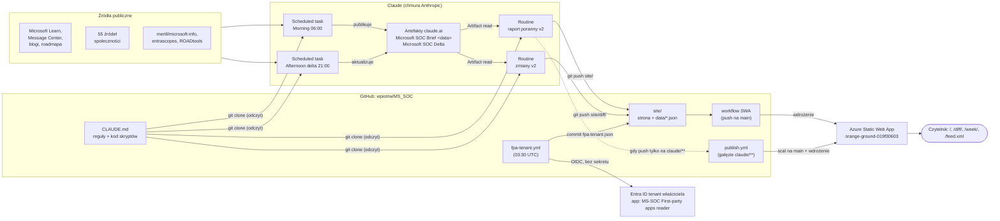
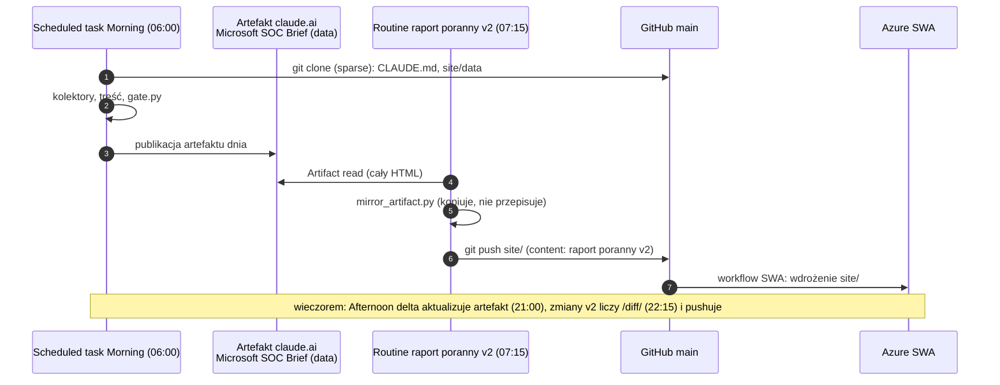
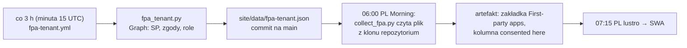
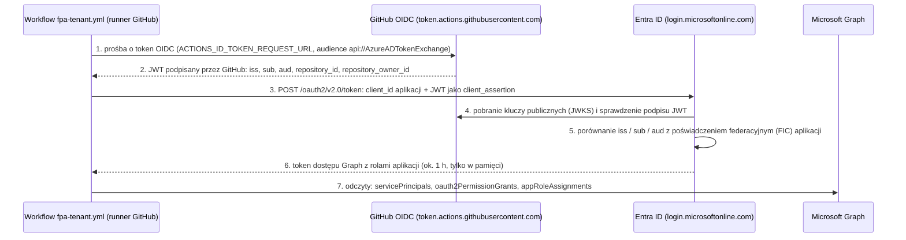

# MS_SOC — Microsoft SOC Brief

| Pole | Wartość |
|---|---|
| Autor | Piotr Wiśniewski |
| Repozytorium | [github.com/wpiotrw/MS_SOC](https://github.com/wpiotrw/MS_SOC) |
| Strona | [orange-ground-019f30603.7.azurestaticapps.net](https://orange-ground-019f30603.7.azurestaticapps.net/) |
| Źródło prawdy dla kodu i reguł | `CLAUDE.md` (ten plik tylko opisuje całość i to, czego nie ma w `CLAUDE.md`) |

Codzienny portal zmian Microsoftu dla SOC: brief poranny (strona główna), strona zmian `/diff/`, przegląd tygodnia `/week/`, kanał RSS `/feed.xml`. Treść budują zadania Claude (scheduled task i routines) według `CLAUDE.md`; GitHub Actions publikuje katalog `site/` w Azure Static Web Apps.

**Po co ten plik:** żeby po zmianie tenanta, konta Azure albo repozytorium dało się wszystko odtworzyć bez zgadywania. Wszystko, co leży poza repozytorium (aplikacja Entra, zasób Static Web App, sekrety, harmonogramy), jest opisane niżej razem z identyfikatorami.

## Spis treści

- [Skróty](#skróty)
- [0. Architektura w pigułce](#0-architektura-w-pigułce)
- [1. Jak to działa (przepływ dnia)](#1-jak-to-działa-przepływ-dnia)
- [2. Repozytorium](#2-repozytorium)
- [3. Azure Static Web App (hosting)](#3-azure-static-web-app-hosting)
- [4. Zadania Claude (scheduled tasks i routines)](#4-zadania-claude-scheduled-tasks-i-routines)
- [4a. CLAUDE.md i skrypty](#4a-claudemd-i-skrypty)
- [4b. Integracje GitHub](#4b-integracje-github)
- [5. Zakładka First-party apps (od 26 IX 2026, CLAUDE.md §5bl)](#5-zakładka-first-party-apps-od-26-ix-2026-claudemd-5bl)
  - [5.1 Źródła publiczne (czyta collect_fpa.py w przebiegu porannym)](#51-źródła-publiczne-czyta-collect_fpapy-w-przebiegu-porannym)
  - [5.2 Migawka tenanta (GitHub Actions, bez sekretu)](#52-migawka-tenanta-github-actions-bez-sekretu)
    - [Co dokładnie robi migawka i kiedy](#co-dokładnie-robi-migawka-i-kiedy)
    - [Jak działa logowanie bez sekretu (Workload Identity Federation)](#jak-działa-logowanie-bez-sekretu-workload-identity-federation)
    - [Bezpieczeństwo: co jest publiczne, co tajne i kto może się podłączyć](#bezpieczeństwo-co-jest-publiczne-co-tajne-i-kto-może-się-podłączyć)
    - [Subject tokenu GitHub: skąd repo:wpiotrw@37083541/MS_SOC@1348453327:ref:refs/heads/main](#subject-tokenu-github-skąd-repowpiotrw37083541ms_soc1348453327refrefsheadsmain)
    - [Dodanie poświadczenia federacyjnego: skryptem albo w portalu](#dodanie-poświadczenia-federacyjnego-skryptem-albo-w-portalu)
    - [Dlaczego GitHub Actions i co nam to daje](#dlaczego-github-actions-i-co-nam-to-daje)
  - [5.3 Do zrobienia raz (właściciel)](#53-do-zrobienia-raz-właściciel)
    - [Jak powstają kody logowania (device code) i ile żyją](#jak-powstają-kody-logowania-device-code-i-ile-żyją)
  - [5.4 Message Center — skąd bierzemy wpisy (od 26 IX 2026)](#54-message-center--skąd-bierzemy-wpisy-od-26-ix-2026)
  - [5.5 Własna kopia stron Learn — mirror/ (od 29 IX 2026)](#55-własna-kopia-stron-learn--mirror-od-29-ix-2026)
  - [5.6 Układ zakładek i liczby na stronie (od 29 IX 2026)](#56-układ-zakładek-i-liczby-na-stronie-od-29-ix-2026)
- [6. Pliki danych na stronie](#6-pliki-danych-na-stronie)
- [7. Gdy coś przestanie działać](#7-gdy-coś-przestanie-działać)
- [8. Dokumentacja i źródła](#8-dokumentacja-i-źródła)
- [9. Stan prac i plan](#9-stan-prac-i-plan)
- [10. Dane wrażliwe — co nie trafia do tego pliku ani do repozytorium](#10-dane-wrażliwe--co-nie-trafia-do-tego-pliku-ani-do-repozytorium)
- [11. Postawienie od zera (nowe repozytorium, inny tenant)](#11-postawienie-od-zera-nowe-repozytorium-inny-tenant)
- [12. Tożsamości, uprawnienia i poświadczenia — pełny wykaz i powód każdego](#12-tożsamości-uprawnienia-i-poświadczenia--pełny-wykaz-i-powód-każdego)
- [13. O narzędziu i świeżość danych (zakładka About, ramka „Data freshness”, format dat)](#13-o-narzędziu-i-świeżość-danych-zakładka-about-ramka-data-freshness-format-dat)
- [14. Zakładka Baselines — Maester i Tenable (od 15 X 2026, §5dv)](#14-zakładka-baselines--maester-i-tenable-od-15-x-2026-5dv)
- [15. Kanały RSS i podpis autora (od 16 X 2026, §5dz)](#15-kanały-rss-i-podpis-autora-od-16-x-2026-5dz)
- [16. Źródła Threat Research i wywiadu o zagrożeniach — ti_sources.json (od 23 X 2026, §5fa)](#16-źródła-threat-research-i-wywiadu-o-zagrożeniach--ti_sourcesjson-od-23-x-2026-5fa)
- [Historia zmian](#historia-zmian)

## Skróty

| Skrót | Rozwinięcie |
|---|---|
| SOC | Security Operations Center — centrum operacji bezpieczeństwa |
| SWA | Azure Static Web Apps — hosting strony |
| OIDC | OpenID Connect — tu: token GitHub Actions wymieniany na token Entra |
| WIF | Workload Identity Federation — logowanie aplikacji Entra tokenem OIDC, bez sekretu |
| FPA | First-party apps — aplikacje Microsoftu w Entra ID |
| MC | Message Center — komunikaty Microsoft 365 |
| MCP | Model Context Protocol — konektor, przez który zadanie Claude korzysta z zewnętrznej usługi (np. GitHub, Microsoft Learn) |
| UTC | Coordinated Universal Time — czas uniwersalny; Warszawa = UTC+2 latem (CEST), UTC+1 zimą (CET) |
| CEST / CET | Central European Summer Time / Central European Time — czas letni / zimowy w Polsce |
| SP | service principal — obiekt aplikacji w konkretnym tenancie |
| RSS | Really Simple Syndication — kanał wiadomości (`/feed.xml`) |
| CI/CD | Continuous Integration / Continuous Delivery — automatyczne budowanie i wdrażanie |
| CA | Conditional Access — dostęp warunkowy Entra |
| FOCI | Family of Client IDs — rodzina aplikacji Microsoftu współdzielących token odświeżania |
| JWT | JSON Web Token — podpisany token z polami (claims), np. `iss`, `sub`, `aud` |
| JWKS | JSON Web Key Set — publiczne klucze wystawcy, którymi sprawdza się podpis JWT |
| FIC | Federated Identity Credential — poświadczenie federacyjne aplikacji Entra |
| AADSTS | Azure Active Directory Security Token Service — prefiks kodów błędów logowania Entra (np. AADSTS700213) |
| CC BY 4.0 | Creative Commons Attribution 4.0 — licencja treści Microsoft Learn (wymaga podania autora) |
| DCA | Defender for Cloud Apps |
| ETag | Entity Tag — znacznik wersji strony z nagłówka HTTP; kopia Learn pobiera stronę ponownie tylko, gdy się zmienił |
| JSON-LD | JavaScript Object Notation for Linked Data — dane strukturalne w `<head>` strony (autor, nagłówek) |
| XDR | Extended Detection and Response — Defender XDR |
| MDE / MDI / MDO / MDCA | Microsoft Defender for Endpoint / for Identity / for Office 365 / for Cloud Apps |
| MSRC | Microsoft Security Response Center |
| DLP | Data Loss Prevention — zapobieganie utracie danych |
| EWS | Exchange Web Services |
| AD FS | Active Directory Federation Services |
| NTLM | NT LAN Manager — starszy protokół uwierzytelniania Windows |

## 0. Architektura w pigułce

Całość to **cztery zadania Claude**, **jedno repozytorium GitHub**, **osiem workflow GitHub Actions** (sześć automatycznych, dwa ręczne do kontroli — pkt 4b), **jedna aplikacja Entra** i **jedna Azure Static Web App**. Odtworzenie wszystkiego od zera, także w innym tenancie: pkt 11. Zadania Claude zbierają i piszą treść, repozytorium przechowuje reguły, kod i dane, GitHub Actions publikuje, a SWA serwuje stronę.



| Element | Rola | Gdzie żyje | Kto go zmienia |
|---|---|---|---|
| `CLAUDE.md` | reguły, kontrakt strony, **kod wszystkich skryptów** (kolektory, bramka, lustro, diff) | repozytorium | właściciel lub sesja Claude na jego prośbę |
| Scheduled tasks (2) | **budują treść**: czytają źródła i publikują artefakt briefu na claude.ai | chmura Claude, konto właściciela | prompt w ustawieniach zadania; zachowanie przez `CLAUDE.md` |
| Routines (2) | **publikują stronę**: kopiują artefakt do `site/` (lustro) i liczą `/diff/` | chmura Claude (Claude Code), z GitHubem | jw. |
| GitHub Actions (3) | wdrożenie na SWA, most z gałęzi `claude/**`, migawka tenanta | repozytorium, `.github/workflows/` | tylko właściciel (Claude nie edytuje workflow — reguła w `CLAUDE.md`) |
| Aplikacja Entra | tożsamość migawki tenanta, bez sekretu (pkt 5.2) | tenant właściciela | właściciel (skrypt `tools/New-FpaReaderApp.ps1` albo portal) |
| Azure Static Web App | hosting gotowego HTML | subskrypcja Azure właściciela | wdrożenia z GitHub Actions |

> [!IMPORTANT]
> **Artefakt jest źródłem, strona jest jego kopią** (`CLAUDE.md` §0a). Brief buduje scheduled task; routine go nie przepisuje ani nie „poprawia”, tylko kopiuje. Dzięki temu artefakt na claude.ai i strona na SWA pokazują to samo.

## 1. Jak to działa (przepływ dnia)

Czasy w strefie Europe/Warsaw (w nawiasie UTC przy czasie letnim).

| Kiedy | Co | Gdzie działa | Wynik |
|---|---|---|---|
| co 3 h (`15 */3 * * *` UTC) | `.github/workflows/fpa-tenant.yml` — migawka tenanta (aplikacje Microsoftu, Message Center z Graph, uprawnienia Graph i role Entra widziane w tenancie) | GitHub Actions | `site/data/fpa-tenant.json`, `site/data/mc-tenant.json`, `site/data/graph-sp.json`, `site/data/graph-sp-history.json` (commit na `main` tylko przy zmianie; wdrożenie strony, gdy przybyła zmiana uprawnień lub ról) |
| ~~06:00~~ | ~~scheduled task „raport poranny”~~ — **wyłączony 26 X 2026** (§5fk: sesja blokowała skrypty repo jako „Code from External”); jego praca to część A routine porannej | — | — |
| 07:15 (05:15) | routine „raport poranny v2” (od 26 X 2026 łączona, model `claude-opus-5-5`) — część A `routines/poranny-A-build.md`: kolektory, research, artefakt briefu; część B `routines/poranny-B-publish.md`: lustro (`mirror_artifact.py --brief`) | Claude (chmura) | `site/index.html`, `site/data/<data>.json`, `site/feed.xml`, `site/data/history.json`, `site/week/index.html` |
| ~~21:00~~ | ~~scheduled task popołudniowy~~ — **wyłączony 26 X 2026** (§5fk); jego praca to część A routine wieczornej | — | — |
| 22:15 (20:15) | routine „zmiany v2” (od 26 X 2026 łączona) — część A `routines/wieczorny-A-delta.md`: `#pmdelta` i artefakt Delta; część B `routines/wieczorny-B-diff.md`: `/diff/` (`make_diff.py`) | Claude (chmura) | `site/diff/index.html`, plik stanu końcowego dnia |
| każdy push na `main` w `site/**` | `.github/workflows/azure-static-web-apps-orange-ground-019f30603.yml` | GitHub Actions | wdrożenie na SWA |
| push na gałąź `claude/**` w `site/**` | `.github/workflows/publish.yml` — przenosi `site/` z gałęzi rutyny na `main` | GitHub Actions | commit na `main` → wdrożenie |

Ten sam dzień na osi czasu (czas warszawski, lato; szerokość paska = typowy czas trwania z przebiegów 25 IX 2026):

```mermaid
gantt
    dateFormat HH:mm
    axisFormat %H:%M
    title Dzień MS_SOC (Europe/Warsaw, czas letni)
    section GitHub Actions
    fpa-tenant.yml (migawka tenanta)          :a1, 05:30, 5m
    section Scheduled tasks
    Morning - brief i artefakt                  :a2, 06:00, 46m
    Afternoon delta - pmdelta i artefakt Delta  :a4, 21:00, 37m
    section Routines
    raport poranny v2 - lustro do site          :a3, 07:15, 33m
    zmiany v2 - strona diff                     :a5, 22:15, 8m
    section Wdrożenie SWA
    po pushu routine porannej                   :a6, after a3, 3m
    po pushu routine wieczornej                 :a7, after a5, 3m
```



> [!NOTE]
> **Zmiana czasu — od 24 X 2026 bez ręcznego przestawiania.** Wszystkie cztery zadania mają harmonogram w strefie `Europe/Warsaw` (`CRON_TZ=Europe/Warsaw …`), więc czas letni i zimowy obsługuje sam harmonogram. Do 24 X 2026 obie routines były zapisane w **UTC** (`0 5 * * *`, `0 20 * * *`; utworzone przez API, a interfejs nie dawał wyboru strefy — sprawdzone 26 IX 2026), dlatego wtedy trzeba je było przestawiać dwa razy w roku. Edycja w interfejsie 24 X 2026 zapisała je ze strefą `Europe/Warsaw` — sprawdzone 25 X 2026: po zmianie czasu wszystkie cztery ruszyły o właściwej godzinie lokalnej. Godziny wpisuje się teraz jako **czas polski**.
>
> | Zadanie | Docelowo (czas polski) | Ustawione (sprawdzone 25 X 2026) |
> |---|---|---|
> | Microsoft SOC Brief — Morning (scheduled task) | 06:00 | 06:00 |
> | [raport poranny v2](https://claude.ai/code/routines/trig_01WgAAz5UkKaKwE49VY6Y6XG) (routine) | **07:15** (Morning kończy się ok. 06:40) | 07:15 ✔ (`CRON_TZ=Europe/Warsaw 15 7 * * *`) |
> | Afternoon delta (scheduled task) | 21:00 | 21:00 |
> | [zmiany v2](https://claude.ai/code/routines/trig_01Gv6tSXTD64NChhaQ2Brx8H) (routine) | **22:15** (Afternoon delta kończy się ok. 21:35) | 22:15 ✔ (`CRON_TZ=Europe/Warsaw 15 22 * * *`) |
>
> Workflow GitHub mają harmonogram w UTC (`fpa-tenant.yml`, `ioc-watch.yml` itd.); zimą ruszają godzinę wcześniej wg czasu polskiego — bez wpływu na kolejność, bo nie zależą od briefu.


Zasady, które trzymają całość w ryzach (szczegóły w `CLAUDE.md`):

- Kod dodawany do strony (skrypty 4–17, bloki CSS, kolektory, `gate.py`, `make_diff.py`, `mirror_artifact.py`) **wycina się z `CLAUDE.md`** skryptem `extract_code.py` (§0c) — nigdy nie przepisuje się go ręcznie ani nie kopiuje z wczorajszej strony. Prompty zadań wskazują na `CLAUDE.md`, więc zmiana kodu nie wymaga zmiany promptów.
- `gate.py` (§0b) to bramka publikacji; pozycje klasy B są raportowane, nie blokują.
- Rejestr uzgodnień (§0f) mówi, co jest zbudowane, a co tylko zaspecyfikowane.

## 2. Repozytorium

| Ścieżka | Zawartość |
|---|---|
| `CLAUDE.md` | reguły, kod i kontrakt strony (jedyne źródło kodu) |
| `community_sources.json`, `microsoftblogs_sources.json`, `microsoftlearn_sources.json`, `threat_sources.json`, `kql_sources.json`, `ti_sources.json` | listy źródeł czytanych przez kolektory (`ti_sources.json` — narzędzia wywiadu o zagrożeniach: crt.sh, VirusTotal, abuse.ch, GreyNoise, ANY.RUN, Silent Push, detections.ai, urlscan.io, §5fa, pkt 16; `threat_sources.json` — Threat Research, §5el, z kanałami KQL `Kind: "kql"`, §5eu; `kql_sources.json` — repozytoria KQL społeczności, §5eu; notatki kuratorowane w `threat_notes.json` — pisze człowiek; notatki porannej routine w `site/data/threat-notes.json`, §5el-b) |
| `site/` | to, co publikuje SWA (strona, `diff/`, `week/`, `data/`, `history/`, `shell/`, `kql/`, `feed.xml`, `staticwebapp.config.json`) |
| `site/data/<RRRR-MM-DD>.json` | stan dnia (blok `soc-brief-state` + `soc-catalog`); `/diff/` i historia liczą z nich zmiany |
| `site/data/fpa-tenant.json` | migawka tenanta dla zakładki First-party apps (pkt 5) |
| `tools/fpa_tenant.py` | skrypt tej migawki (uruchamia go workflow) |
| `tools/mc_tenant.py` | Message Center tenanta z Graph (krok workflow migawki) |
| `tools/code_refresh.py` | wstawia do `site/index.html` kod z `CLAUDE.md` (skrypty 4–17 i arkusz CSS), danych nie rusza |
| `tools/site_retention.py` | pakuje `site/history/` i starsze stany w `site/data/`, usuwa pliki starsze niż 30 dni (data z nazwy pliku); uruchamia go `code-refresh.yml` |
| `mirror/` | własna kopia stron Microsoft Learn używanych przez portal (pkt 5.5, opis w `mirror/README.md`) |
| `tools/learn-mirror/`, `tools/mirror_scope.py`, `tools/run_learn_mirror.sh` | narzędzie kopii (kopia `merill/learn-mirror`, licencja MIT), liczenie zakresu i przebieg kopii |
| `.claude/rules/ms-soc-spec.md` | zasada dla sesji Claude: `CLAUDE.md` (~2,2 MB) czytać tylko sekcjami, kod wycinać `extract_code.py` |
| `campaigns.json`, `youtube_sources.json` | poprawki właściciela do kampanii (nazwy, scalenia, definicje, `settings` — czasy wyświetlania i progi) i kanały YouTube dla materiałów kampanii |
| `tools/campaigns.py` | wykrywanie kampanii (wycofania, wymuszenia, koniec wsparcia, „by default”, baseline'y) → `site/data/campaigns.json`, `site/data/campaigns-history.json`; uruchamia go `campaigns.yml` |
| `tools/msrc_cves.py` | szczegóły CVE z publicznego API MSRC Security Update Guide (`api.msrc.microsoft.com/sug/v2.0`, bez logowania) dla każdego CVE na portalu → `site/data/msrc-cves.json`; krok „MSRC CVE details” w `code-refresh.yml`, nigdy nie przerywa joba (§5eb) |
| `tools/roles_elsewhere.py` | role wbudowane Entra tak, jak widzi je inny tenant (publiczna strona msadminroles.com, Daniel Bradley), porównane z naszymi z `graph-sp.json` → `site/data/roles-elsewhere.json`; krok w `fpa-tenant.yml`, nigdy nie przerywa joba (§5ed) |
| `tools/public_trackers.py` | role Entra (Entra-Rolelens) i uprawnienia Graph (merill/microsoft-info) z publicznych repozytoriów innych tenantów, porównane z naszym przez `roles_elsewhere.py` → `roles-rolelens.json`, `roles-merill.json`; krok w `fpa-tenant.yml`, nigdy nie przerywa joba (§5ej) |
| `tools/threats.py` | Threat Research: kanały z `threat_sources.json`, CISA KEV (Microsoft), filtr trafności Entra/M365, grupowanie w historie, sprawdzenie „czy Microsoft opisał” (feedy Microsoftu, Message Center), trend 30 dni, notatki z `threat_notes.json` → `site/data/threats.json`; krok w `fpa-tenant.yml`, nigdy nie przerywa joba (§5el) |
| `tools/doc_ga.py` | Preview → GA w dokumentacji: tytuły stron, które straciły „(preview)” — w naszej kopii Learn i (raz dziennie) w repozytorium `MicrosoftDocs/entra-docs`, z informacją, czy Entra What's new to ogłosił → `site/data/doc-ga.json`, pamięć `cache/doc-titles.json`; krok w `fpa-tenant.yml` (§5eo) |
| `tools/changes_page.py` | strona „What changed” (`/diff/` i `/week/`): `site/data/changes-7d.json` z rejestru zmian i plików danych portalu (7 dni, bez księgowości, jedno pole = jeden rekord) + aplikacja z `tools/changes_app.html`; stronę routine przenosi do `diff/full.html` / `week/print.html`; uruchamiają go `publish.yml` i `code-refresh.yml` (§5eq) |
| `tools/changes_app.html` | szablon strony „What changed” (przełącznik okresu, szyna zakładek z + ~ −, kafelki, filtr technologii, wyszukiwanie, druk) (§5eq) |
| `tools/kql_extract.py` | rozpoznaje zapytania Kusto (KQL) w artykule HTML, Markdown lub pliku — z tabelami Defender XDR / Sentinel / Entra, bez Kibana KQL, SPL i SQL; używany przez `threats.py`, `kql_repos.py`, `kql_archive.py` (§5eu) |
| `tools/ioc_watch.py` | infrastruktura incydentów (§5fb, pkt 16): domeny i IP z analiz + kandydaci z certyfikatów (crt.sh) → VirusTotal, GreyNoise, URLhaus, ThreatFox → `site/data/ioc-watch.json`, `site/data/ioc-watch-history.json`; źródła i limity wyłącznie z `ti_sources.json`; uruchamia go `ioc-watch.yml` |
| `tools/kql_repos.py` | zapytania KQL z publicznych repozytoriów społeczności (`kql_sources.json`), raz dziennie w `campaigns.yml` → `cache/kql-repos.json`; pełna treść, autor, licencja repozytorium, link (§5eu) |
| `tools/threat_todo.py` | dla porannej routine: `todo` — które historie Threat Research opisać dziś (update / new / backlog, najwyżej 5), `check` — walidacja `site/data/threat-notes.json` przed commitem, exit 1 = nie commitować (§5el-b) |
| `tools/mobile_check.py` | sprawdzenie telefonu przed commitem kodu (Playwright, profil iPhone 13, CPU ×4): przewijanie w bok, elementy poza ekranem, przykryte przyciski, błędy JS, czas zdań Overview (§5eb, pozycja 123 listy §0) |
| `tools/kql_archive.py` | archiwum zapytań KQL z zakładki Hunting → `site/kql/<data>-<slug>.kql` + `index.json` (każde zapytanie raz, powtórki jako `reused`); uruchamia go `campaigns.yml` |
| `tools/fpa_sources.py` | kopia ostatniej dobrej wersji źródeł First-party apps w `cache/fpa/` i lista aplikacji z pliku Microsoftu `known-guids.json` → `site/data/fpa-docs.json`; uruchamia go `fpa-tenant.yml` |
| `tools/api_surfaces.py` | każde API Microsoftu, któremu aplikacja może nadać uprawnienia, z liczbą uprawnień aplikacyjnych, delegowanych (w tym wymagających zgody administratora), wspólnych i RSC oraz ich nazwami — z service principali Microsoftu w naszym tenancie co 3 h; zmiany 90 dni → `site/data/api-surfaces.json` (§5dr) |
| `tools/graph_sp.py` | uprawnienia Microsoft Graph (role aplikacyjne, zakresy delegowane, RSC) i definicje ról wbudowanych Entra odczytane z naszego tenanta co 3 h; historia zmian → `site/data/graph-sp.json`, `site/data/graph-sp-history.json` (§5cy, pkt 5.2) |
| `tools/stamp.py` | znacznik świeżości `site/data/fresh/<klucz>.json` (kiedy, który workflow, przebieg, commit); wołają go `code-refresh.yml`, `fpa-tenant.yml`, `campaigns.yml`, `learn-mirror.yml`, `publish.yml` przed commitem (§5cz, pkt 13.5) |
| `tools/fpa_compare.py` | porównanie aplikacji Microsoftu w tenancie z listą Merilla — same liczby (workflow ręczny `fpa-compare.yml`) |
| `tools/New-FpaReaderApp.ps1` | zakłada aplikację Entra dla migawki tenanta (pkt 5.3, pkt 11) |
| `cache/fpa/` | kopie źródeł First-party apps z licencją pozwalającą na kopię (merill, ROADtools, GPC — MIT; `known-guids.json` Microsoftu); poza `site/`, więc nie jest wdrażane |
| `.github/workflows/` | osiem workflow — tabela w pkt 4b |

## 3. Azure Static Web App (hosting)

| Pole | Wartość |
|---|---|
| Adres | https://orange-ground-019f30603.7.azurestaticapps.net/ |
| Nazwa zasobu (z nazwy hosta i workflow) | `orange-ground-019f30603` |
| Wdrożenie | GitHub Actions, [`Azure/static-web-apps-deploy@v1`](https://github.com/Azure/static-web-apps-deploy) ([konfiguracja wdrożenia](https://learn.microsoft.com/azure/static-web-apps/build-configuration)), `action: upload`, `app_location: /site`, `skip_app_build: true` (strona jest gotowym HTML, nic się nie buduje) |
| Sekret w GitHub (Settings → Secrets and variables → Actions) | `AZURE_STATIC_WEB_APPS_API_TOKEN_ORANGE_GROUND_019F30603` — [token wdrożeniowy SWA](https://learn.microsoft.com/azure/static-web-apps/deployment-token-management) |
| Konfiguracja strony | `site/staticwebapp.config.json` ([opis pliku](https://learn.microsoft.com/azure/static-web-apps/configuration)): `navigationFallback` → `/index.html` z wyłączeniem `/diff/*`, `/history/*`, `/data/*`, `*.json`; nagłówki `cache-control: public, max-age=300, must-revalidate`, `X-Content-Type-Options: nosniff`, `X-Frame-Options: DENY`, `Referrer-Policy: no-referrer`; typy MIME dla `.json` i `.html` |
| Plan (SKU) | **Standard** (potwierdzone przez właściciela 30 IX 2026): 500 MB na środowisko, 2 GB łącznie, 15 000 plików ([Quotas in Azure Static Web Apps](https://learn.microsoft.com/azure/static-web-apps/quotas)) |
| Subskrypcja, grupa zasobów, region | **do uzupełnienia** — nie są zapisane w repozytorium, a aplikacja Lokka nie ma ról Azure, więc nie dało się ich odczytać 25 IX 2026. Odczyt: Azure Portal → Static Web Apps → `orange-ground-019f30603` → Overview |

**Odtworzenie w nowej subskrypcji / nowym tenancie Azure**

1. Azure Portal → Create → Static Web App; źródło wdrożenia **Other** (nie łączymy z GitHubem z portalu, workflow już jest).
2. Po utworzeniu: Overview → **Manage deployment token** → skopiuj token ([instrukcja Microsoft](https://learn.microsoft.com/azure/static-web-apps/deployment-token-management)).
3. GitHub → repozytorium → Settings → Secrets and variables → Actions → sekret o nazwie z workflow (albo zmień nazwę sekretu w `.github/workflows/azure-static-web-apps-orange-ground-019f30603.yml`).
4. Nowa strona ma inny adres `*.azurestaticapps.net`. Zmień go w: `CLAUDE.md` (wyszukaj `orange-ground-019f30603`), `mirror_artifact.py` w `CLAUDE.md` (`site_url` w `write_feed`, `write_week`), w tym pliku i ewentualnie w nazwie pliku workflow.
5. Uruchom workflow wdrożenia ręcznie (Actions → Azure Static Web Apps CI/CD → Run workflow) i sprawdź `/`, `/diff/`, `/week/`, `/feed.xml`.

## 4. Zadania Claude (scheduled tasks i routines)

Dwa rodzaje zadań, bo mają różne możliwości: **scheduled task** (Claude, tryb Cowork) ma narzędzie do publikacji artefaktów claude.ai i wszystkie konektory konta, ale nie wypycha zmian do repozytorium; **routine** (Claude Code w chmurze) ma podłączony GitHub i może zrobić `git push`, więc to ono publikuje stronę.

| | Morning | Afternoon delta | raport poranny v2 | zmiany v2 |
|---|---|---|---|---|
| Rodzaj | scheduled task | scheduled task | routine | routine |
| Pełna nazwa | Microsoft SOC Brief — Morning (06:00 Warsaw, codziennie) | Microsoft SOC Brief — Afternoon delta (21:00 Warsaw, codziennie) | MS SOC BRIEF - raport poranny v2 | MS SOC BRIEF - zmiany v2 |
| ID | `trig_017actQokUqkqq9vRfReGbnS` | `trig_01TCAKZsZhEDAuydDCEG9Bmu` | `trig_01WgAAz5UkKaKwE49VY6Y6XG` | `trig_01Gv6tSXTD64NChhaQ2Brx8H` |
| Harmonogram | `CRON_TZ=Europe/Warsaw 0 6 * * *` | `CRON_TZ=Europe/Warsaw 0 21 * * *` | `CRON_TZ=Europe/Warsaw 15 7 * * *` (od 25 X 2026) | `CRON_TZ=Europe/Warsaw 15 22 * * *` (od 25 X 2026) |
| Model | `claude-opus-5` | `claude-opus-5` | domyślny | domyślny |
| Zatwierdzanie działań | automatyczne (`auto`) | automatyczne (`auto`) | — (routines nie mają tego ustawienia) | — |
| Konektory (MCP) istotne dla zadania | Microsoft Learn, KQL Search, Context7 (+ pozostałe konektory konta) | jw. | GitHub, Microsoft Learn, KQL Search, Context7, visualize | jw. |
| Czyta | źródła (§7), `CLAUDE.md` i `site/data` z repozytorium (klon sparse, tylko odczyt) | poranny artefakt, źródła, `CLAUDE.md` | dzisiejszy artefakt (Artifact read), `CLAUDE.md` | artefakt dnia i poprzedni stan (`soc-brief-state`, `soc-catalog`) |
| Pisze | artefakt `Microsoft SOC Brief <data>` na claude.ai | nowa wersja tego samego artefaktu (sekcja `#pmdelta`) + artefakt „Microsoft SOC Delta” | `site/index.html`, `site/data/<data>.json`, `feed.xml`, `history.json`, `week/` → `git push origin HEAD:main` | `site/diff/index.html`, poprzednia wersja do `site/history/` → push |
| Powiadomienia | push + e-mail | push + e-mail | e-mail | e-mail |
| Ostatni przebieg (25 IX 2026, UTC) | 04:08–04:54 **OK** | 19:06–19:44 **OK** | 06:19–06:53 **OK** | 20:07–20:15 **FAILED** |

> [!NOTE]
> Prompty są długie (40–92 tys. znaków), ale nie zawierają kodu: każdy krok wskazuje sekcję `CLAUDE.md`, a kod skryptów jest z niego wycinany przy każdym przebiegu. Dlatego zmiana zachowania = zmiana `CLAUDE.md`, bez dotykania promptów. Kopie promptów: projekt Claude „SchedTasks & Routines”, katalog `claude/backup/`. Zasada właściciela: prompt zmienia się tylko po zrobieniu kopii zapasowej.

**Kroki zadań (nagłówki z promptów):**

| Zadanie | Kroki |
|---|---|
| Morning | STEP 0 ciągłość → STEP 1 źródła (§7) → STEP 2 treść raportu (§8) → STEP 2b rejestr zmian 14 dni (§5aj, §5al) → STEP 3 budowa artefaktu HTML → STEP 4 walidacja (`gate.py`) i publikacja |
| Afternoon delta | STEP 1 wczytanie porannego briefu → STEP 2 ponowne przejście źródeł → STEP 3 różnice (+3b katalog) → STEP 4 aktualizacja briefu **w miejscu** (ten sam URL) → STEP 5 odpowiedź |
| raport poranny v2 | STEP −1 **lustro artefaktu** (`mirror_artifact.py`, §0a) — gdy się uda, koniec; STEP 0–4 to ścieżka awaryjna budowania strony, gdy artefaktu nie ma |
| zmiany v2 | STEP 1 dwa stany (starszy i nowszy) → STEP 2 `make_diff.py` (§3) → STEP 3 sprawdzenie pliku → STEP 4 historia, commit, dowód → STEP 5 odpowiedź |



## 4a. `CLAUDE.md` i skrypty

`CLAUDE.md` ma ok. 26,5 tys. wierszy i jest jedynym źródłem kodu. Zadanie **wycina** skrypt poleceniem `extract_code.py` (§0c) do `/tmp` i go uruchamia — nie przepisuje go z pamięci i nie kopiuje z wczorajszej strony.

| Sekcja | O czym | Kto używa |
|---|---|---|
| §0 lista kontrolna | pozycje sprawdzane w każdym przebiegu; klasa A zatrzymuje publikację, klasa B tylko raportuje | wszystkie |
| §0a lustro | artefakt jest źródłem, SWA kopią; procedura i tryby awarii | raport poranny v2 |
| §0b bramka | `gate.py` — asercje przed publikacją | Morning, raport poranny v2 |
| §0c kod z tego pliku | `extract_code.py` | wszystkie |
| §0d migawka powłoki | zapis powłoki strony na wypadek braku artefaktu | routines |
| §0e–§0i | odmowa publikacji ≠ diagnoza, rejestr uzgodnień, przebieg którego nie było, rozmiar `site/`, most `claude/**` | wszystkie |
| §1–§2 | layout strony, który panel co zawiera | Morning |
| §3 | strona zmian `/diff/` i `make_diff.py` | zmiany v2, Afternoon delta |
| §4–§5 (5a…5bl) | reguły treści, zakładki (Graph API, Component versions, Community, Learn, Blogs, First-party apps …) | Morning, Afternoon |
| §7 | źródła — obowiązkowe w całości | Morning, Afternoon |
| §8 | treść raportu | Morning |

| Skrypt (wycinany z `CLAUDE.md`) | Co robi |
|---|---|
| `extract_code.py` | wycina z `CLAUDE.md` blok kodu o danej nazwie |
| `gate.py` | bramka publikacji: asercje klasy A/B, rejestr uzgodnień |
| `mirror_artifact.py` | lustro artefaktu do `site/` (+ `--brief`: feed, historia, tydzień; `--diff`) |
| `make_diff.py` | liczy `/diff/` z dwóch stanów `soc-brief-state` / `soc-catalog` |
| `collect_components.py` | wersje 13 komponentów i treść wydań |
| `collect_blogs.py`, `probe_learn.py`, `learn_changes.py`, `collect_nt.py` | Microsoft Blogs, zmiany Microsoft Learn, zakładka społeczności |
| `collect_fpa.py` | zakładka First-party apps: źródła publiczne + `site/data/fpa-tenant.json` |

| Plik w repozytorium (nie w `CLAUDE.md`) | Co robi |
|---|---|
| `tools/fpa_tenant.py` | migawka tenanta (uruchamia GitHub Actions) |
| `tools/New-FpaReaderApp.ps1` | tworzy aplikację Entra i poświadczenie federacyjne (uruchamia właściciel) |
| `community_sources.json`, `microsoftblogs_sources.json`, `microsoftlearn_sources.json` | listy źródeł dla kolektorów |

## 4b. Integracje GitHub

| Integracja | Do czego | Uprawnienia / sekret |
|---|---|---|
| Repozytorium `wpiotrw/MS_SOC` | publiczne, licencja MIT, gałąź domyślna `main`; utworzone 27 VIII 2026 (ID repozytorium `1348453327`, ID właściciela `37083541`) | — |
| Klon anonimowy (`git clone --depth 1 --filter=blob:none --sparse`) | scheduled tasks czytają `CLAUDE.md` i `site/data` | brak — repozytorium publiczne |
| GitHub w routines (konektor MCP `github` + push z sesji) | routine wypycha `site/` na `main` albo na gałąź `claude/**` | integracja GitHub konta Claude właściciela |
| `publish.yml` | push routine na `claude/**` → kopiuje `site/` na `main` i wdraża | `GITHUB_TOKEN` (`contents: write`) + sekret SWA |
| Workflow SWA | push na `main` w `site/**` → wdrożenie | sekret `AZURE_STATIC_WEB_APPS_API_TOKEN_ORANGE_GROUND_019F30603` |
| `fpa-tenant.yml` („First-party apps tenant snapshot”) | co 3 godziny (minuta 15 UTC) i ręcznie: migawka aplikacji tenanta (`fpa-tenant.json`), Message Center tenanta (`mc-tenant.json`), uprawnienia Graph i role Entra z tenanta (`graph-sp.json`, `graph-sp-history.json`), kopie źródeł First-party apps (`cache/fpa/`, `fpa-docs.json`); wdraża stronę sam, gdy przybyła zmiana uprawnień lub ról | `GITHUB_TOKEN` (`contents: write`, `id-token: write`) + zmienne repozytorium `AZURE_TENANT_ID`, `AZURE_CLIENT_ID` + sekret `AZURE_STATIC_WEB_APPS_API_TOKEN_…` (tylko do wdrożenia); **bez sekretu Entra** |
| `code-refresh.yml` | push zmieniający `CLAUDE.md` (i po migawce tenanta) → `code_refresh.py`, bramka w trybie `--mirror`, commit `site/index.html`, wdrożenie | `GITHUB_TOKEN` (`contents: write`) + sekret SWA |
| `learn-mirror.yml` | 4 razy na dobę (01:37, 07:37, 13:37, 19:37 UTC) odświeża `mirror/learn/`; commituje tylko `mirror/`, więc nie wdraża strony | `GITHUB_TOKEN` (`contents: write`) |
| `campaigns.yml` („Campaign tracking”) | 05:40 i 20:40 UTC, po „Publish routine output” i po migawce tenanta, po zmianie `tools/campaigns.py`, `campaigns.json`, `youtube_sources.json`, `tools/kql_archive.py`; liczy kampanie (`tools/campaigns.py`) i archiwum KQL (`tools/kql_archive.py`), commituje tylko gdy coś się zmieniło; wdraża je `code-refresh.yml` (uruchamiany po nim) | `GITHUB_TOKEN` (`contents: write`) |
| `collector-check.yml` („Collector check”, ręczny) | wycina kolektory z `CLAUDE.md` i uruchamia te, które czytają nowe lub zmienione źródła (blogi, społeczność, strony z kopii Learn, mapa Graph, what's new); wynik w adnotacjach przebiegu i jako artefakt na 7 dni; niczego nie zapisuje w repozytorium | `GITHUB_TOKEN` (`contents: read`) |
| `fpa-compare.yml` („First-party apps — tenant vs Merill”, ręczny) | porównanie aplikacji Microsoftu w tenancie z listą Merilla i plikiem Microsoftu `known-guids.json`; w logu i adnotacjach **tylko liczby** (log publicznego repozytorium jest publiczny) | `id-token: write` + zmienne `AZURE_TENANT_ID`, `AZURE_CLIENT_ID` (ten sam login co migawka) |
| Wspólna kolejka | workflow wdrażające mają [`concurrency`](https://docs.github.com/en/actions/writing-workflows/choosing-what-your-workflow-does/control-the-concurrency-of-workflows-and-jobs) `group: swa-deploy` — nigdy nie wdrażają równolegle | — |
| Sesje Claude (rozmowy w projekcie „SchedTasks & Routines”) | od 29 IX 2026 sesja w chmurze podłącza repozytorium przez aplikację Claude GitHub (jedno zatwierdzenie na starcie) i wypycha zwykłym `git push`; tak weszły wszystkie zmiany od `a0765ed`. Druga droga: klon na komputerze właściciela (Git Credential Manager, `gh` z zakresem `workflow`). Workflow uruchamiane ręcznie właściciel potwierdza sam | aplikacja Claude GitHub na repozytorium; konto GitHub właściciela |

> [!NOTE]
> Commit zrobiony w workflow tokenem `GITHUB_TOKEN` **nie uruchamia** innych workflow ([GitHub Docs](https://docs.github.com/en/actions/writing-workflows/choosing-when-your-workflow-runs/events-that-trigger-workflows): poza `workflow_dispatch` i `repository_dispatch` zdarzenia z `GITHUB_TOKEN` nie tworzą przebiegów). Commit migawki tenanta nie wdraża więc strony sam — plik trafia na SWA przy najbliższym wdrożeniu (push routine porannej). Dla zakładki to wystarcza, bo brief czyta plik z repozytorium, nie ze strony.

## 5. Zakładka First-party apps (od 26 IX 2026, `CLAUDE.md` §5bl)

Aplikacje Microsoftu w Entra ID: które istnieją, jakie uprawnienia do API mogą uzyskać (z poziomem L1–L4 Microsoftu), co się zmieniło dzień do dnia, jakie zgody i role mają w naszym tenancie. Sekcja `#fpa` na `/diff/`, eksport CSV (nazwa, appId, uprawnienia).

### 5.1 Źródła publiczne (czyta `collect_fpa.py` w przebiegu porannym)

| Źródło | Plik | Daje | Licencja |
|---|---|---|---|
| [merill/microsoft-info](https://github.com/merill/microsoft-info) | `_info/MicrosoftApps.json` | appId, nazwa, tenant właściciela (sweep Graph w tenancie demo autora, 2× dziennie) | MIT |
| [dirkjanm/ROADtools](https://github.com/dirkjanm/ROADtools) | `roadtx/roadtools/roadtx/firstpartyscopes.json` | uprawnienia per API, FOCI, public client, redirect URI (aktualizowane ręcznie co 1–3 mies.) | MIT |
| [zh54321/GraphPreConsentExplorer](https://github.com/zh54321/GraphPreConsentExplorer) | `lists/GraphPreConsent.json` | uprawnienia Graph, auth code, device code, FOCI | MIT |
| [microsoftgraph/microsoft-graph-devx-content](https://github.com/microsoftgraph/microsoft-graph-devx-content) | `permissions/new/permissions.json` | poziom L1–L4 i opis uprawnień Graph | MIT |
| [f-bader/entrascopes.com](https://github.com/f-bader/entrascopes.com) | `resources.json`, `bypasses.json` | nazwy API, znane obejścia CA | brak pliku licencji — tylko odczyt, z podaniem autorów |

Microsoft nie publikuje listy swoich aplikacji ani uprawnień, które nadaje im bez zgody (pre-authorization). Te uprawnienia **wykrywa się, logując się każdą aplikacją** — tak powstają dane ROADtools i Graph Pre-Consent Explorer.

### 5.2 Migawka tenanta (GitHub Actions, bez sekretu)

Źródła publiczne mówią, co aplikacje Microsoftu **mogą** uzyskać. Migawka tenanta mówi, co **zostało im nadane u nas**: zgody delegowane (`oauth2PermissionGrants`) i role aplikacyjne (`appRoleAssignments`) aplikacji spoza naszego tenanta. Czyta ją `tools/fpa_tenant.py`, uruchamiany codziennie przez workflow `fpa-tenant.yml`.

| Pole | Wartość |
|---|---|
| Tenant | tenant właściciela, `833fd6f2-…` (pełne ID: zmienna repozytorium `AZURE_TENANT_ID`) |
| Aplikacja Entra | **MS-SOC First-party apps reader** |
| Application (client) ID | `87ab5007-…` (pełne: zmienna repozytorium `AZURE_CLIENT_ID`) |
| Object ID aplikacji | `161afcd6-…` |
| Object ID service principala | `66acc967-…` |
| Uprawnienia (Application, tylko odczyt) | Microsoft Graph → [**Application.Read.All**](https://learn.microsoft.com/graph/permissions-reference#applicationreadall) (service principale i ich role aplikacyjne) + [**DelegatedPermissionGrant.Read.All**](https://learn.microsoft.com/graph/permissions-reference#delegatedpermissiongrantreadall) (tylko zgody delegowane) + [**ServiceMessage.Read.All**](https://learn.microsoft.com/graph/permissions-reference#servicemessagereadall) (Message Center tenanta, `tools/mc_tenant.py`, od 26 IX 2026; od 9 X 2026 nadawane też przez `tools/New-FpaReaderApp.ps1`) + [**RoleManagement.Read.Directory**](https://learn.microsoft.com/graph/permissions-reference#rolemanagementreaddirectory) (definicje ról wbudowanych Entra, `tools/graph_sp.py`, od 10 X 2026; bez niej krok 7 zapisuje `rolesNote` i czyta tylko uprawnienia). Uprawnienia Graph same (krok 7) wymagają tylko Application.Read.All |
| Dlaczego nie Directory.Read.All | Directory.Read.All czyta cały katalog: użytkowników, grupy, urządzenia. Dokumentacja Microsoftu podaje go jako „least privileged” dla `GET /oauth2PermissionGrants`, ale Graph ma węższą rolę **DelegatedPermissionGrant.Read.All** („Read all delegated permission grants”). Jeśli Graph jej nie przyjmie (403), skrypt zapisze migawkę bez zgód delegowanych, z polem `grantsNote`, i nie przerwie działania — wtedy decydujemy, czy dodać Directory.Read.All |
| [Zgoda administratora](https://learn.microsoft.com/entra/identity/enterprise-apps/grant-admin-consent) | **nadana** 25 IX 2026 przez skrypt (obie role przypisane do service principala); potwierdzona pierwszym przebiegiem (`grantsNote` puste); sprawdzenie — pkt 5.3, krok 1 |
| Poświadczenie federacyjne (działające) | nazwa `github-ms-soc-main-immutable`, issuer `https://token.actions.githubusercontent.com`, subject `repo:wpiotrw@37083541/MS_SOC@1348453327:ref:refs/heads/main`, audience `api://AzureADTokenExchange` — dodane 25 IX 2026 (skrypt z `-Subject`), bo GitHub wystawia dla tego repozytorium subject niezmienny (opis niżej) |
| Poświadczenie federacyjne (stare) — **usunięte 10 X 2026** | nazwa `github-ms-soc-main`, subject `repo:wpiotrw/MS_SOC:ref:refs/heads/main` — format nazwowy; GitHub go dla tego repozytorium nie wystawia, więc logowanie nim kończyło się AADSTS700213. Właściciel usunął je 10 X 2026 (Microsoft zaleca nie zostawiać poświadczenia opartego na nazwach); w aplikacji zostało tylko `github-ms-soc-main-immutable` |
| Sekrety | **brak** |
| Workflow | `.github/workflows/fpa-tenant.yml` (od 9 X 2026 co 3 godziny, minuta 15 UTC, i ręcznie; wcześniej raz dziennie 03:30 UTC); przeniesiony z `tools/` przez właściciela 25 IX 2026 (commit `e2d3f64`) |
| Wynik | `site/data/fpa-tenant.json` (aplikacje, zgody, role), `site/data/mc-tenant.json` (Message Center tenanta), `cache/fpa/` i `site/data/fpa-docs.json` (kopie źródeł First-party apps, `tools/fpa_sources.py` — nie czyta tenanta) |
| Utworzono | 25 IX 2026 skryptem `tools/New-FpaReaderApp.ps1` (logowanie kodem urządzenia kontem administratora tenanta). Pierwsza udana migawka: 25 IX 2026 (commit `c75f0ce`) |
| Poprzednia wersja | Tego samego dnia aplikacja powstała omyłkowo w demo tenancie Contoso (`ea0d500a-…`, appId `373c2197-…`), bo do niego było podłączone narzędzie Lokka. Migawka z Contoso została usunięta ze strony; aplikację w Contoso można usunąć (pkt 5.3, „Usunięcie”) |

#### Co dokładnie robi migawka i kiedy

Workflow działa **automatycznie co 3 godziny, w minucie 15 UTC** (00:15, 03:15, … — Message Center tenanta zmienia się w ciągu dnia, a przebieg poranny i kampanie biorą najnowszą migawkę) i można go uruchomić ręcznie (Actions → „First-party apps tenant snapshot” → Run workflow). Pierwszy udany przebieg: 25 IX 2026, commit `c75f0ce`.

| Krok | Wywołanie (tylko odczyt) | Wynik |
|---|---|---|
| 1. Logowanie | token OIDC GitHuba → token Graph aplikacji (opis niżej) | token na ~1 h, w pamięci |
| 2. Wszystkie service principale tenanta | [`GET /servicePrincipals`](https://learn.microsoft.com/graph/api/serviceprincipal-list)`?$select=id,appId,displayName,appOwnerOrganizationId` | `spTotal`; `spMicrosoft` = te, których właścicielem jest jeden z tenantów Microsoftu (np. `f8cdef31-…`, `72f988bf-…`; [jak Microsoft to weryfikuje](https://learn.microsoft.com/troubleshoot/entra/entra-id/governance/verify-first-party-apps-sign-in)) |
| 3. Zgody delegowane | [`GET /oauth2PermissionGrants`](https://learn.microsoft.com/graph/api/oauth2permissiongrant-list) | per klient: API → zakresy (np. `Microsoft Graph: openid profile`); przy 403 pole `grantsNote` zamiast przerwania |
| 4. Role aplikacyjne | dla każdego SP spoza naszego tenanta: [`GET /servicePrincipals/{id}/appRoleAssignments`](https://learn.microsoft.com/graph/api/serviceprincipal-list-approleassignments) + nazwy ról zasobu | per klient: `API: rola` |
| 5. Zapis | `site/data/fpa-tenant.json` | pola `read`, `tenant`, `spTotal`, `spMicrosoft`, `grantsNote`, `clients[]` |
| 6. Message Center tenanta | [`GET /admin/serviceAnnouncement/messages`](https://learn.microsoft.com/graph/api/serviceannouncement-list-messages) (`ServiceMessage.Read.All`) — `tools/mc_tenant.py` | `site/data/mc-tenant.json` (pkt 5.4); krok może się nie udać bez przerwania workflow |
| 7b. Uprawnienia każdego API Microsoftu (§5dr, od 14 X 2026) | [`GET /servicePrincipals?$top=999&$select=appId,displayName,appOwnerOrganizationId,appRoles,oauth2PermissionScopes,resourceSpecificApplicationPermissions`](https://learn.microsoft.com/graph/api/serviceprincipal-list) (Application.Read.All — już nadane, nic nowego) — `tools/api_surfaces.py` | `site/data/api-surfaces.json`: API należące do Microsoftu (te same identyfikatory tenantów co krok 1), które oferują choć jedno uprawnienie, z liczbami i nazwami; zmiany 90 dni; odczyt z mniej niż 50 API uznany za uszkodzony i niezapisany; plik zapisywany tylko przy zmianie. Krok może się nie udać — reszta migawki zostaje |
| 7. Uprawnienia Graph i role Entra w tenancie (§5cy) | [`GET /servicePrincipals(appId='00000003-0000-0000-c000-000000000000')`](https://learn.microsoft.com/graph/permissions-reference)`?$select=appRoles,oauth2PermissionScopes,resourceSpecificApplicationPermissions` (Application.Read.All) i [`GET /roleManagement/directory/roleDefinitions?$filter=isBuiltIn eq true`](https://learn.microsoft.com/graph/api/rbacapplication-list-roledefinitions) w wersji **beta** (RoleManagement.Read.Directory; v1.0 nie zwraca `isPrivileged`, sprawdzone 10 X 2026) — `tools/graph_sp.py` | `site/data/graph-sp.json` (stan) i `site/data/graph-sp-history.json` (zdarzenia z minutą odczytu, 90 dni); pliki zapisywane tylko przy zmianie; pierwszy odczyt = punkt odniesienia bez zdarzeń; odczyt wyglądający na uszkodzony (< 500 ról aplikacyjnych, < 80 ról Entra) nie jest zapisywany. Krok może się nie udać — reszta migawki zostaje |
| 7c. Katalog akcji ról (§5ef, od 18 X 2026) | [`GET beta/roleManagement/directory/resourceNamespaces`](https://learn.microsoft.com/graph/api/rbacapplication-list-resourcenamespaces?view=graph-rest-beta) i [`GET …/resourceNamespaces/{ns}/resourceActions`](https://learn.microsoft.com/graph/api/unifiedrbacresourcenamespace-list-resourceactions?view=graph-rest-beta) (**RoleManagement.Read.Directory** — to samo uprawnienie co odczyt ról, nic nowego) — `tools/graph_sp.py` | klucz `actions` w `site/data/graph-sp.json`; nowa akcja usługi (np. `microsoft.directory/…`) = zdarzenie `surface: action` w `graph-sp-history.json`, zanim dostanie ją rola |
| 7d. Role w innym tenancie (§5ed) | publiczna strona `https://msadminroles.com/` (bez logowania) — `tools/roles_elsewhere.py` | `site/data/roles-elsewhere.json` — porównanie, nie źródło podstawowe |
| 7e. Drugi własny tenant (§5ef-b) | aplikacja **MS-SOC Dev tenant reader** w tenancie deweloperskim: **Application.Read.All** (uprawnienia Graph z service principala) i **RoleManagement.Read.Directory** (definicje ról i katalog akcji) — aplikacyjne, tylko odczyt, zgoda administratora; logowanie poświadczeniem federacyjnym GitHub (subject `repo:wpiotrw@37083541/MS_SOC@1348453327:ref:refs/heads/main`), bez sekretu; tworzy ją `tools/New-FpaReaderApp.ps1 -Permissions …`; zmienne repozytorium `DEV_TENANT_ID`, `DEV_CLIENT_ID` | `site/data/graph-sp-dev.json`, `graph-sp-dev-history.json`, `roles-dev.json` (bez identyfikatora tenanta) |
| 7a. Kopie źródeł First-party apps | `tools/fpa_sources.py` — pobiera pliki publiczne (merill, ROADtools, GPC, `known-guids.json` Microsoftu), **nie czyta tenanta** | `cache/fpa/`, `site/data/fpa-docs.json` |
| 8. Commit | tylko gdy któryś plik się zmienił: `data: tenant snapshot (first-party apps, Message Center, Graph permissions) <data>` | historia zmian zgód w gicie |
| 9. Wdrożenie (§5cy) | `Azure/static-web-apps-deploy` — tylko gdy zmienił się plik historii (nowe zdarzenia, raz na dobę data odczytu, zmiana stanu odczytu ról) | strona pokazuje zmianę uprawnień lub ról przed porannym briefem (karta Overview „Identity surface”, zdanie „Identity surface”) |

„Klient” to service principal **nienależący do naszego tenanta**, który ma u nas zgodę delegowaną albo rolę aplikacyjną — czyli aplikacja z zewnątrz (Microsoftu albo firmy trzeciej), której ktoś coś nadał.

**Wynik pierwszego przebiegu (25 IX 2026):**

| Miara | Wartość |
|---|---|
| Service principale w tenancie | 475 |
| … należące do tenantów Microsoftu | 410 |
| Klienci z zewnątrz ze zgodą lub rolą | 17 (5 Microsoftu, 12 innych) |
| … ze zgodą delegowaną | 16 |
| … z rolą aplikacyjną | 2 |
| `grantsNote` | puste — **DelegatedPermissionGrant.Read.All wystarcza**, Directory.Read.All nie jest potrzebne |



> [!TIP]
> Nic nie trzeba robić ręcznie. Harmonogram GitHub Actions działa bez komputera i bez sesji Claude. GitHub [wyłącza harmonogramy](https://docs.github.com/actions/managing-workflow-runs/disabling-and-enabling-a-workflow) w repozytorium publicznym po 60 dniach bez aktywności — tu commity są codziennie, więc to nie grozi; gdyby się zdarzyło, workflow włącza się przyciskiem „Enable workflow” w zakładce Actions.

#### Jak działa logowanie bez sekretu (Workload Identity Federation)

W całym łańcuchu nie ma hasła, sekretu ani certyfikatu. Mechanizm nazywa się [Workload Identity Federation](https://learn.microsoft.com/entra/workload-id/workload-identity-federation); jego elementem jest [poświadczenie federacyjne (FIC)](https://learn.microsoft.com/graph/api/resources/federatedidentitycredentials-overview), a wymianę tokenu opisuje [client credentials z poświadczeniem federacyjnym](https://learn.microsoft.com/entra/identity-platform/v2-oauth2-client-creds-grant-flow#third-case-access-token-request-with-a-federated-credential). Po stronie GitHuba: [OpenID Connect reference](https://docs.github.com/en/actions/reference/security/oidc). Zamiast „znam hasło aplikacji” działa zasada „Entra ufa podpisanemu oświadczeniu GitHuba, że ten przebieg pochodzi z tego repozytorium i tej gałęzi”. Aplikacja Entra (App registration) nie przechowuje więc sekretu, tylko **regułę zaufania** (FIC).

**Kto co wie — wszystkie dane potrzebne do logowania:**

| Dana | Skąd ją ma przebieg | Czy jest tajna |
|---|---|---|
| ID tenanta `833fd6f2-…` i ID aplikacji `87ab5007-…` | zmienne repozytorium `AZURE_TENANT_ID` i `AZURE_CLIENT_ID` (Settings → Secrets and variables → Actions → Variables), czytane w `env:` pliku `.github/workflows/fpa-tenant.yml` jako `${{ vars.… }}` | nie — to identyfikatory, nie hasła; sam identyfikator nie pozwala się zalogować |
| Adres, pod którym runner prosi GitHub o token OIDC (`ACTIONS_ID_TOKEN_REQUEST_URL`) i jednorazowy token do tej prośby (`ACTIONS_ID_TOKEN_REQUEST_TOKEN`) | GitHub ustawia je w środowisku runnera **tylko** wtedy, gdy workflow ma `permissions: id-token: write` | token prośby jest ważny tylko w tym przebiegu; GitHub maskuje go w logach |
| Token OIDC (JWT) | `fpa_tenant.py` pobiera go z adresu powyżej, z `audience=api://AzureADTokenExchange` | krótkotrwały, związany z jednym przebiegiem |
| Reguła zaufania (FIC): issuer + subject + audience | zapisana w aplikacji Entra (Certificates & secrets → Federated credentials) | nie — to reguła, nie sekret |
| Klucze publiczne GitHuba do sprawdzenia podpisu | Entra pobiera je sama z `https://token.actions.githubusercontent.com/.well-known/openid-configuration` (JWKS) | publiczne |

**Przebieg krok po kroku:**



1. Workflow ma `permissions: id-token: write`, więc GitHub udostępnia w środowisku `ACTIONS_ID_TOKEN_REQUEST_URL` i `ACTIONS_ID_TOKEN_REQUEST_TOKEN`.
2. `tools/fpa_tenant.py` (funkcja `token()`) prosi o token OIDC. GitHub zwraca JWT podpisany swoim kluczem, z polami m.in. `iss = https://token.actions.githubusercontent.com`, `sub` = z którego repozytorium i gałęzi jest przebieg (format w następnym punkcie), `aud = api://AzureADTokenExchange`. Skrypt wypisuje w logu `iss`, `sub`, `aud` (linia `OIDC claims …`) — to ułatwia diagnozę; sam token nie jest wypisywany.
3. Skrypt wysyła JWT do `https://login.microsoftonline.com/<tenant>/oauth2/v2.0/token` jako `client_assertion` (`client_assertion_type = urn:ietf:params:oauth:client-assertion-type:jwt-bearer`, `grant_type = client_credentials`, `scope = https://graph.microsoft.com/.default`). JWT występuje tu w miejscu, w którym zwykle byłby sekret aplikacji.
4. Entra sprawdza podpis kluczami publicznymi GitHuba i ważność tokenu.
5. Entra szuka w aplikacji `client_id` poświadczenia federacyjnego z **dokładnie** tym samym issuer, subject i audience. Brak zgodności = błąd `AADSTS700213` ([kody błędów Entra](https://learn.microsoft.com/entra/identity-platform/reference-error-codes)) (tak było 25 IX 2026 — opis niżej).
6. Zgodność = token dostępu Graph z rolami aplikacyjnymi, na które administrator dał zgodę (Application.Read.All, DelegatedPermissionGrant.Read.All, ServiceMessage.Read.All, a po zgodzie także RoleManagement.Read.Directory). Żyje około godziny, istnieje tylko w pamięci przebiegu, nie jest nigdzie zapisywany.

Nie ma czego ukraść ani odnawiać. Token OIDC z innego repozytorium, innej gałęzi albo forka ma inny `sub` i zostanie odrzucony; token przechwycony z logu nie istnieje, bo nie jest wypisywany.

Poświadczenie tworzy skrypt `tools/New-FpaReaderApp.ps1` wywołaniem Graph `POST /applications/{id}/federatedIdentityCredentials`, albo administrator w portalu (niżej). Skrypt `fpa_tenant.py` go **nie tworzy**, tylko z niego korzysta.

#### Bezpieczeństwo: co jest publiczne, co tajne i kto może się podłączyć

Repozytorium jest publiczne, więc każdy widzi kod, workflow i README. Do tenanta to nikogo nie wpuszcza, bo w tym łańcuchu nie ma żadnego sekretu, który dałoby się skopiować (sprawdzone 10 X 2026).

| Element | Gdzie jest | Czy to sekret |
|---|---|---|
| ID tenanta i ID aplikacji | zmienne repozytorium `AZURE_TENANT_ID`, `AZURE_CLIENT_ID`; w plikach repozytorium tylko pierwsze 8 znaków | nie — to identyfikatory, nie hasła; ID tenanta można odczytać publicznie z każdej jego zweryfikowanej domeny. Pełnych wartości i tak nie wpisujemy do plików (pkt 10) |
| Reguła zaufania (issuer, subject, audience) | aplikacja Entra → Certificates & secrets → Federated credentials | nie — sama do niczego nie wpuszcza |
| Klucz, którym GitHub podpisuje token OIDC | wyłącznie po stronie GitHuba; Entra sprawdza podpis kluczami publicznymi GitHuba | nie istnieje w repozytorium ani w tenancie |
| Token dostępu do Graph | pamięć jednego przebiegu workflow, ok. 1 h, nie jest wypisywany ani zapisywany | tak, ale krótkotrwały i nigdzie nie leży |
| Token wdrożeniowy Static Web App | GitHub → Settings → Secrets and variables → Actions → **Secrets** (zaszyfrowany) | **tak — jedyny prawdziwy sekret rozwiązania**; nie ma go w plikach repozytorium |

| Kto próbuje | Wynik |
|---|---|
| Ktoś kopiuje kod albo robi fork | odrzucony — jego token ma inny subject (inne ID repozytorium) |
| Ktoś zna ID tenanta i aplikacji | odrzucony — bez tokenu podpisanego przez GitHub dla tego repozytorium nic nie zrobi |
| Pull request albo push na inną gałąź | odrzucony — workflow migawki startuje tylko z harmonogramu i ręcznie (Run workflow wymaga prawa zapisu do repozytorium, które ma tylko właściciel), a inna gałąź dałaby inny subject |
| Ktoś przejmie konto GitHub właściciela | **jedyna realna droga** — dlatego uwierzytelnianie wieloskładnikowe na koncie GitHub. Nawet wtedy aplikacja ma tylko uprawnienia do odczytu (Application.Read.All, DelegatedPermissionGrant.Read.All, ServiceMessage.Read.All, RoleManagement.Read.Directory) i niczego w tenancie nie zmieni |

> ⚠️ **Historia commitów:** pełne ID tenanta i aplikacji oraz nazwa domeny tenanta były w kilku commitach z 25 IX 2026 (później zredagowane). Historia publicznego repozytorium jest widoczna. Dostępu to nie daje (tabela wyżej); usunięcie z historii jest w planie razem z przejściem na repozytorium prywatne (pkt 9).

> ✅ **Stare poświadczenie `github-ms-soc-main`** (subject z samych nazw, `repo:wpiotrw/MS_SOC:ref:refs/heads/main`) **usunięte 10 X 2026**. Nie było używane, a gdyby nazwę konta lub repozytorium przejął kiedyś ktoś inny, mógłby dostać pasujący token („subject recycling”, opis w następnej części). W aplikacji zostało jedno poświadczenie: `github-ms-soc-main-immutable` (subject z ID). Przy nowym tenancie lub repozytorium zakładamy od razu tylko poświadczenie z ID.

#### Subject tokenu GitHub: skąd `repo:wpiotrw@37083541/MS_SOC@1348453327:ref:refs/heads/main`

Pole `sub` tokenu OIDC mówi, **kto** się loguje. GitHub składa je z części oddzielonych dwukropkami:

| Część | Wartość | Znaczenie |
|---|---|---|
| `repo:` | stały prefiks | token pochodzi z workflow repozytorium |
| `wpiotrw@37083541` | login właściciela `@` **ID właściciela** | `37083541` to numeryczne ID konta `wpiotrw` w GitHub |
| `/MS_SOC@1348453327` | nazwa repozytorium `@` **ID repozytorium** | `1348453327` to numeryczne ID repozytorium `MS_SOC` |
| `:ref:refs/heads/main` | typ i nazwa odwołania | przebieg z gałęzi `main` (dla środowiska byłoby `:environment:<nazwa>`, dla pull requestu `:pull_request`) |

**Dlaczego z ID, a nie jak wcześniej `repo:wpiotrw/MS_SOC:ref:refs/heads/main`:** nazwy konta i repozytorium można zmienić, przenieść albo po usunięciu użyć ponownie. Ktoś, kto później założy repozytorium o tej samej nazwie, dostałby token pasujący do starego poświadczenia („subject recycling”). ID są nadawane raz i nigdy nie są używane ponownie. Dlatego GitHub wprowadził format niezmienny (immutable): **repozytoria utworzone po 15 VII 2026 dostają go domyślnie**, starsze mogą go włączyć w ustawieniach OIDC. `MS_SOC` powstało 27 VIII 2026, więc od początku wystawia subject z ID — a poświadczenie było utworzone w starym formacie. Stąd AADSTS700213 przy pierwszym przebiegu.

**Skąd wziąć ID (sprawdzone 25 IX 2026, oba sposoby dają te same liczby):**

- z logu workflow — linia `OIDC claims (federated credential must match): {"sub": "…"}` wypisywana przez `fpa_tenant.py`; to najpewniejsze źródło, bo to dokładnie ten `sub`, który zobaczy Entra;
- z API GitHub: `GET https://api.github.com/repos/wpiotrw/MS_SOC` → pole `id` (ID repozytorium) i `owner.id` (ID właściciela). Adres działa też w zwykłej przeglądarce, bez logowania — wystarczy odczytać te dwa pola i złożyć ciąg według wzoru `repo:<login>@<owner.id>/<nazwa>@<id>:ref:refs/heads/main`. W PowerShell (sprawdzone w PowerShell 7.4, 10 X 2026):

```powershell
$r = Invoke-RestMethod https://api.github.com/repos/wpiotrw/MS_SOC
"repo:$($r.owner.login)@$($r.owner.id)/$($r.name)@$($r.id):ref:refs/heads/main"
```

**Czy adres `api.github.com/repos/...` jest zawsze publiczny i czy można sprawdzić cudze repozytorium** (dokumentacja GitHub sprawdzona 10 X 2026):

| Sytuacja | Co zwraca `https://api.github.com/repos/<właściciel>/<repozytorium>` |
|---|---|
| repozytorium publiczne — nasze albo **dowolnego innego użytkownika czy organizacji** | dane repozytorium, w tym `id` i `owner.id`, **bez logowania** — GitHub: „This endpoint can be used without authentication … if only public resources are requested” ([Get a repository](https://docs.github.com/en/rest/repos/repos#get-a-repository)) |
| repozytorium prywatne, zapytanie bez logowania albo bez dostępu | **404 Not Found** — GitHub celowo nie potwierdza, że prywatne repozytorium istnieje ([Troubleshooting the REST API](https://docs.github.com/en/rest/using-the-rest-api/troubleshooting-the-rest-api)) |
| repozytorium prywatne, zapytanie z tokenem osoby z dostępem | dane repozytorium, jak dla publicznego |
| za dużo zapytań bez logowania | **403** — limit 60 zapytań na godzinę z jednego adresu IP; z tokenem 5 000 na godzinę ([Rate limits for the REST API](https://docs.github.com/en/rest/using-the-rest-api/rate-limits-for-the-rest-api)) |

Numer samego konta (bez repozytorium) zwraca `https://api.github.com/users/<login>` → pole `id`. To nie jest wyciek: ID konta i repozytorium są publicznymi identyfikatorami, a każde repozytorium publiczne i tak pokazuje je każdemu. Do subject potrzebne są oba, a numer z ciągu nic nie daje bez tokenu podpisanego przez GitHub dla tego repozytorium (część „Bezpieczeństwo” wyżej).

> ⚠️ **Po przejściu na repozytorium prywatne (plan, pkt 9)** adres bez logowania zwróci 404. Subject wtedy bierzemy z linii „OIDC claims” w logu workflow albo z API z tokenem (`gh api repos/wpiotrw/MS_SOC` po `gh auth login`, albo funkcja niżej z `-Token`). Sam subject się nie zmienia — numery repozytorium są stałe przy zmianie widoczności.

Funkcja dla dowolnego repozytorium i gałęzi (składnia sprawdzona w PowerShell 7.4; wynik sprawdzony na danych `wpiotrw/MS_SOC`, 10 X 2026):

```powershell
function Get-GitHubOidcSubject {
    param(
        [Parameter(Mandatory)][string]$Owner,
        [Parameter(Mandatory)][string]$Repo,
        [string]$Branch = 'main',
        [string]$Token            # tylko dla repozytorium prywatnego: token z prawem odczytu
    )
    $h = @{ 'User-Agent' = 'oidc-subject'; 'Accept' = 'application/vnd.github+json' }
    if ($Token) { $h['Authorization'] = "Bearer $Token" }
    try {
        $r = Invoke-RestMethod -Uri "https://api.github.com/repos/$Owner/$Repo" -Headers $h -ErrorAction Stop
    } catch {
        $code = $_.Exception.Response.StatusCode.value__
        if ($code -eq 404) { throw "Brak repozytorium $Owner/$Repo albo jest prywatne (bez tokenu GitHub odpowiada 404)." }
        if ($code -eq 403) { throw "GitHub odmowil (403) - zwykle limit 60 zapytan na godzine bez logowania; podaj -Token albo sprobuj pozniej." }
        throw
    }
    [pscustomobject]@{
        Repozytorium = $r.full_name
        Prywatne     = $r.private
        IdWlasciciela = $r.owner.id
        IdRepozytorium = $r.id
        Subject      = "repo:$($r.owner.login)@$($r.owner.id)/$($r.name)@$($r.id):ref:refs/heads/$Branch"
    }
}

# przyklady
Get-GitHubOidcSubject -Owner wpiotrw -Repo MS_SOC
Get-GitHubOidcSubject -Owner wpiotrw -Repo MS_SOC -Branch dev
```

Token zawiera też osobne pola `repository_id` i `repository_owner_id` z tymi samymi liczbami. Podgląd i zmiana szablonu subject: REST `GET/PUT /repos/{owner}/{repo}/actions/oidc/customization/sub` ([GitHub OIDC reference](https://docs.github.com/en/actions/reference/security/oidc), [GitHub Changelog: immutable subject claims](https://github.blog/changelog/2026-04-23-immutable-subject-claims-for-github-actions-oidc-tokens/), sprawdzone 25 IX 2026).

#### Dodanie poświadczenia federacyjnego: skryptem albo w portalu

Poświadczenie ma zawsze **trzy** pola i wszystkie trzy muszą zgadzać się z tokenem: **issuer** (kto wystawił token), **subject** (kto się loguje) i **audience** (dla kogo token jest przeznaczony). Dla GitHub Actions issuer i audience są zawsze takie same, zmienia się tylko subject:

| Pole | Wartość dla tego repozytorium | Czy się zmienia |
|---|---|---|
| Issuer | `https://token.actions.githubusercontent.com` | nie — ten sam dla wszystkich repozytoriów GitHub.com |
| Subject | `repo:wpiotrw@37083541/MS_SOC@1348453327:ref:refs/heads/main` | tak — zależy od repozytorium, gałęzi i formatu |
| Audience | `api://AzureADTokenExchange` | nie — zalecana wartość Microsoftu dla Entra |

**Dlaczego skrypt przyjmuje tylko subject, a w portalu wpisuje się trzy pola:** skrypt ma issuer i audience wpisane na stałe w kodzie (`tools/New-FpaReaderApp.ps1`, krok 3: `issuer = 'https://token.actions.githubusercontent.com'`, `audiences = @('api://AzureADTokenExchange')`), więc z zewnątrz potrzebuje tylko tej jednej wartości, która się zmienia. Portal nie zna kontekstu, więc w scenariuszu „Other issuer” trzeba podać wszystkie trzy. To te same trzy pola — różni się tylko to, kto je wpisuje.

**Sposób A — skrypt** (PowerShell 7, logowanie kodem urządzenia jak w opisie niżej; konto Cloud Application Administrator albo wyższe):

```powershell
Set-Location "$env:LOCALAPPDATA\Temp\mssoc-repo"; git pull origin main
# ID tenanta bierzemy ze zmiennej repozytorium, żeby nie trzymać go w dokumentacji
$tid = gh variable get AZURE_TENANT_ID --repo wpiotrw/MS_SOC
pwsh -NoProfile -File .\tools\New-FpaReaderApp.ps1 -TenantId $tid `
  -Subject 'repo:wpiotrw@37083541/MS_SOC@1348453327:ref:refs/heads/main'
```

Skrypt jest idempotentny: aplikacji, service principala i zgód nie tworzy drugi raz (wypisze `juz nadane`), a poświadczenie dodaje tylko wtedy, gdy nie ma już takiego z tym subjectem. Z `-Subject` nadaje mu nazwę z końcówką `-immutable` (`github-ms-soc-main-immutable`), bo nazwy poświadczeń w aplikacji muszą być unikalne, a w chwili jego dodania (25 IX 2026) istniało jeszcze stare `github-ms-soc-main` (usunięte 10 X 2026). Bez `-Subject` używa starego formatu `repo:<Repo>:ref:refs/heads/<Branch>`.

**Sposób B — portal Entra admin center:**

1. [Microsoft Entra admin center](https://entra.microsoft.com) → **Identity → Applications → App registrations → All applications → MS-SOC First-party apps reader**.
2. **Certificates & secrets → zakładka Federated credentials → + Add credential**.
3. **Federated credential scenario: Other issuer.** Scenariusz „GitHub Actions deploying Azure resources” składa subject sam z pól Organization, Repository i Entity type (według dokumentacji Microsoftu), czyli z nazw — dla subjectu z ID wpisujemy go wprost.
4. **Issuer:** `https://token.actions.githubusercontent.com`
5. **Type: Explicit subject identifier**, **Value:** `repo:wpiotrw@37083541/MS_SOC@1348453327:ref:refs/heads/main` — skopiowane dokładnie, bez spacji; wielkość liter ma znaczenie.
6. **Name:** `github-ms-soc-main-immutable`; **Audience:** `api://AzureADTokenExchange` (wartość domyślna — zostaw).
7. **Add.** Potem uruchom workflow ręcznie (Actions → „First-party apps tenant snapshot” → Run workflow).

Po pierwszym zielonym przebiegu usuń stare poświadczenie `github-ms-soc-main`, jeśli istnieje (ta sama zakładka → ikona kosza przy nazwie) — w tenancie właściciela zrobione 10 X 2026. Źródła: [Migrate GitHub Actions federated credentials to immutable subjects](https://learn.microsoft.com/entra/workload-id/workload-identities-github-immutable-subjects), [Configure an app to trust an external identity provider](https://learn.microsoft.com/entra/workload-id/workload-identity-federation-create-trust#configure-a-federated-identity-credential-on-an-app), [Graph: create federatedIdentityCredential](https://learn.microsoft.com/graph/api/federatedidentitycredential-post) (sprawdzone 25 IX 2026).

#### Dlaczego GitHub Actions i co nam to daje

- **Działa bez nikogo i bez komputera.** Harmonogram GitHuba uruchamia workflow codziennie, niezależnie od sesji Claude i od tego, czy Twój komputer jest włączony.
- **Tożsamość bez sekretu.** Tylko GitHub Actions (i inne systemy z tokenami OIDC) mogą logować się do Entra przez poświadczenie federacyjne. Zadania Claude takiego tokenu nie mają, więc musiałyby trzymać sekret aplikacji w prompcie albo w pliku, a to nie wchodzi w grę.
- **Uprawnienia są przypięte do repozytorium i gałęzi.** Poświadczenie przyjmuje tylko tokeny z `wpiotrw/MS_SOC` i gałęzi `main`, więc kopia repozytorium albo inna gałąź nic nie dostanie.
- **Ślad i powtarzalność.** Każde uruchomienie ma log w zakładce Actions, a każda zmiana migawki jest commitem w historii repozytorium.
- **Jedno miejsce publikacji.** GitHub Actions już wdraża stronę na Static Web App (push w `site/**`) i przenosi wyniki rutyn z gałęzi `claude/**` na `main`. Migawka tenanta jest trzecim workflow w tym samym mechanizmie. Jej commit uruchamia wdrożenie, a poranny przebieg Claude czyta plik z klonu repozytorium.
- **Koszt:** w publicznym repozytorium minuty GitHub Actions są bezpłatne; w prywatnym mieszczą się w limicie darmowym (przebieg trwa około minuty).

### 5.2a Uprawnienia aplikacji: „Configured permissions” a „Other permissions granted” (30 X 2026)

Uprawnienie aplikacyjne w Entra ID składa się z **dwóch osobnych zapisów** w dwóch różnych obiektach:

| Zapis | Gdzie | Co znaczy | Co pokazuje portal |
|---|---|---|---|
| **requiredResourceAccess** (RRA) | rejestracja aplikacji (*application*, App registrations → API permissions) | lista uprawnień, których aplikacja **potrzebuje** — deklaracja, nic jeszcze nie daje | tabela **Configured permissions** |
| **appRoleAssignment** | jednostka usługi (*service principal*, Enterprise applications → Permissions) | **zgoda administratora** — faktyczne nadanie; od niej zależy, czy token aplikacji dostaje rolę | status „Granted for …” |

Przycisk **Grant admin consent** w portalu robi drugie dla tego, co już jest w pierwszym. Pierwsza wersja skryptu `tools/Grant-GraphRadarPermissions.ps1` (30 X, 21:48) tworzyła od razu **appRoleAssignment** (`New-MgServicePrincipalAppRoleAssignment`), a nie dopisywała uprawnień do RRA. Uprawnienia działały (token je miał, radar odczytał 22 obiekty), ale portal pokazał je w sekcji **„Other permissions granted for …”** — nadane, lecz niezadeklarowane w rejestracji. Microsoft opisuje to tak: przycisk zgody przy takich uprawnieniach proponuje dopisać je do Configured permissions albo usunąć ([Configure app permissions for a web API](https://learn.microsoft.com/entra/identity-platform/quickstart-configure-app-access-web-apis#more-on-api-permissions-and-admin-consent)).

Druga wersja (30 X, 22:10) najpierw dopisuje brakujące pozycje do RRA (`Update-MgApplication -RequiredResourceAccess`, zakres `Application.ReadWrite.All`), potem nadaje zgodę tam, gdzie jej brak — i wtedy oba zapisy się zgadzają, a portal pokazuje wszystko w jednej tabeli. Dlaczego to ważne: kto patrzy tylko na rejestrację aplikacji (audyt, przegląd uprawnień), nie widzi uprawnień spoza RRA, a ponowne „Grant admin consent” albo odtworzenie aplikacji z manifestu by ich nie objęło.

Przy okazji: `Policy.Read.HybridAuthentication` (odczyt `featureRolloutPolicies`) figuruje w pliku uprawnień Microsoftu jako aplikacyjne, ale Microsoft Graph w tenancie **nie ma takiej roli aplikacji** — skrypt to zgłosił. Jedyne uprawnienie aplikacyjne do tego endpointu to `Directory.ReadWrite.All` (zapis), więc radar tego obiektu nie czyta.

### 5.3 Do zrobienia raz (właściciel)

> [!IMPORTANT]
> **Od 30 X 2026 (§5fs): uprawnienia Graph radar dla „MS-SOC Dev tenant reader” (tenant deweloperski).** Uruchom jako Global Administrator albo Privileged Role Administrator tenanta deweloperskiego:
> `./tools/Grant-GraphRadarPermissions.ps1 -TenantId <domena-tenanta-dev>` — dodaje (tylko odczyt, Application) i wpisuje do „Configured permissions”: Policy.Read.All, Policy.Read.AuthenticationMethod, Policy.Read.PermissionGrant, Organization.Read.All, OnPremDirectorySynchronization.Read.All, DeviceManagementConfiguration.Read.All, DeviceManagementServiceConfig.Read.All. Potem GitHub → Actions → „Graph radar” → **Run workflow**. Bez nich radar czyta tylko publiczne `$metadata`, a każdy endpoint tenanta zapisuje 403.

> [!IMPORTANT]
> **Od 10 X 2026 (§5cy): zgoda na RoleManagement.Read.Directory.** Bez niej `tools/graph_sp.py` czyta same uprawnienia Graph, a role Entra zostają z dokumentacji (na stronie: notka „Roles from our tenant: not read”). Nadanie ręcznie w portalu (najprościej) albo skryptem — obie drogi niżej.

**Ręcznie w portalu (konto Privileged Role Administrator albo Global Administrator):**

1. [Microsoft Entra admin center](https://entra.microsoft.com) → **Identity → Applications → App registrations → All applications → MS-SOC First-party apps reader → API permissions**.
2. **+ Add a permission → Microsoft Graph → Application permissions** → wyszukaj `RoleManagement.Read.Directory` → zaznacz → **Add permissions**.
3. **Grant admin consent for <nazwa tenanta> → Yes**. Status przy nowej pozycji: zielone „Granted for …”.
4. GitHub → Actions → „First-party apps tenant snapshot” → **Run workflow**. W logu kroku „Microsoft's Graph permissions and Entra roles…” ma być `roles <liczba>`, a nie `roles not read`; w karcie Overview „Identity surface” znika notka „Roles from our tenant: not read”.

**Skryptem `tools/New-FpaReaderApp.ps1`** (w repozytorium; PowerShell 7, `git` i `gh` zalogowany jako właściciel repozytorium; logowanie kodem urządzenia):

```powershell
$p = Join-Path $env:LOCALAPPDATA 'Temp\mssoc-repo'
if (-not (Test-Path (Join-Path $p '.git'))) { git clone https://github.com/wpiotrw/MS_SOC.git $p }
Set-Location $p; git pull origin main
$tid = gh variable get AZURE_TENANT_ID --repo wpiotrw/MS_SOC   # ID tenanta ze zmiennej repozytorium, nie z pliku
pwsh -NoProfile -File .\tools\New-FpaReaderApp.ps1 -TenantId $tid -Subject 'repo:wpiotrw@37083541/MS_SOC@1348453327:ref:refs/heads/main'
```

Co robi skrypt (idempotentny — przy ponownym uruchomieniu niczego nie dubluje):

| Krok | Wywołanie Graph | Wynik |
|---|---|---|
| Logowanie | kod urządzenia przez publicznego klienta Microsoft Graph Command Line Tools; zakresy delegowane `Application.ReadWrite.All`, `AppRoleAssignment.ReadWrite.All` | jeden token na cały przebieg; sprawdza, czy zalogowano do właściwego tenanta |
| 1. Aplikacja | `GET/POST/PATCH /applications` | aplikacja „MS-SOC First-party apps reader” (single tenant) z `requiredResourceAccess`: Application.Read.All, DelegatedPermissionGrant.Read.All, ServiceMessage.Read.All, RoleManagement.Read.Directory |
| 2. Service principal | `POST /servicePrincipals` | tworzy, gdy brak (ponawia przy opóźnionej replikacji) |
| 3. Poświadczenie federacyjne | `POST /applications/{id}/federatedIdentityCredentials` | issuer GitHuba, podany subject, audience `api://AzureADTokenExchange` — tylko gdy nie ma takiego subjectu |
| 4. Zgoda administratora | `POST /servicePrincipals/{Graph}/appRoleAssignedTo` | przypisanie czterech ról aplikacyjnych; wypisuje `nadane` / `juz nadane` / `BLAD` |
| Wynik | — | na ekranie i w `%TEMP%\ms-soc-fpa-app.json` (zawiera pełne ID — nie commitować) |

Role konta: Cloud Application Administrator (kroki 1–3) i Privileged Role Administrator albo Global Administrator (krok 4 — [najmniej uprzywilejowana rola dla ról aplikacyjnych Microsoft Graph](https://learn.microsoft.com/graph/api/serviceprincipal-post-approleassignedto), sprawdzone 10 X 2026).

#### Nadawanie uprawnień przez Claude (Lokka) — co jest potrzebne

Sesja Claude w chmurze nie ma dostępu do tenanta; może go mieć przez **Lokka** (serwer MCP na komputerze właściciela, tryb `interactive` = token delegowany zalogowanego użytkownika). Stan 10 X 2026: Lokka gotowa, ale **niezalogowana** (lista połączeń pusta). Aby Claude sam nadał uprawnienie aplikacji (krok 4 skryptu), potrzebne są:

| Co | Wartość | Po co |
|---|---|---|
| Logowanie w Lokka | konto administratora w tenancie (okno „Lokka connections”) | token delegowany |
| Rola konta w Entra | **Privileged Role Administrator** (najlepiej aktywowana w PIM na czas zadania) | Graph wymaga jej przy nadawaniu ról aplikacyjnych Microsoft Graph |
| Zakresy delegowane Lokka | **AppRoleAssignment.ReadWrite.All** + **Application.Read.All** (minimum do `POST /servicePrincipals/{id}/appRoleAssignedTo`); dodatkowo **Application.ReadWrite.All**, jeśli Claude ma też dopisywać uprawnienie do listy „API permissions” aplikacji (`requiredResourceAccess`) | nadanie zgody; wpis widoczny w portalu |

> [!WARNING]
> **AppRoleAssignment.ReadWrite.All to uprawnienie o sile administratora globalnego**: kto je ma, może nadać dowolnej aplikacji dowolne uprawnienie aplikacyjne (np. RoleManagement.ReadWrite.Directory) i przejąć tenant. Dla Lokka: tylko delegowane (nigdy aplikacyjne), zgoda na sesję, rola Privileged Role Administrator aktywowana w PIM na czas zadania i wylogowanie po nim. Nadanie ręczne w portalu (wyżej) nie wymaga dawania tych zakresów żadnemu narzędziu.

**Krok 1 — zgoda administratora (sprawdzenie)**

Zgodę nadał skrypt `tools/New-FpaReaderApp.ps1` (przypisanie ról aplikacyjnych). Aby to sprawdzić albo nadać ją ręcznie:

1. Otwórz stronę uprawnień aplikacji w Entra admin center (konto z rolą Privileged Role Administrator albo Global Administrator):
   [Microsoft Entra admin center](https://entra.microsoft.com) → **Identity → Applications → App registrations → All applications → MS-SOC First-party apps reader → API permissions**.
2. Lista zawiera cztery pozycje Microsoft Graph typu **Application**: `Application.Read.All`, `DelegatedPermissionGrant.Read.All`, `ServiceMessage.Read.All` (od 26 IX 2026) i `RoleManagement.Read.Directory` (od 10 X 2026).
3. Kolumna Status pokazuje zielone „Granted for <nazwa tenanta>”. Jeśli nie — kliknij **Grant admin consent for <nazwa tenanta>** → **Yes**.

**Krok 2 — przeniesienie workflow do `.github/workflows` (PowerShell + git + gh)**

> [!NOTE]
> **Wykonane 25 IX 2026** (commit `e2d3f64`). Instrukcja zostaje na wypadek odtwarzania w innym repozytorium.

Narzędzia Claude nie mogą zapisywać w `.github/workflows` (ochrona plików CI), dlatego plik czeka w `tools/fpa-tenant.yml`.

```powershell
# 1. Klon repozytorium (ten sam, przez który Claude wypycha zmiany)
Set-Location "$env:LOCALAPPDATA\Temp\mssoc-repo"   # katalog Temp: jesli go nie ma, sklonuj: git clone https://github.com/wpiotrw/MS_SOC.git
git pull origin main

# 2. Przeniesienie pliku do katalogu workflow
git mv tools/fpa-tenant.yml .github/workflows/fpa-tenant.yml
git commit -m "ci: workflow migawki tenanta dla zakladki First-party apps"

# 3. Push. Zmiana pliku workflow wymaga tokenu z zakresem "workflow".
#    Git na tym komputerze loguje sie przez Git Credential Manager (credential.helper = manager),
#    ktory zwykle ma ten zakres. Jesli push zwroci "refusing to allow ... to create or update workflow",
#    dodaj zakres w gh i ustaw gh jako pomocnika logowania gita, potem powtorz push:
#    gh auth refresh -h github.com -s workflow
#    gh auth setup-git
git push origin main

# 4. Pierwsze uruchomienie i podglad (bez czekania do 05:30).
#    gh 2.101.0 jest zainstalowany na komputerze właściciela (winget) i zalogowany jako wpiotrw, zakresy repo + workflow (sprawdzone 26 IX 2026);
#    na nowym komputerze: winget install --id GitHub.cli, potem nowe okno PowerShell i: gh auth login
#    Bez gh: github.com/wpiotrw/MS_SOC -> Actions -> "First-party apps tenant snapshot" -> Run workflow (main)
gh workflow run fpa-tenant.yml --repo wpiotrw/MS_SOC --ref main
Start-Sleep -Seconds 10
gh run list --repo wpiotrw/MS_SOC --workflow fpa-tenant.yml --limit 1
gh run watch --repo wpiotrw/MS_SOC $(gh run list --repo wpiotrw/MS_SOC --workflow fpa-tenant.yml --limit 1 --json databaseId --jq ".[0].databaseId")
```

Poprawny przebieg kończy się linią `OK site/data/fpa-tenant.json: …` i commitem `data: first-party apps tenant snapshot …` na `main`. Jeśli pojawi się `AADSTS700213` (brak pasującego poświadczenia federacyjnego), porównaj `sub` z linii `OIDC claims …` w logu z subjectem poświadczenia: inny format (z ID albo bez) albo workflow uruchomiony z innej gałęzi niż `main`. Błąd `403` przy `servicePrincipals` oznacza, że krok 1 nie został wykonany.

**Odtworzenie na innym tenancie — skrypt `tools/New-FpaReaderApp.ps1`**

Bez lokalnego repozytorium: pobierz sam skrypt — `Invoke-WebRequest -UseBasicParsing https://raw.githubusercontent.com/wpiotrw/MS_SOC/main/tools/New-FpaReaderApp.ps1 -OutFile New-FpaReaderApp.ps1` — i uruchom go z tego katalogu (przykład dla drugiego tenanta: pkt 12.1b).

Skrypt robi wszystko w jednym przebiegu i można go uruchamiać wielokrotnie (nie tworzy duplikatów): aplikacja z dwiema rolami Graph, service principal, poświadczenie federacyjne GitHub, zgoda administratora. Loguje się **raz, kodem urządzenia**, przez publicznego klienta Microsoft Graph Command Line Tools, a potem wywołuje Graph REST tym jednym tokenem. Nie potrzebuje modułów `Microsoft.Graph` ani okna logowania WAM, więc działa też z procesu bez okna. Wymaga PowerShell 7 (`pwsh`). Konto: Cloud Application Administrator (aplikacja) oraz Privileged Role Administrator albo Global Administrator (zgoda).

```powershell
Set-Location "$env:LOCALAPPDATA\Temp\mssoc-repo"; git pull origin main
pwsh -NoProfile -File .\tools\New-FpaReaderApp.ps1 -TenantId "<ID tenanta>"
# Skrypt wypisze: KOD: XXXXXXXXX  STRONA: https://login.microsoft.com/device
# Otworz strone, wpisz kod, zaloguj sie kontem admina docelowego tenanta.
# Na koncu wypisze AZURE_TENANT_ID i AZURE_CLIENT_ID (i zapisze JSON w %TEMP%\ms-soc-fpa-app.json).
```

Wypisane wartości zapisz jako zmienne repozytorium (`gh variable set AZURE_TENANT_ID --body <ID> --repo <właściciel>/<repo>`, tak samo `AZURE_CLIENT_ID`) i uruchom workflow ręcznie. Workflow czyta je jako `${{ vars.AZURE_TENANT_ID }}` i `${{ vars.AZURE_CLIENT_ID }}` — pełnych ID nie ma w żadnym pliku repozytorium. Inne repozytorium albo gałąź: parametry `-Repo "<właściciel>/<repo>"` i `-Branch "<gałąź>"` (subject poświadczenia `repo:<właściciel>/<repo>:ref:refs/heads/<gałąź>`). Repozytorium utworzone po 15 VII 2026 (albo z włączonym formatem niezmiennym) wymaga `-Subject` z ID — wartość weź z linii `OIDC claims` w logu albo z API GitHub (pkt 5.2, „Subject tokenu GitHub”).

#### Jak powstają kody logowania (device code) i ile żyją

Kod logowania to przepływ [**OAuth 2.0 device authorization grant**](https://learn.microsoft.com/entra/identity-platform/v2-oauth2-device-code) Microsoft identity platform ([RFC 8628](https://datatracker.ietf.org/doc/html/rfc8628)). Skrypt robi to bez żadnego modułu, dwoma wywołaniami HTTP:

1. **Wygenerowanie kodu:** `POST https://login.microsoftonline.com/<tenant>/oauth2/v2.0/devicecode` z `client_id = 14d82eec-204b-4c2f-b7e8-296a70dab67e` (publiczny klient Microsoft Graph Command Line Tools) i `scope` = zakresy Graph, o które prosimy. Entra odpowiada polami `user_code` (krótki kod, który wpisujesz), `verification_uri` (strona `https://login.microsoft.com/device`), `device_code` (długi kod, którego używa tylko skrypt), `expires_in` i `interval`.
2. **Czekanie na logowanie:** skrypt co `interval` sekund wysyła `POST …/oauth2/v2.0/token` z `grant_type = urn:ietf:params:oauth:grant-type:device_code` i `device_code`. Dopóki nie zalogujesz się w przeglądarce, Entra zwraca `authorization_pending` (skrypt czeka dalej; przy `slow_down` też). Po zalogowaniu zwraca token dostępu. Każdy inny błąd (np. `authorization_declined`, `expired_token`) przerywa skrypt.

**Czas życia kodu ustala Entra, nie skrypt.** Pole `expires_in` w odpowiedzi to liczba sekund do wygaśnięcia `user_code` i `device_code`; według dokumentacji Microsoftu domyślnie 15 minut ([dokumentacja](https://learn.microsoft.com/entra/identity-platform/v2-oauth2-device-code), sprawdzone 25 IX 2026). Klient nie może go wydłużyć. Skrypt czeka dokładnie tyle, ile podała Entra (`$deadline = teraz + expires_in`), a potem kończy się komunikatem „Kod wygasł bez logowania”. Nowy kod = ponowne uruchomienie skryptu. Token dostępu z logowania żyje około godziny (pole `expires_in` odpowiedzi `/token`) i wystarcza na cały przebieg.

**Co zmieniałem 25 IX 2026 i dlaczego (historia prób):**

| Próba | Co się stało | Zmiana |
|---|---|---|
| [`Connect-MgGraph`](https://learn.microsoft.com/powershell/module/microsoft.graph.authentication/connect-mggraph) (logowanie przez przeglądarkę) | W Windows moduł loguje przez WAM (Web Account Manager). Z procesu uruchomionego bez okna kończy się błędem „A window handle must be configured”. `Set-MgGraphOption -DisableLoginByWAM $true` nie pomógł w tym samym przebiegu. | przejście na kod urządzenia |
| `Connect-MgGraph -UseDeviceCode` | Moduł wypisał kod, ale przestał czekać po **120 sekundach** („Authentication timed out after 120 seconds due to inactivity”) — to limit czasu **klienta** (modułu), a nie kodu, który w Entra żył dalej. | `-ClientTimeout 900`, czyli czekanie po stronie klienta wydłużone do 15 minut, tyle co `expires_in` kodu |
| `-UseDeviceCode -ClientTimeout 900` | Przebieg przerwany z zewnątrz (restart narzędzia uruchamiającego polecenia); przy ponownym uruchomieniu w osobnym procesie (`Start-Process pwsh … -RedirectStandardOutput`) moduł po zalogowaniu **poprosił o drugi kod** przy kolejnym wywołaniu Graph. | rezygnacja z modułu |
| Skrypt `New-FpaReaderApp.ps1` (REST) | Jeden kod, jedno logowanie, jeden token na cały przebieg; czeka do `expires_in` z odpowiedzi Entra. Zadziałało za pierwszym razem. | wersja w repozytorium |

Uruchamianie w tle z zapisem wyjścia do pliku, żeby przerwanie narzędzia nie zabiło logowania:

```powershell
Start-Process pwsh -ArgumentList '-NoProfile','-File','.\tools\New-FpaReaderApp.ps1','-TenantId','<ID tenanta>' `
  -RedirectStandardOutput "$env:TEMP\ms-soc-fpa-app.out" -RedirectStandardError "$env:TEMP\ms-soc-fpa-app.err" -WindowStyle Hidden
Get-Content "$env:TEMP\ms-soc-fpa-app.out" -Wait   # pokaże KOD, potem ZALOGOWANO, APLIKACJA, GOTOWE
```

Uwaga bezpieczeństwa: kod urządzenia daje token temu, kto go wpisze i się zaloguje. Nie przekazuj kodu innym osobom, loguj się tylko na `login.microsoft.com/device` i tylko wtedy, gdy sam uruchomiłeś skrypt. Jeśli w tenancie jest [polityka Conditional Access blokująca przepływ kodu urządzenia](https://learn.microsoft.com/entra/identity/conditional-access/policy-block-authentication-flows), skrypt zakończy się błędem logowania — wtedy uruchom go z wyjątkiem w polityce albo użyj skryptu z konta i urządzenia, które polityka dopuszcza.

**Usunięcie** (gdy zakładka nie jest już potrzebna): usuń aplikację w App registrations (usuwa też service principal i poświadczenie) oraz plik workflow. Niepotrzebna kopia w demo tenancie Contoso: appId `373c2197-…`, tenant `ea0d500a-…`.

### 5.4 Message Center — skąd bierzemy wpisy (od 26 IX 2026)

Lista wpisów Message Center powstaje z **kodu** (`collect_mc.py`, `CLAUDE.md` §5bo), a nie z przepisywania indeksu przez przebieg. 26 IX 2026 brief miał 145 wpisów zamiast 368 z poprzedniego dnia i brakowało MC1479509, choć wpisy obok niego były. **Nie filtrujemy po istotności dla bezpieczeństwa** — istotność jest znacznikiem, nie powodem pominięcia.

| Źródło | Co daje | Ograniczenie |
|---|---|---|
| [mc.merill.net](https://mc.merill.net/messages-index.json) (indeks, od §5eh JSON) | publiczny plik `messages-index.json` archiwum Merilla Fernando (licencja MIT, [merill/mc](https://github.com/merill/mc)): każdy post Message Center z wielu tenantów (18 X 2026: 4 698) z kategorią, flagą „major”, datami, tagami i streszczeniem (`mcSummary`); data działania i ważność aktywnych postów z `@data/messages.json` w jego repozytorium | bierzemy posty zmienione w ostatnich 30 dniach; gdy JSON nie odpowie — dawny odczyt strony (payload Next.js, potem tabela HTML, 200 wierszy) |
| [msmessagecenter.com/feed.xml](https://msmessagecenter.com/feed.xml) | 100 ostatnich wpisów: data publikacji, kategoria, usługa | streszczenie jest ich, nie Microsoftu (`feedSummary`, nie `summary`) |
| [DeltaPulse](https://deltapulse.app) — publiczny serwer MCP `https://deltapulse.app/mcp` ([dokumentacja](https://deltapulse.app/llms-full.txt)) | każdy wpis MC opublikowany lub zmieniony w ostatnich 30 dniach: usługa, kategoria, waga, „major”, termin, miesiące wdrożenia, tagi; krótkie streszczenie dla nowych wpisów | tylko przez MCP (regulamin zabrania scrapingu, `robots.txt` zamyka `/api/`); streszczenie jest ich (`dpSummary`). Dodane 26 IX 2026, bo MC1478962 nie było ani w indeksie, ani w kanale — tego dnia DeltaPulse dołożył 22 wpisy z tygodnia, których nie miał żaden brief |
| Microsoft Graph w naszym tenancie ([`GET /admin/serviceAnnouncement/messages`](https://learn.microsoft.com/graph/api/serviceannouncement-list-messages)) | pełne metadane: kategoria, waga, „major”, termin działania, zmiany pole po polu | tylko usługi, które tenant subskrybuje; wymaga uprawnienia [`ServiceMessage.Read.All`](https://learn.microsoft.com/graph/permissions-reference#servicemessagereadall) z zgodą administratora |
| poprzedni stan (`mc.entries`) | wpisy już znane zostają | o ich wyjściu decyduje okno czasu (§5bg) |

Wpis ma pole `origin` z listą źródeł, które go znają (np. `index+feed+deltapulse+tenant`). Żadne źródło nie jest jedynym źródłem prawdy — wpis znany indeksowi, a nieznany tenantowi, to luka pokrycia tenanta, nie brak wpisu.

**Tenant przez Graph** — `tools/mc_tenant.py` w workflow `fpa-tenant.yml` (ten sam login bez sekretu co migawka aplikacji), zapis do `site/data/mc-tenant.json`: wiadomości (tytuł, usługi, kategoria, waga, termin, pierwsze ~400 znaków treści i skrót treści `bodyHash`) oraz dziennik zmian z 30 dni (`new` / `changed` z polami przed → po / `removed`). Bez uprawnienia Graph zwraca 403: plik zapisuje notatkę, a migawka aplikacji działa dalej. **Stan 26 IX 2026: uprawnienie `ServiceMessage.Read.All` jeszcze nienadane.**

Workflow `fpa-tenant.yml` działa **co 3 godziny** (`15 */3 * * *`): 26 IX 2026 GitHub uruchomił zaplanowany przebieg 03:30 dopiero o 08:46, a Message Center zmienia się w ciągu dnia. Commit powstaje tylko przy zmianie pliku.

### 5.5 Własna kopia stron Learn — mirror/ (od 29 IX 2026)

Microsoft zapowiedział 23 IX 2026, że do końca grudnia 2026 zamyka publiczne repozytoria dokumentacji. Zamknięte repozytorium znika razem z historią, więc nie da się już sprawdzić, co zmieniło się **w środku** strony. Portal ma być od tego niezależny, dlatego trzyma własną kopię stron Learn, których używa, w folderze `mirror/` tego repozytorium (`CLAUDE.md` §5cf; szczegóły w `mirror/README.md`).

| Co | Jak |
|---|---|
| Zakres | tylko strony, które portal cytuje, plus strony z `microsoftlearn_sources.json`, plus każda strona spisu treści wpisu z polem `Toc` (§5eg: Microsoft 365 admin, 286 stron); liczy go `tools/mirror_scope.py` przy każdym przebiegu (pierwszy przebieg 29 IX 2026: 41 obszarów, 676 stron) |
| Układ | `mirror/learn/<obszar>/<ścieżka>.md` — osobny podkatalog na obszar, bo ścieżki z różnych repozytoriów Microsoftu się pokrywają |
| Harmonogram | `learn-mirror.yml`, 4 razy na dobę; commit tylko przy realnej zmianie strony (porównanie ETag i treści) |
| Kolejność odczytu w kolektorach | repozytorium Microsoftu → mirror Merilla (Intune, Defender, Entra) → nasza kopia; dla obszarów bez mirrora Merilla nasza kopia jest źródłem podstawowym (7 z 9 zamkniętych obszarów) |
| Historia strony | `git log -p -- mirror/learn/<obszar>/<ścieżka>.md` |
| Licencja | treść © Microsoft, [CC BY 4.0](https://creativecommons.org/licenses/by/4.0/); atrybucja w `mirror/README.md` |

> [!IMPORTANT]
> Folder `mirror/` jest poza `site/`: nie wchodzi do Static Web App (limit 500 MB na środowisko w planie Standard) i nie uruchamia wdrożenia. Pełnych zestawów dokumentacji (~150 MB) nie trzymamy w `main` — każdy klon i każde wdrożenie ciągnąłby je za sobą.

### 5.6 Układ zakładek i liczby na stronie (od 29 IX 2026)

Właściciel zaakceptował 29 IX 2026 makiety wszystkich zakładek (artefakt Design „SOC Brief — Graph API i Roles”). Wdrażamy je rzędami; zasada: **unowocześniać, niczego nie psuć**.

| Rząd | Zakładki | Stan |
|---|---|---|
| Katalogi (etap A) | Graph API, Roles | ✅ §5ch: jedno pole „Look in”, okruszki i „Copy link”, „Copy” przy GUID, przyklejony pasek liczb, przełącznik 14 / 7 dni |
| „Dziś” | Overview, Today, Deadlines, New | ✅ §5ci: jeden widok na górze każdej zakładki, stare sekcje za przyciskiem „Show the full sections” |
| „Strumienie” | Message Center, Microsoft Learn, Microsoft Blogs, Community Articles | następne |
| „Katalogi i stany” | First-party apps, Component versions, Products, Sources, Hunting & actions | po „Strumieniach” |

**Jak zbudowany jest widok zakładki (§5ci):** widok powstaje z wierszy, które zakładka już niesie w swoich sekcjach, i z rekordów stanu dnia — nie może więc pokazać innego zbioru niż sekcje. Stare sekcje zostają w stronie bez zmian. Link lub kafelek, który prowadzi do elementu w starych sekcjach, otwiera odpowiadający wiersz widoku, a gdy widok go nie ma (wykresy, rejestr 14 dni) — pełne sekcje. Każdy wiersz ma „Copy link” (`#tab=<zakładka>&item=<id>`).

**Co znaczą liczby:**

| Miejsce | Liczba | Przykład (brief 29 IX 2026) |
|---|---|---|
| Menu po lewej (komputer), niebieska | ile się **ruszyło** od poprzedniego briefu — nie ile zakładka zawiera | Deadlines 7 = +2 nowe, −5 usunięte |
| Menu po lewej, szare 0 | porównano z poprzednim briefem, nic się nie ruszyło; nagłówek zakładki mówi, kiedy ruszyła się ostatnio | Graph API: „last moved in the 28 Sep brief: +8 added · ~304 changed” |
| Menu po lewej, brak liczby | zakładka nie jest porównywana (Overview, Sources, Hunting) | — |
| Nagłówek zakładki, pogrubiony początek | ile zakładka **zawiera** — ta sama liczba co menu na telefonie | 126 deadlines, 147 items, 139 roles |
| Kafle na górze strony | liczone z tych samych danych co karty Overview | 25 due within 7 days, 12 new since the brief |

> [!NOTE]
> „New since the brief” = pozycje, które ten brief zobaczył pierwszy raz (29 IX: 12). Rejestr zmian zapisuje 10 z nich w zakładce New, a 2 w Deadlines — widoki Today i New mówią to wprost.

## 6. Pliki danych na stronie

| Plik | Pisze | Uwagi |
|---|---|---|
| `site/data/<data>.json` | lustro poranne; przebieg wieczorny nadpisuje stanem końcowym dnia | od 26 IX 2026 zawiera klucz `fpa` |
| `site/data/history.json` | lustro poranne (`write_history`) | historia wartości wpisów z 14 dni |
| `site/data/fpa-tenant.json` | workflow `fpa-tenant.yml` | migawka tenanta (tylko aplikacje Microsoftu; inne jako liczba) |
| `site/data/mc-tenant.json` | workflow `fpa-tenant.yml` (`tools/mc_tenant.py`) | Message Center tenanta z Graph i dziennik zmian 30 dni |
| `site/feed.xml`, `site/feed-<technologia>.xml` | lustro poranne (`write_feed`) i `tools/feed_refresh.py` w `code-refresh.yml` po każdym przebiegu | RSS 2.0, dziewięć kanałów — rozdział 15 |
| `site/week/index.html` | lustro poranne (`write_week`) | przegląd tygodnia, druk do PDF |
| `site/data/fresh/<klucz>.json` | `tools/stamp.py` w workflow (`code`, `tenant`, `campaigns`, `learn`, `publish`) | kiedy ostatnio dany workflow zmienił to, co pokazuje strona — ramka „Data freshness”, chipy zakładek, About (pkt 13.5) |

## 7. Gdy coś przestanie działać

| Objaw | Gdzie patrzeć |
|---|---|
| Strona nie odświeżyła się rano | GitHub → Actions: ostatni przebieg wdrożenia SWA i `publish.yml`; historia uruchomień rutyny w Claude |
| Zakładka First-party apps mówi „No first-party app data” | przebieg poranny nie uruchomił `collect_fpa.py` (pozycja 114 bramki); źródło nieodczytane widać w panelu źródeł zakładki |
| Kolumna „consented here” pusta | brak `site/data/fpa-tenant.json` albo workflow kończy się błędem 403 — brak zgody administratora (pkt 5.3); pole `grantsNote` w pliku = Graph nie przyjął DelegatedPermissionGrant.Read.All |
| `/diff/` pokazuje „baseline” przy First-party apps | pierwszy dzień z kluczem `fpa` albo poprzedni stan go nie ma — to poprawne |
| Workflow migawki: `HTTP 401` i `AADSTS700213` | `sub` z linii `OIDC claims` w logu nie pasuje do poświadczenia federacyjnego (pkt 5.2, „Subject tokenu GitHub”) |
| Workflow migawki: `HTTP 403` przy Graph | brak zgody administratora (pkt 5.3, krok 1) |
| Routine nie wystartowała albo ma status FAILED | historia uruchomień zadania w Claude (link do sesji w e-mailu z powiadomieniem); częsta przyczyna we wrześniu 2026: wyczerpany tygodniowy limit użycia |
| Zakładka pokazuje w menu szare 0 | to nie błąd: nic się nie ruszyło od poprzedniego briefu; kiedy ruszyła się ostatnio, mówi nagłówek zakładki (pkt 5.6) |
| Widok zakładki nie pokazuje czegoś, co było | przycisk „Show the full sections” na dole zakładki — stare sekcje są nietknięte |
| Workflow `code-refresh` kończy się na bramce, pozycja 104 | strona z poprzedniego dnia sprawdzana po północy UTC, przed porannym przebiegiem — to data, nie kod; następny przebieg poranny zbuduje stronę na nowo |
| Kopia Learn nie ma nowych commitów | GitHub → Actions → „Learn mirror”; brak commitu przy sukcesie = żadna strona się nie zmieniła |
| Strona rano nieświeża | sprawdź godzinę routine „raport poranny v2” (czas polski, po porannym briefie — pkt 1, zmiana czasu) |

## 8. Dokumentacja i źródła

Wszystkie linki sprawdzone 25–26 IX 2026 (Microsoft Learn przez wyszukiwarkę dokumentacji, repozytoria GitHub przez `git ls-remote`).

**Microsoft Entra ID — tożsamość aplikacji i logowanie**

| Temat | Dokumentacja Microsoft |
|---|---|
| Workload Identity Federation (logowanie bez sekretu) | [Workload identity federation concepts](https://learn.microsoft.com/entra/workload-id/workload-identity-federation) |
| Poświadczenie federacyjne w aplikacji — portal | [Configure an app to trust an external identity provider](https://learn.microsoft.com/entra/workload-id/workload-identity-federation-create-trust#configure-a-federated-identity-credential-on-an-app) |
| Subject niezmienny GitHub (z ID) | [Migrate GitHub Actions federated credentials to immutable subjects](https://learn.microsoft.com/entra/workload-id/workload-identities-github-immutable-subjects) |
| Dodawanie poświadczeń aplikacji | [Add and manage application credentials](https://learn.microsoft.com/entra/identity-platform/how-to-add-credentials) |
| Wymiana tokenu OIDC na token Entra | [Client credentials flow — federated credential](https://learn.microsoft.com/entra/identity-platform/v2-oauth2-client-creds-grant-flow#third-case-access-token-request-with-a-federated-credential) |
| Kod urządzenia (device code) | [OAuth 2.0 device authorization grant](https://learn.microsoft.com/entra/identity-platform/v2-oauth2-device-code) |
| Blokowanie kodu urządzenia w Conditional Access | [Block authentication flows with Conditional Access](https://learn.microsoft.com/entra/identity/conditional-access/policy-block-authentication-flows) |
| Zgoda administratora | [Grant tenant-wide admin consent to an application](https://learn.microsoft.com/entra/identity/enterprise-apps/grant-admin-consent) |
| Role administracyjne (Cloud Application Administrator, Privileged Role Administrator) | [Microsoft Entra built-in roles](https://learn.microsoft.com/entra/identity/role-based-access-control/permissions-reference) |
| Kody błędów logowania (AADSTS…) | [Microsoft Entra authentication and authorization error codes](https://learn.microsoft.com/entra/identity-platform/reference-error-codes) |
| Rozpoznawanie aplikacji Microsoftu (`appOwnerOrganizationId`) | [Verify first-party Microsoft applications in sign-in reports](https://learn.microsoft.com/troubleshoot/entra/entra-id/governance/verify-first-party-apps-sign-in) |

**Microsoft Graph — wywołania migawki i skryptu**

| Temat | Dokumentacja Microsoft |
|---|---|
| Uprawnienia Application.Read.All, DelegatedPermissionGrant.Read.All | [Microsoft Graph permissions reference](https://learn.microsoft.com/graph/permissions-reference) |
| Lista service principali | [List servicePrincipals](https://learn.microsoft.com/graph/api/serviceprincipal-list) |
| Zgody delegowane | [List oauth2PermissionGrants](https://learn.microsoft.com/graph/api/oauth2permissiongrant-list) |
| Role aplikacyjne service principala | [List appRoleAssignments granted to a service principal](https://learn.microsoft.com/graph/api/serviceprincipal-list-approleassignments) |
| Poświadczenie federacyjne przez Graph | [Create federatedIdentityCredential](https://learn.microsoft.com/graph/api/federatedidentitycredential-post), [Federated identity credentials overview](https://learn.microsoft.com/graph/api/resources/federatedidentitycredentials-overview) |
| Moduł PowerShell (historia prób) | [Connect-MgGraph](https://learn.microsoft.com/powershell/module/microsoft.graph.authentication/connect-mggraph) |

**Azure Static Web Apps — hosting**

| Temat | Dokumentacja Microsoft |
|---|---|
| Konfiguracja `staticwebapp.config.json` | [Configure Azure Static Web Apps](https://learn.microsoft.com/azure/static-web-apps/configuration) |
| Wdrożenie z GitHub Actions (`skip_app_build`) | [Build configuration for Azure Static Web Apps](https://learn.microsoft.com/azure/static-web-apps/build-configuration) |
| Token wdrożeniowy | [Reset deployment tokens in Azure Static Web Apps](https://learn.microsoft.com/azure/static-web-apps/deployment-token-management) |
| Pytania i odpowiedzi | [Azure Static Web Apps FAQ](https://learn.microsoft.com/azure/static-web-apps/faq) |

**Microsoft 365**

| Temat | Dokumentacja Microsoft |
|---|---|
| Message Center (źródło zakładki MC) | [Message center in the Microsoft 365 admin center](https://learn.microsoft.com/microsoft-365/admin/manage/message-center) |

**GitHub**

| Temat | Dokumentacja GitHub |
|---|---|
| Token OIDC w GitHub Actions, subject, `repository_id` | [OpenID Connect reference](https://docs.github.com/en/actions/reference/security/oidc) |
| Zmiana formatu subject (15 VII 2026) | [Immutable subject claims for GitHub Actions OIDC tokens](https://github.blog/changelog/2026-04-23-immutable-subject-claims-for-github-actions-oidc-tokens/) |
| Harmonogram, `workflow_dispatch`, `GITHUB_TOKEN` nie uruchamia innych workflow | [Events that trigger workflows](https://docs.github.com/en/actions/writing-workflows/choosing-when-your-workflow-runs/events-that-trigger-workflows) |
| Wyłączanie harmonogramu po 60 dniach bez aktywności | [Disabling and enabling a workflow](https://docs.github.com/actions/managing-workflow-runs/disabling-and-enabling-a-workflow) |
| `concurrency` (kolejka `swa-deploy`) | [Control the concurrency of workflows and jobs](https://docs.github.com/en/actions/writing-workflows/choosing-what-your-workflow-does/control-the-concurrency-of-workflows-and-jobs) |
| Akcja wdrożeniowa SWA | [Azure/static-web-apps-deploy](https://github.com/Azure/static-web-apps-deploy) |
| Logowanie gita na Windows | [Git Credential Manager](https://github.com/git-ecosystem/git-credential-manager) |

**Społeczność — źródła zakładki First-party apps i narzędzia**

| Projekt | Autor | Do czego |
|---|---|---|
| [merill/microsoft-info](https://github.com/merill/microsoft-info) | Merill Fernando | lista aplikacji Microsoftu (appId, nazwa, tenant właściciela) |
| [dirkjanm/ROADtools](https://github.com/dirkjanm/ROADtools) | Dirk-jan Mollema | uprawnienia aplikacji Microsoftu wykryte logowaniem, FOCI |
| [zh54321/GraphPreConsentExplorer](https://github.com/zh54321/GraphPreConsentExplorer) | zh54321 | uprawnienia Graph nadane bez zgody (pre-consent) |
| [microsoftgraph/microsoft-graph-devx-content](https://github.com/microsoftgraph/microsoft-graph-devx-content) | Microsoft Graph | poziomy L1–L4 i opisy uprawnień Graph |
| [f-bader/entrascopes.com](https://github.com/f-bader/entrascopes.com) | Fabian Bader | nazwy API i znane obejścia Conditional Access |
| [merill/lokka](https://github.com/merill/lokka) | Merill Fernando | serwer MCP do Microsoft Graph, używany przy konfiguracji aplikacji |

**Standardy**

| Temat | Dokument |
|---|---|
| Kod urządzenia | [RFC 8628 — OAuth 2.0 Device Authorization Grant](https://datatracker.ietf.org/doc/html/rfc8628) |

## 9. Stan prac i plan

Szczegółowy stan, decyzje i pomiary każdej sesji są w dokumentach projektu Claude „SchedTasks & Routines” (punkt wejścia: `claude/ms-soc-handover.md`, prywatny). Ten plik trzyma skrót, żeby repozytorium samo mówiło, gdzie jesteśmy.

| Kolejność | Zadanie | Stan (30 IX 2026) |
|---|---|---|
| 1 | Własna kopia stron Learn + wpięcie w kolektory + naprawa adresów 404 (§5cf, §5cg) | ✅ |
| 2 | Graph API i Roles — układ z makiety, etap A (§5ch) | ✅; etap B: ścieżka powiązań i porównanie dwóch ról lub uprawnień — do zrobienia |
| 3 | Rząd „Dziś”: Overview, Today, Deadlines, New (§5ci, §5ci-b) | ✅ |
| 3a | Strona zmian `/diff/` spójna z zakładkami strony głównej. **Etap 1 zrobiony 30 IX (wariant A, §5cj):** obie strony mówią, co porównują; `/diff/` ma zdanie „What this page compares”, listę pozycji z przebiegu popołudniowego, kolumnę „On the main page (morning pass)” w tabeli „What changed, by tab” i zasady liczenia zwinięte pod kafelkami; strona główna pokazuje jedną linię, gdy `/diff/` z tego samego dnia zna pozycje, których ona nie ma. Dalej: te same słowniki statusów i produktów, daty „29 Sep” zamiast ISO, klikalne liczby jak w Overview | w toku |
| 4 | Rząd „Strumienie”: Message Center, Learn, Blogs, Community | po 3a |
| 5 | Rząd „Katalogi i stany”: First-party apps, Component versions, Products, Sources, Hunting & actions | po 4 |
| 6 | Przy wierszach Learn: link Docs X-Ray Merilla i nasze porównanie z historii `mirror/` | po 4 |
| później | Repozytorium prywatne i usunięcie zredagowanych danych z historii commitów; pełna dokumentacja bez redakcji w osobnym prywatnym repozytorium `MS_SOC_HOWITWORKS` | ustalone przez właściciela jako niższy priorytet |

**Plan v2 (zatwierdzony przez właściciela 5 X 2026)** — szczegóły w dokumentach projektu (`claude/ms-soc-portal-v2-plan-2026-10-05.md`, `claude/ms-soc-portal-v2-design-2026-10-05.md`, prywatne):

| Etap | Co | Stan (5 X 2026) |
|---|---|---|
| 0 | Kopie: tag `before-portal-v2-2026-10-05`, kopia repozytorium poza GitHubem, kopie promptów czterech zadań | ✅ |
| — | Poprawki obecnej strony przed nowym portalem: telefon i zdania dnia (§5co) | ✅ |
| 1 | Własna domena (subdomena, rekord CNAME u dostawcy domeny, „Set default” w Static Web App) | czeka na właściciela |
| 2 | `/diff/` czytelny: nagłówek „do przeczytania / referencyjne”, zdania dnia per technologia; `/diff/` zostaje osobną stroną | następny |
| 3 | Dwa samodzielne routines zamiast czterech zadań | po 2 |
| 4 | Nowy portal pod `/next/` (React budowany w GitHub Actions, dane w plikach JSON per zakładka, zakładki zostają) — zakładka po zakładce, stara strona działa do przełączenia | po 3 |
| 5 | Repozytorium prywatne (wcześniej rzadsze harmonogramy workflow i usunięcie linków do repozytorium ze strony) | na końcu |

Pozycje 4–6 tabeli powyżej (rzędy „Strumienie”, „Katalogi i stany”, linki przy wierszach Learn) wchodzą do etapu 4 jako treść zakładek nowego portalu.

**Zasada pracy:** kod strony zmienia się tylko w `CLAUDE.md`; przy każdej zmianie sprawdzamy też, czy nie wymaga ona zmiany promptów dwóch routines i dwóch scheduled tasks (skrypty strony i kolektory biorą z `CLAUDE.md` same, więc zwykle nie) oraz czy strona `/diff/` nie potrzebuje tej samej zmiany; każda zmiana jest testowana (Playwright na stronie zbudowanej przez `tools/code_refresh.py`, bramka w trybie `--mirror` jak w workflow), a po wypchnięciu sprawdzana na żywej stronie. Każda sesja kończy etap wpisem w historii zmian tego pliku.

## 10. Dane wrażliwe — co nie trafia do tego pliku ani do repozytorium

Repozytorium jest publiczne. Przy każdej aktualizacji tego pliku (i `CLAUDE.md`, `site/`, workflow) obowiązuje:

| Nie wpisujemy | Zamiast tego |
|---|---|
| pełnych ID tenanta, aplikacji Entra, obiektów, subskrypcji | zmienne repozytorium (`vars.AZURE_TENANT_ID`, `vars.AZURE_CLIENT_ID`) albo pierwszy blok ID (`833fd6f2-…`) |
| nazwy i domeny tenanta, kont administratorów, adresów e-mail, nazw komputerów | opis roli („konto administratora tenanta”) |
| sekretów, tokenów, kluczy API, haseł, kodów logowania | sekrety GitHub (`secrets.*`); w README tylko nazwa sekretu |
| aplikacji innych wydawców z tenanta | tylko liczba (`otherClients`) |
| wewnętrznych ścieżek i treści dokumentów projektu Claude | odwołanie do dokumentu po nazwie |

Publiczne identyfikatory, które mogą zostać: ID repozytorium i właściciela GitHub (są w każdym tokenie OIDC), appId publicznych klientów Microsoftu (np. Microsoft Graph Command Line Tools), adres strony SWA. Pełna, niezredagowana dokumentacja ma trafić do prywatnego repozytorium `MS_SOC_HOWITWORKS` (pkt 9).

> [!WARNING]
> Przed każdym commitem tego pliku sesja Claude sprawdza go pod kątem pełnych identyfikatorów GUID, adresów e-mail i nazw tenanta (np. `grep` wzorca GUID i `@`), a każdy znaleziony pełny GUID uzasadnia jako publiczny albo skraca.

## 11. Postawienie od zera (nowe repozytorium, inny tenant)

Lista kroków, gdy cały portal ma powstać od nowa — np. w innym (także darmowym) tenancie Microsoft 365, w innej subskrypcji Azure albo w innym repozytorium. Kolejność ma znaczenie. Nic z tego nie wymaga sekretu Entra.

| # | Krok | Gdzie | Szczegóły |
|---|---|---|---|
| 1 | Repozytorium | GitHub | fork albo kopia `wpiotrw/MS_SOC` (z historią `site/data`, bo `/diff/` i kampanie liczą zmiany względem poprzednich dni). Repozytorium publiczne pozwala zadaniom Claude klonować je bez logowania |
| 2 | Azure Static Web App | Azure Portal | pkt 3, „Odtworzenie w nowej subskrypcji / nowym tenancie Azure”: zasób, token wdrożeniowy, sekret `AZURE_STATIC_WEB_APPS_API_TOKEN_<NAZWA>` w repozytorium, zmiana adresu strony w `CLAUDE.md` |
| 3 | Aplikacja Entra dla migawki tenanta | docelowy tenant | `pwsh -NoProfile -File tools/New-FpaReaderApp.ps1 -TenantId <ID tenanta> [-Subject <subject OIDC>]` kontem administratora (logowanie kodem urządzenia, pkt 5.3). Skrypt zakłada aplikację **MS-SOC First-party apps reader**, nadaje i zatwierdza **Application.Read.All**, **DelegatedPermissionGrant.Read.All**, **ServiceMessage.Read.All**, **RoleManagement.Read.Directory** (wszystkie tylko odczyt) i dodaje poświadczenie federacyjne GitHub OIDC. Role konta: Cloud Application Administrator + Privileged Role Administrator (albo Global Administrator). Subject: nowe repozytorium wystawia format niezmienny `repo:<właściciel>@<id>/<repo>@<id>:ref:refs/heads/main` — dokładną wartość workflow wypisuje w linii „OIDC claims” (pkt 5.2). Pełny wykaz uprawnień z powodami: pkt 12 |
| 4 | Zmienne repozytorium | GitHub → Settings → Secrets and variables → Actions → **Variables** | `AZURE_TENANT_ID` i `AZURE_CLIENT_ID` z wyniku skryptu (to nie są sekrety, ale pełnych wartości nie wpisujemy do plików repozytorium — pkt 10) |
| 4b | Drugi tenant (opcjonalnie) | drugi tenant + zmienne repozytorium | aplikacja „MS-SOC Dev tenant reader” tym samym skryptem z `-Name` i `-Permissions Application.Read.All,RoleManagement.Read.Directory` (12.1b), zmienne `DEV_TENANT_ID`, `DEV_CLIENT_ID`; bez nich portal działa, tylko bez porównania z drugim tenantem |
| 5 | Workflow | GitHub → Actions | włącz workflow (fork ma je wyłączone); uruchom ręcznie kolejno: „First-party apps tenant snapshot”, „Learn mirror”, „Campaign tracking”, „Code refresh”; sprawdź „Collector check” (adnotacje przebiegu) |
| 6 | Zadania Claude | claude.ai (scheduled tasks) i Claude Code (routines) | cztery zadania z pkt 4 — prompty są w projekcie Claude „SchedTasks & Routines” (`claude/prompts/`, kopie w `claude/backup/`), **nie w repozytorium**, bo zawierają e-mail właściciela i identyfikatory; w promptach zmień adres repozytorium i strony. Routines potrzebują integracji GitHub konta Claude z prawem zapisu do repozytorium |
| 7 | Sprawdzenie | strona | `/`, `/diff/`, `/week/`, `/feed.xml`, `/kql/index.json`, `/data/campaigns.json`; bramka: `python3 gate.py site/index.html site --mirror --doc CLAUDE.md` (pkt 4a) |

**Co zmienia inny tenant (np. darmowy):**

| Obszar | Skutek |
|---|---|
| Lista First-party apps | **żaden** — bazą są pliki publiczne i lista Microsoftu `known-guids.json`; tenant dokłada tylko obserwacje (9 X 2026: 28 aplikacji Microsoftu widzianych tylko u nas, niepublikowanych bez zgody właściciela) |
| Kolumna „consented here” w First-party apps | zgody i role z nowego tenanta (zwykle mniej) |
| Message Center tenanta (`mc-tenant.json`) | wpisy tylko dla usług, które nowy tenant subskrybuje; reszta Message Center i tak przychodzi z indeksu mc.merill.net i DeltaPulse (pkt 5.4) |
| Kampanie | daty i treści z Message Center tenanta mogą być uboższe; wykrywanie działa dalej na pozostałych źródłach |
| Pozostałe zakładki | bez zmian — nie korzystają z tenanta |

> [!WARNING]
> Darmowy tenant może nie mieć części usług (np. bez licencji Defender czy Intune część wpisów Message Center się nie pojawi). To nie psuje strony, ale `mc-tenant.json` będzie krótszy — porównaj liczbę wpisów przed i po zmianie.

## 12. Tożsamości, uprawnienia i poświadczenia — pełny wykaz i powód każdego

Jedno miejsce na pytanie „czego potrzebuje to rozwiązanie, żeby działać, i dlaczego”. Stan na 10 X 2026. **Zasada właściciela (10 X 2026): każde nowe uprawnienie, poświadczenie albo zmiana sposobu działania trafia do tej tabeli i do pamięci Projektu**, żeby narzędzie dało się odtworzyć w innym tenancie (pkt 11).

### 12.1 Aplikacja Entra „MS-SOC First-party apps reader” (tenant właściciela)

Jedyna aplikacja Entra rozwiązania. Typ: single tenant. Używa jej wyłącznie GitHub Actions (`fpa-tenant.yml`, `fpa-compare.yml`). **Wszystkie uprawnienia są aplikacyjne (Application), tylko do odczytu, z zgodą administratora** — skrypty działają bez zalogowanego użytkownika, co trzy godziny.

| Uprawnienie Microsoft Graph | Od | Wywołanie | Skrypt | Do czego jest potrzebne | Co się dzieje bez niego |
|---|---|---|---|---|---|
| **Application.Read.All** | 25 IX 2026 | `GET /servicePrincipals` (z `appOwnerOrganizationId`), `GET /servicePrincipals/{id}/appRoleAssignments`, `GET /servicePrincipals(appId='00000003-0000-0000-c000-000000000000')` (role aplikacyjne, zakresy delegowane, RSC) | `tools/fpa_tenant.py`, `tools/graph_sp.py`, `tools/api_surfaces.py`, `tools/fpa_compare.py` | lista aplikacji Microsoftu w tenancie i uprawnień aplikacyjnych, które im nadano (zakładka First-party apps, kolumna „consented here”); lista wszystkich uprawnień Microsoft Graph, które da się nadać w tenancie — z niej karta i zdanie „Identity surface” wykrywają nowe uprawnienia w ciągu 3 h | migawka nie działa (krok 1 workflow kończy się błędem); brak wykrywania nowych uprawnień z tenanta |
| **DelegatedPermissionGrant.Read.All** | 25 IX 2026 | `GET /oauth2PermissionGrants` | `tools/fpa_tenant.py` | zgody delegowane nadane aplikacjom Microsoftu w tenancie (np. `Microsoft Graph: openid profile`) | pole `grantsNote` w `fpa-tenant.json`; role aplikacyjne nadal są czytane |
| **ServiceMessage.Read.All** | 26 IX 2026 | `GET /admin/serviceAnnouncement/messages` | `tools/mc_tenant.py` | Message Center tenanta z pełnymi metadanymi (kategoria, waga, „major”, termin działania) — porównywany z mc.merill i DeltaPulse (pkt 5.4) | 403 zapisane w `mc-tenant.json`; zakładka Message Center tylko ze źródeł publicznych |
| **RoleManagement.Read.Directory** | 10 X 2026 | `GET /roleManagement/directory/roleDefinitions?$filter=isBuiltIn eq true` | `tools/graph_sp.py` | definicje ról wbudowanych Entra (akcje, oznaczenie „privileged”) co 3 h — nowa rola, nowe akcje roli albo zmiana „privileged” są widoczne z tenanta, zanim Microsoft opisze je w dokumentacji | `rolesNote` w `graph-sp.json`; role tylko z dokumentacji Microsoftu (na stronie notka „Roles from our tenant: not read”) |

**Poświadczenie aplikacji: poświadczenie federacyjne (Federated Identity Credential), bez sekretu i bez certyfikatu.** Trzy pola: issuer `https://token.actions.githubusercontent.com`, subject `repo:wpiotrw@37083541/MS_SOC@1348453327:ref:refs/heads/main` (repozytorium i gałąź `main`; jak go złożyć — pkt 5.2), audience `api://AzureADTokenExchange`. Dlaczego tak: sekret albo certyfikat trzeba by trzymać w GitHub i odnawiać, a wyciek dawałby dostęp z dowolnego miejsca; token OIDC GitHuba wydawany jest tylko przebiegowi z tego repozytorium i tej gałęzi, żyje kilka minut i nie ma czego ukraść (pkt 5.2, „Bezpieczeństwo”).

**Skąd w tenancie:** skrypt `tools/New-FpaReaderApp.ps1` (pkt 5.3) albo ręcznie w portalu (pkt 5.3, „Ręcznie w portalu”). Wartości `AZURE_TENANT_ID` i `AZURE_CLIENT_ID` idą do zmiennych repozytorium (12.2).

### 12.1b Aplikacja Entra „MS-SOC Dev tenant reader” (drugi tenant, opcjonalna — §5ef-b, 18 X 2026)

Druga, **niezależna** aplikacja w innym tenancie (u właściciela: tenant deweloperski). Aplikacja z 12.1 zostaje bez zmian i nadal czyta tenant główny. Po co: role i uprawnienia Microsoftu docierają do tenantów falami (pierścienie wdrożeń), więc drugi tenant często widzi nowość wcześniej. Typ: single tenant. Używa jej wyłącznie krok „Dev tenant” w `fpa-tenant.yml` — pomijany, dopóki nie ma zmiennych `DEV_TENANT_ID` i `DEV_CLIENT_ID`.

| Uprawnienie Microsoft Graph (Application, tylko odczyt, zgoda administratora) | Do czego |
|---|---|
| **Application.Read.All** | lista uprawnień Microsoft Graph, które da się nadać w tym tenancie (`tools/graph_sp.py`) |
| **RoleManagement.Read.Directory** | definicje ról wbudowanych Entra i katalog akcji katalogu (`resourceActions`) |

**Poświadczenie:** to samo co w 12.1 — federacyjne GitHub OIDC, **ten sam subject** `repo:wpiotrw@37083541/MS_SOC@1348453327:ref:refs/heads/main`, bez sekretu. Jedno repozytorium może logować się do wielu tenantów: każdy tenant ma własną aplikację z własnym poświadczeniem federacyjnym, a workflow wybiera tenant zmiennymi. Alternatywa (aplikacja z 12.1 jako multi-tenant + zgoda w drugim tenancie) — odrzucona: poszerza zasięg głównej aplikacji.

**Utworzenie (bez lokalnego repozytorium, PowerShell 7):**

```powershell
$d = "$env:USERPROFILE\Downloads\soc_temp"; New-Item -ItemType Directory -Force $d | Out-Null
Invoke-WebRequest -UseBasicParsing "https://raw.githubusercontent.com/wpiotrw/MS_SOC/main/tools/New-FpaReaderApp.ps1" -OutFile "$d\New-FpaReaderApp.ps1"
Set-Location $d
pwsh -NoProfile -File .\New-FpaReaderApp.ps1 -TenantId <ID-drugiego-tenanta> `
  -Name 'MS-SOC Dev tenant reader' `
  -Permissions Application.Read.All,RoleManagement.Read.Directory `
  -Subject 'repo:wpiotrw@37083541/MS_SOC@1348453327:ref:refs/heads/main'
```

Wypisane wartości → zmienne repozytorium `DEV_TENANT_ID` i `DEV_CLIENT_ID` (12.2), potem ręczne uruchomienie „First-party apps tenant snapshot”. Wynik: `site/data/graph-sp-dev.json`, `graph-sp-dev-history.json`, `roles-dev.json` (bez identyfikatora tenanta).

### 12.2 GitHub — sekrety, zmienne i token przebiegu

| Element | Rodzaj | Gdzie | Kto używa | Do czego | Sekret? |
|---|---|---|---|---|---|
| `AZURE_STATIC_WEB_APPS_API_TOKEN_ORANGE_GROUND_019F30603` | sekret repozytorium | Settings → Secrets and variables → Actions → **Secrets** | `azure-static-web-apps-…yml`, `publish.yml`, `code-refresh.yml`, `fpa-tenant.yml` | token wdrożeniowy Azure Static Web App — jedyny sposób wgrania `site/` na stronę ([zarządzanie tokenem](https://learn.microsoft.com/azure/static-web-apps/deployment-token-management)) | **tak — jedyny sekret rozwiązania**; przy nowej Static Web App: nowy token (pkt 3) |
| `AZURE_TENANT_ID` | zmienna repozytorium | Settings → … → **Variables** | `fpa-tenant.yml`, `fpa-compare.yml` | do którego tenanta logować się tokenem OIDC | nie (identyfikator), ale pełnej wartości nie wpisujemy do plików (pkt 10) |
| `AZURE_CLIENT_ID` | zmienna repozytorium | jw. | jw. | która aplikacja Entra (12.1) | nie, jw. |
| `DEV_TENANT_ID` | zmienna repozytorium (opcjonalna, §5ef-b) | jw. | `fpa-tenant.yml`, krok „Dev tenant” | drugi tenant (12.1b); bez niej krok jest pomijany | nie, jw. |
| `DEV_CLIENT_ID` | zmienna repozytorium (opcjonalna) | jw. | jw. | aplikacja „MS-SOC Dev tenant reader” (12.1b) | nie, jw. |
| `VT_API_KEY` | sekret repozytorium (§5fa, wpisany 23 X 2026) | Settings → Secrets and variables → Actions → **Secrets** | `ioc-watch.yml` | klucz darmowego publicznego API VirusTotal (500 zapytań/dzień, 4/min) — ocena domen i IP z incydentów (pkt 16) | **tak**; wpisuje właściciel, nigdy w czacie ani w pliku |
| `ABUSECH_AUTH_KEY` | sekret repozytorium (§5fa, wpisany 23 X 2026) | jw. | `ioc-watch.yml` | Auth-Key abuse.ch — ThreatFox i URLhaus (pkt 16) | **tak**, jw. |
| `GREYNOISE_API_KEY` | sekret repozytorium (§5fb, wpisany 23 X 2026) | jw. | `ioc-watch.yml` | klucz GreyNoise Community (50 zapytań/tydzień) — kontekst adresów IP z incydentów (pkt 16) | **tak**, jw. |
| `GITHUB_TOKEN` · `contents: write` | token przebiegu, nadawany przez GitHub na czas przebiegu | `permissions:` w pliku workflow | `campaigns.yml`, `code-refresh.yml`, `fpa-tenant.yml`, `learn-mirror.yml`, `publish.yml` | commit danych i strony na `main` | nie przechowywany |
| `GITHUB_TOKEN` · `contents: read` | jw. | jw. | `collector-check.yml`, `fpa-compare.yml` | tylko odczyt repozytorium | jw. |
| `GITHUB_TOKEN` · `id-token: write` | jw. | jw. | `fpa-tenant.yml`, `fpa-compare.yml` | prawo poproszenia GitHuba o token OIDC dla logowania do Entra (12.1); bez niego logowanie federacyjne jest niemożliwe | jw. |

### 12.3 Logowania ludzi i narzędzi (delegowane, tylko przy konfiguracji)

| Kto / co | Kiedy | Zakresy delegowane i role konta | Dlaczego |
|---|---|---|---|
| `tools/New-FpaReaderApp.ps1` (kod urządzenia przez publicznego klienta Microsoft Graph Command Line Tools) | raz przy postawieniu i przy dodaniu uprawnienia | `Application.ReadWrite.All` (utworzenie i zmiana aplikacji, poświadczenie federacyjne), `AppRoleAssignment.ReadWrite.All` (nadanie uprawnień aplikacyjnych); konto: Cloud Application Administrator + Privileged Role Administrator (albo Global Administrator) | jedyny moment, w którym potrzebne są uprawnienia do zapisu; token żyje tylko w czasie przebiegu skryptu, nic nie jest zapisywane |
| Lokka (serwer MCP na komputerze właściciela, tryb `interactive`) | opcjonalnie — gdy Claude ma sam czytać albo zmieniać tenant | do odczytu: według zadania; do nadawania uprawnień aplikacji: `AppRoleAssignment.ReadWrite.All` + `Application.Read.All` (+ `Application.ReadWrite.All` dla listy „API permissions”), konto z rolą Privileged Role Administrator aktywowaną w PIM | szczegóły i ostrzeżenie: pkt 5.3, „Nadawanie uprawnień przez Claude (Lokka)” |
| Aplikacja Claude GitHub | sesje Claude (rozmowy w Projekcie) | dostęp do repozytorium `wpiotrw/MS_SOC` zatwierdzony na starcie sesji | `git push` zmian kodu i dokumentacji (pkt 4b) |
| Konektor GitHub w routines | przebiegi routines | integracja GitHub konta Claude właściciela | push `site/` (pkt 4, 4b) |

### 12.4 Czego rozwiązanie NIE używa

Sekretów aplikacji Entra (client secret), certyfikatów, osobistych tokenów GitHub (PAT), ról Azure RBAC, kont usługowych z hasłem ani uprawnień do zapisu w tenancie przy normalnej pracy. Zadania Claude (scheduled tasks, routines) nie logują się do tenanta wcale — czytają tylko pliki, które zapisał workflow.

## 13. O narzędziu i świeżość danych (zakładka About, ramka „Data freshness”, format dat)

Ten rozdział jest odpowiednikiem zakładki **About** na stronie (od 10 X 2026, CLAUDE.md §5cz). Zakładkę otwiera link „About ›” w zielonej ramce w prawym górnym rogu albo adres `…/#tab=about`.

### 13.1 Czym jest narzędzie

- **GuardZilla · Microsoft SOC Brief** to codzienny raport dla zespołu SOC pracującego z Microsoft 365, Entra, Intune, Defender, Purview i Azure.
- Pokazuje w jednym miejscu, co Microsoft zmienił, dodał albo usunął: wpisy Message Center, roadmapę, strony Learn, blogi, artykuły społeczności, uprawnienia Graph, role Entra, własne aplikacje Microsoftu (first-party), wersje komponentów i kampanie (wycofania, wymuszenia, koniec wsparcia).
- Każda zakładka zaczyna od tego, co się ruszyło od poprzedniego briefu; każda liczba otwiera wiersze, z których powstała.
- Niezależność: własne kopie źródeł (strony Learn, listy aplikacji first-party) i odczyt naszego tenanta co 3 godziny — awaria zewnętrznego źródła niczego nie gubi.

### 13.2 Autor i wersja

| Pole | Wartość |
|---|---|
| Autor | Piotr Wiśniewski |
| Wykonanie | Claude (Anthropic): scheduled tasks, routines i sesje kodu |
| Wersja | `rrrr.mm.dd · §etap · sha`, np. `2026.10.10 · §5cz · abc1234` — data i commit ostatniego odświeżenia kodu strony (`site/data/fresh/code.json`), etap = najnowszy akapit **§5c..** w `CLAUDE.md` |
| Kod i dokumentacja | to repozytorium (`CLAUDE.md` = specyfikacja i jedyne źródło kodu strony, `README.md` = instrukcja) |

### 13.3 Jak działa (dzień)

| Godzina (Warszawa) | Co | Kto |
|---|---|---|
| 06:00 | czyta wszystkie źródła (CLAUDE.md §7), buduje brief, publikuje na claude.ai | scheduled task „Morning” |
| 07:15 | czyta źródła, buduje brief i kopiuje go na stronę (GitHub → Azure Static Web Apps), gotowe ok. 08:30 | routine „raport poranny v2” (łączona) |
| 21:00 | ponownie czyta źródła | scheduled task „Afternoon delta” |
| 22:15 | ponownie czyta źródła i liczy stronę „co się zmieniło” (`/diff/`) | routine „zmiany v2” (łączona) |
| co 3 h | odczyt tenanta (tylko odczyt, bez sekretu — poświadczenie federacyjne GitHub OIDC): aplikacje Microsoftu i zgody, Message Center, uprawnienia Graph, definicje ról Entra | workflow `fpa-tenant.yml` |
| 2× dziennie (05:40 i 20:40 UTC) i po każdym briefie | kampanie i archiwum KQL | workflow `campaigns.yml` |
| 4× dziennie | nasza kopia stron Learn | workflow `learn-mirror.yml` |
| 2× dziennie (06:25 i 18:25 UTC) | infrastruktura incydentów: domeny i IP sprawdzane w VirusTotal, GreyNoise, URLhaus, ThreatFox (§5fb) | workflow `ioc-watch.yml` |
| po każdej zmianie `CLAUDE.md` | kod strony | workflow `code-refresh.yml` |

### 13.4 Zakładki — co robią i skąd świeżość

| Zakładka | Co pokazuje | Odświeżanie (chip pod nagłówkiem zakładki) |
|---|---|---|
| Overview | dzień w zdaniach, terminy, nowe pozycje, wersje komponentów, powierzchnia tożsamości (uprawnienia Graph, role, aplikacje first-party), kampanie | poranny brief |
| Today | najważniejsze pozycje dnia i pozycje według produktów, które ruszyły się od poprzedniego briefu | poranny brief |
| Deadlines | każda pozycja z datą: w ciągu 7 i 30 dni, minione w ostatnich 7 dniach, z datami Microsoftu | poranny brief |
| Message Center | każdy wpis Message Center (bez filtrowania), nowe i zmienione, z tenanta przez Graph i z publicznych kopii | GitHub Actions co 3 h + poranny brief |
| New | pozycje, które weszły do briefu od poprzedniego | poranny brief |
| Graph API | każde uprawnienie Microsoft Graph: co wywołuje, kto je ma, co Microsoft zmienił | GitHub Actions co 3 h (uprawnienia z tenanta) + poranny brief |
| Roles | role wbudowane Entra: akcje, flaga „privileged”, zmiany Microsoftu | GitHub Actions co 3 h (definicje ról z tenanta) + poranny brief |
| First-party apps | aplikacje Microsoftu w Entra i uprawnienia, które dostają bez zgody | GitHub Actions co 3 h (migawka tenanta) + poranny brief (listy publiczne) |
| Component versions | 13 komponentów (Entra Connect, Cloud Sync, klient GSA, MDE, MDI, Authenticator, platformy Apple …) z historią wersji | poranny brief |
| Campaigns | wycofania, wymuszenia, koniec wsparcia i zmiany domyślne — daty, wpisy MC, co zrobić | GitHub Actions 2× dziennie i po każdym briefie |
| Microsoft Learn | co się zmieniło na obserwowanych stronach Learn i listach „what's new” | poranny brief; kopia stron Learn — GitHub Actions 4× dziennie |
| Microsoft Blogs | blogi i kanały Microsoftu (Security, Tech Community, Azure updates, Graph changelog, MSRC) | poranny brief |
| Community Articles | źródła społeczności z `community_sources.json` | poranny brief |
| Sources | każde źródło briefu, kiedy przeczytane i czy link działa | poranny brief |
| Hunting & actions | zapytania KQL i działania dla pozycji dnia; każde zapytanie archiwizowane w repozytorium | poranny brief; archiwum — GitHub Actions 2× dziennie |
| Products | te same pozycje pogrupowane według produktów | poranny brief |
| Baselines | co testują Maester i Tenable w Microsoft 365, Entra, M365 Apps i AI (CIS, CISA SCuBA, baseline'y Microsoftu): każdy test z krokami sprawdzenia i naprawy, wersje, trendy, Maester vs Tenable — rozdział 14 | GitHub Actions raz dziennie (05:15 UTC) |
| About | ten rozdział na stronie: czym jest narzędzie, autor, wersja, tabela świeżości, jak działa, zakładki, bezpieczeństwo, linki | budowana przy otwarciu strony |

### 13.5 Ramka „Data freshness” i znaczniki świeżości

- **Ramka w prawym górnym rogu** (od 1100 px szerokości; węziej — pod tytułem): *Brief* (data briefu i pora przebiegu), *Page code* (ostatnie odświeżenie kodu i etap §), *Latest data* (najnowszy z: migawka tenanta, odczyt uprawnień/ról, kampanie). Kolor: zielona = brief z dziś, bursztynowa = z wczoraj, czerwona = starszy.
- **Znaczniki** pisze `tools/stamp.py <klucz>` do `site/data/fresh/<klucz>.json` — każdy workflow tuż przed swoim commitem, więc znacznik trafia na stronę w tym samym wdrożeniu co dane:

| Klucz (plik) | Workflow | Kiedy |
|---|---|---|
| `code` | `code-refresh.yml` | każde odświeżenie kodu strony (nie sam commit retencji) (dodatkowo pole `spec` = najnowszy etap §) |
| `tenant` | `fpa-tenant.yml` | migawka tenanta, która coś zmieniła |
| `campaigns` | `campaigns.yml` | kampanie / archiwum KQL się zmieniły |
| `iocwatch` | `ioc-watch.yml` | wynik sprawdzenia domen i IP incydentów się zmienił (§5fb) |
| `learn` | `learn-mirror.yml` | kopia Learn się zmieniła (commit tokenem `GITHUB_TOKEN` nie wdraża — strona pokaże znacznik przy najbliższym wdrożeniu) |
| `publish` | `publish.yml` | brief routine skopiowany na `main`; workflow najpierw przywraca `site/data/fresh` z `main`, bo klon routine bywa starszy i cofnąłby znaczniki innych workflow |

  Pola: `key`, `at` (UTC, minuty), `workflow`, `run` (ID przebiegu GitHub), `sha` (7 znaków), `note`, `spec`. Nic tajnego — nazwy workflow, numery przebiegów i commity są publiczne w publicznym repozytorium. Jeden plik na workflow = brak konfliktów przy `git pull --rebase`.

### 13.6 Podpowiedzi, powrót z About i link do `/diff/` (od 10 X 2026, §5cz-b)

- **Podpowiedzi:** jeden wygląd dymka w całym portalu i w `/diff/` zamiast szarych dymków przeglądarki. Pojawia się po chwili przytrzymania kursora nad etykietą, chipem, plakietką lub przyciskiem (np. kolumny + ~ − w menu bocznym, daty, źródła, statusy).
- **Kółko „?”** oznacza ważną podpowiedź: w ramce „Data freshness” (Brief, Page code, Latest data; w `/diff/` Compared, Page built), przy nagłówku menu bocznego (znaczenie kolumn + ~ −), na końcu chipa każdej zakładki. Działa po najechaniu, z klawiatury (Tab, Enter) i po dotknięciu na telefonie; Esc albo dotknięcie obok zamyka.
- W Overview pod nagłówkiem jest linia o podpowiedziach i link „How to read this page ›” do karty w About.
- **Znaczenie wierszy ramki:** *Brief* — kiedy zbudowano dzisiejszy brief (przebieg poranny ok. 06:00, popołudniowy 21:00); *Page code* — kiedy workflow „Code refresh” przebudował kod strony z `CLAUDE.md` (wygląd i działanie, nie dane); `§5cz` to najnowszy etap specyfikacji zawarty w stronie; *Latest data* — najnowsze dane zapisane przez workflow po briefie.
- **Powrót z About:** przycisk „← Back to <zakładka>” na górze i na dole zakładki oraz pływający w prawym dolnym rogu; wraca do zakładki, z której otwarto About.
- **Link do `/diff/`:** niebieski przycisk „What changed since the last brief” w ramce i wyróżniona pigułka pod tytułem.
- **`/diff/`:** pozycje z przebiegu popołudniowego jako karty (technologia, obszar, status, tytuł, opis, data publikacji, Message Center, termin, źródło) zamiast listy.
- Na stronie autor jest podpisany samym imieniem i nazwiskiem (Piotr Wiśniewski); dokumentacja zachowuje pełny podpis.

### 13.7 Kolory i telefon (od 10 X 2026, §5da)

- **Kolor niesie znaczenie, nie dekorację.** Najważniejsza informacja — nazwa uprawnienia, roli, tytuł pozycji, temat artykułu — jest w kolorze tekstu i pogrubiona. Wartość „przed” jest szara i przekreślona, „po” zwykłym kolorem tekstu (bez czerwonych i zielonych tła). Plakietki (poziom uprawnień, typ, źródło) są neutralnym obrysem; czerwony zostaje tylko dla prawdziwego zagrożenia (np. rola uprzywilejowana, Tier 0, CRITICAL). Stan zmiany (nowe / zmienione / usunięte) to mała kolorowa kropka.
- **Graph API:** widok „Find” zaczyna się od wyszukiwarki uprawnień (tabela źródeł jest w „Sources & method”); „Since the previous brief” pokazuje każde uprawnienie raz z listą zmienionych pól; dziennik 14 dni jest od najnowszego dnia; w tabeli API wspólna notatka i wspólna data sprawdzenia są podane raz nad tabelą.
- **Telefon (do 720 px):** każda tabela danych wyświetla się jako karty (nazwa jako tytuł karty, pozostałe kolumny jako pary „etykieta — wartość”), nic nie przewija się w bok; długa lista pokazuje 40 pozycji i przycisk „Show all” (wyszukiwarka i filtry działają na wszystkich pozycjach).

- **New / changed / removed (od 10 X 2026, §5db).** Graph API i Roles: *NEW* — uprawnienie lub rola, której nie było w katalogu poprzedniego briefu, albo która **stała się nadawalna w tym tenancie** (mapa wdrożeń Microsoftu pokazywała ją jako wdrożoną gdzie indziej, teraz jest w service principalu Microsoft Graph tenanta — pole `inInventory`); *CHANGED* — wpis już obecny dostał inną wartość (status dokumentacji, wersja, zgoda, endpointy, opis); *REMOVED* — wypadł z katalogu albo przestał być nadawalny tutaj. New, Today, Deadlines, Products: *NEW* — pozycja pierwszy raz w briefie, *CHANGED* — zmieniła się pozycja już obecna, *REMOVED* — wypadła z okna. Message Center: *NEW* (pigułka) — post pierwszy raz widziany przez brief; słowa Microsoftu „new” i „updated” w liście i siatce dni — opublikowany / zmieniony przez Microsoft tego dnia. Learn, Blogs, Community: *added to the list* / *changed* / *left the list* (wypadł z kanału lub okna — u źródła nic nie usunięto). Component versions: *CHANGED* — nowa wersja, stan wydania lub koniec wsparcia. Liczniki liczą zmiany pól: pozycja z trzema zmienionymi polami to trzy zmiany, pokazane raz.

- **Graph API i Roles — kafelki albo tabela (od 10 X 2026, §5dc).** „Since the previous brief” ma przełącznik *Tiles | Table* (zapamiętywany w przeglądarce). Kafelek nowego uprawnienia mówi wprost: „✓ Assignable in this tenant now — an admin can select it in Entra admin center → App registrations → API permissions”. Tabela: data, nazwa, zmiana, *Grantable here*, typ, zgoda, opis. Kliknięcie kafelka lub wiersza rozwija zmiany pole po polu i pełny panel uprawnienia/roli. W „What changed in the last 14 days” jedno uprawnienie danego dnia to jeden wiersz; „+” pokazuje pola i panel.
- **Filtrowanie każdej tabeli po każdej kolumnie (od 10 X 2026, §5dd).** Duże tabele mają zielony pasek SKRYPTU 11 (szukanie w wybranej kolumnie + menu dla kolumn, które grupują). Pozostałe — małe tabele i te, które bloki budują same (siatki dzień po dniu, pulpity kampanii, porównanie Component versions, About) — mają przycisk *Filter columns*: jedno pole na kolumnę, wszystkie działają razem. „Since the previous brief” w Graph API i Roles ma jeden pasek filtrów nad kafelkami i tabelą (filtr zostaje po przełączeniu widoku). Każdy włączony filtr pokazuje się w zielonej ramce u góry strony jako osobny chip; *Reset all filters* czyści wszystkie naraz. W `/diff/` pole i filtry ma każda tabela od 2 wierszy.
- **Kafelki „A” i lista „B” (od 10 X 2026, §5de).** W „Since the previous brief” (Graph API, Roles) kafelek zaczyna się od nazwy uprawnienia, pod nią tytuł Microsoftu, kolorowy pasek z lewej mówi new/changed/removed. Drugi widok to lista — jedno uprawnienie w wierszu, data i *Open* z prawej (przełącznik *Tiles | List*). Plakietka „✓ Assignable here” znaczy: administrator może je już wybrać w Entra admin center → App registrations → API permissions.
- **„At a glance” na szerokim ekranie (od 10 X 2026, §5df).** Przy oknie od ok. 2 200 px w pustym miejscu nagłówka pojawia się panel z przełącznikiem: *Activity* (mapa aktywności zakładek z 13–14 dni), *Deadlines* (terminy na 90 dni, kolor = pilność) i *Campaigns* (kampanie z najbliższą datą, kolor = priorytet). Kliknięcie otwiera zakładkę, pozycję albo kartę kampanii.
- **Opisy widoków (od 10 X 2026, §5dg).** *Check a call* (Graph API) i *Sources & method* (Graph API, Roles) zaczynają się od karty „What this view is for”; *Check a call* ma przykładowe wywołania do kliknięcia.
- **Tabela „Microsoft's updates to Graph permissions”** to historia commitów pliku `permissions.json` w publicznym repozytorium Microsoftu `microsoft-graph-devx-content` (które uprawnienie wywołuje które endpointy), nie stan tenanta. Ostatni commit Microsoftu: 01/10/2026 — tabela jest aktualna, dopóki Microsoft nie opublikuje kolejnej synchronizacji.

### 13.8 Format dat i przełącznik 24h / AM/PM

- Każda data na stronie głównej i w `/diff/` jest pokazywana jako **dd/MM/yyyy HH:mm**, np. `30/01/1984 10:20`; po przełączeniu na AM/PM — `30/01/1984 10:20 AM`. Godziny są czasem warszawskim (czasy UTC z danych są przeliczane).
- Przełącznik jest w ramce „Data freshness”; wybór zapamiętuje przeglądarka (`localStorage`, klucz `socTime`) i jest wspólny dla strony głównej i `/diff/`. Bez dostępu do `localStorage` (tryb prywatny) — 24h.
- Tekst strony nie jest przepisywany: oryginał zostaje w stronie (ukryty wizualnie), a sformatowaną datę rysuje CSS z atrybutu `data-v`. Dzięki temu sortowanie, wyszukiwarki, filtry i testy widzą to samo co wcześniej.
- Nie są konwertowane: nazwy plików i ścieżki (`2026-10-10.json`), kod, pola formularzy oraz `/week/` (wydruk do PDF).

## 14. Zakładka Baselines — Maester i Tenable (od 15 X 2026, §5dv)

> ℹ️ **Portal pokazuje statystykę, niczego nie uruchamia.** Zakładka czyta publiczne katalogi dwóch narzędzi i mówi, co one sprawdzają, w jakiej wersji, co się zmieniło i jak samemu sprawdzić oraz naprawić każdą pozycję. Żaden test nie jest wykonywany na tenancie, nie ma nowych uprawnień aplikacji ani sekretów.

### 14.1 Źródła i zakres

| Źródło | Skąd | Co bierzemy | Zakres |
|---|---|---|---|
| Maester (framework testów PowerShell) | `git clone` publicznego repozytorium `maester365/maester`; wydania z API GitHub (zapas: `git ls-remote --tags`) | atrybut `[MaesterTest(...)]` każdego `tests/**/Test.<ID>.ps1` (ID, tytuł, produkt, funkcja, obszar, waga, wpływ na użytkownika, koszt, MITRE, kontrolki frameworków, usługa, licencja), plik `Test.<ID>.md` obok (co sprawdza, *Remediation action*, odnośniki), `tests/<zestaw>/suite.json` (wersja CIS i ScubaGear) | zestawy MT (własne Maestera), CIS, CISA SCuBA, EIDSCA, ORCA; poza zakresem produkty `ad`, `azure-devops`, `github` |
| Tenable (katalog plików audytu) | publiczne listy `https://www.tenable.com/audits/updated` i `/newest` (wszystkie strony) oraz strona każdego pliku audytu w zakresie | nazwa, typ (CIS, DISA STIG, MSCT, TNS), rewizja, data; dla najnowszej wersji każdej rodziny — elementy: numer, tytuł, kategorie, NIST 800-53, uzasadnienie, rozwiązanie | `baselines_sources.json` → `tenable.include` (regex nazwy → technologia portalu): CIS Microsoft 365 Foundations, CISA SCuBA M365 (Entra ID, Exchange Online, Defender, SharePoint/OneDrive, Teams, Power Platform), CIS Azure Foundations, Intune (CIS i Tenable Best Practices), M365 Apps / Office (MSCT, CIS, DISA), OneDrive, Edge, Defender Antivirus |
| ScubaGear (CISA) | API GitHub `cisagov/ScubaGear` (zapas: tagi git) | najnowsze wydanie — do porównania, którą wersję SCuBA ma Tenable | — |

**NIS2:** ani Maester, ani Tenable nie publikuje zestawu testów ani pliku audytu NIS2 dla Microsoft 365. Kolektor sprawdza to w każdym przebiegu na pełnej liście Tenable i strona mówi to wprost; testy niosą kontrolki NIST SP 800-53, które są wspólnym mianownikiem.

### 14.2 Kolektor i workflow

| Element | Gdzie | Co robi |
|---|---|---|
| `tools/baselines.py` | repozytorium | czyta oba źródła, porównuje z poprzednim przebiegiem, zapisuje pliki danych; `--backfill <klon> <plik>` liczy stany miesięczne z historii git Maestera, `--seed <plik>` — pierwszy przebieg bez zdarzeń |
| `tools/baselines_more.py` | repozytorium | §5fq: CISA ScubaGear (rzadki klon, `baselines/*.md`), Zero Trust Assessment (rzadki klon, testy) i Intune security baselines (kopia Learn w `mirror/`); dopasowanie do Maestera i Tenable, różnice, zdarzenia; pisze `baselines-controls.json`, `baselines-zta.json`, `baselines-intune.json`, `baselines-more-history.json`; wołany przez `tools/baselines.py` |
| `tools/graph_radar.py` | repozytorium | §5fs: `$metadata` beta i v1.0 (porównanie z poprzednim przebiegiem, `--backfill` z msgraph-metadata) i GET konfiguracji tenanta deweloperskiego (tylko nazwy pól); pisze `site/data/graph-radar.json` i `data/graph-radar/`; workflow „Graph radar” |
| `tools/Grant-GraphRadarPermissions.ps1` | repozytorium | §5fs: nadaje aplikacji „MS-SOC Dev tenant reader” uprawnienia tylko do odczytu potrzebne radarowi (uruchamia właściciel jako Global Administrator / Privileged Role Administrator tenanta deweloperskiego) |
| `data/graph-radar/notes.json` | repozytorium | §5ft: ręczne opisy znalezisk radaru (klucz: typ i pole): tytuł, co to jest, możliwe użycia, artykuły sprawdzone ręcznie z datą sprawdzenia; `basis` mówi, czy opis pochodzi od Microsoftu, z artykułu, czy tylko z nazwy pola. Obok `articles.json` (dopasowania z feedów portalu) i `docs-cache.json` (strony referencyjne Graph) — oba pisze `graph_radar.py` |
| `tools/m365_endpoints.py` | repozytorium | §5fu: web service Microsoftu `endpoints.office.com` (wersja, rekordy zmian, bieżąca lista); pisze `site/data/m365-endpoints.json` i `data/m365-endpoints/`; workflow „M365 endpoints” (05:25 i 15:25 UTC) |
| `tools/baselines_cipp.py` | repozytorium | §5fw: standardy CIPP (CyberDrain/CIPP, `frontend/src/data/standards.json`, AGPL-3.0 — tylko id, nazwy, tagi, wpływ, daty); pisze `site/data/baselines-cipp.json` i `data/baselines-cipp/state.json`; wołany z `tools/baselines.py` (workflow „Baselines tracking”, 05:15 i 15:15 UTC) |
| `baselines_sources.json` | katalog główny repozytorium | zakres: wykluczone produkty Maestera, reguły rodzin Tenable; dopisany wiersz działa od następnego przebiegu |
| `.github/workflows/baselines.yml` | repozytorium | workflow „Baselines tracking”: codziennie 05:15 UTC, po zmianie kolektora lub zakresu, ręcznie; commit tylko przy zmianie; potem „Code refresh” wdraża stronę (`workflow_run`) |
| `site/data/baselines.json` | strona | podsumowanie (~55 kB): liczby, pliki i rodziny Tenable, frameworki, porównanie, trendy, zdarzenia 14 dni, wersje — czytają je Overview, `/diff/` i `/week/` |
| `site/data/baselines-tests.json` | strona | katalog Maestera (~720 kB, ~125 kB gzip) — pobierany dopiero przy otwarciu zakładki |
| `site/data/baselines-tenable.json` | strona | elementy Tenable (~3 MB, ~530 kB gzip) — pobierane przy otwarciu rodziny albo odpowiednika testu |
| `site/data/baselines-history.json` | strona | pamięć kolektora: stany miesięczne od 02/2024, migawki dzienne, pierwszy dzień każdego testu i pliku, odciski, zdarzenia 60 dni |
| `site/data/fresh/baselines.json` | strona | znacznik świeżości (`tools/stamp.py baselines`) |

Zdarzenia: test nowy / zmieniony (tytuł, waga, treść) / usunięty, nowe wydanie Maestera, zmiana wersji CIS lub ScubaGear, plik audytu nowy / zaktualizowany (data, rewizja, liczba elementów) / wycofany (zniknął z listy Tenable), elementy dodane lub usunięte w najnowszym pliku. Parowanie Maester ↔ Tenable: CIS po numerze rekomendacji (`CIS.M365.1.1.1` ↔ `1.1.1`), SCuBA po numerze polityki (`CISA.MS.AAD.1.1` ↔ `MS.AAD.1.1v1`).

### 14.3 Strona

- Zakładka **Baselines** w grupie Act (menu boczne, menu telefonu, pasek zakładek). Pasek „Today, all runs” (kafelki/lista) — z niego menu boczne bierze liczby.
- Widoki: **Overview** (liczby-filtry, ramki wersji od najnowszej, wykres testów miesiąc po miesiącu z liniami trendu, nowe w miesiącu Maester vs Tenable, technologie, waga, tabela frameworków), **Tests** (technologia → funkcja jak Graph API i Roles; panel testu: co sprawdza, „Check it yourself” — `Install-Module Maester`, `Connect-Maester`, `Invoke-Maester -TestId '<ID>'` (Maester 3.0 preview; w 2.3 `-Tag` dla MT i CISA), „How to fix”, metadane, odpowiednik Tenable z jego rozwiązaniem, linki do maester.dev, kodu i Learn), **Frameworks**, **Maester vs Tenable** (pokrycie tej samej linii bazowej, wersje, dzień po dniu, technologie), **Tenable audits** (rodziny, wersje w ramkach, elementy z rozwiązaniem i linkiem do testu Maestera), **Versions & history**.
- Filtry pokazuje zielony pasek; skok z innej zakładki zaznacza cel (§5du). Tabele mają ramkę na każdej komórce i paski wierszy; na telefonie są kartami.
- Overview: karta „Baselines · Maester and Tenable” i zdanie „Baselines” z trzema kafelkami. `/diff/`: sekcja „Baselines: Maester and Tenable” i chip w pasku. `/week/`: tabela tygodnia. About: wiersz zakładki i świeżość.

### 14.4 Stan pierwszego przebiegu (15 X 2026)

425 testów Maestera w zakresie (MT 191, CISA 79, ORCA 67, CIS 44, EIDSCA 44; High 139; AI i agenci 22), 81 plików Tenable w zakresie z 1 785 na liście (43 najnowsze, 2 835 elementów), 122 testy sparowane z Tenable. CIS M365: obie strony v7.0.0, wspólne 44 rekomendacje, 116 tylko w Tenable. SCuBA: Tenable v1.5.0 (22/03/2025), ScubaGear 1.8.0, Maester — gałąź główna ScubaGear; wspólne 78, 1 tylko w Maesterze, 51 tylko w Tenable. Plik „MSCT M365 Apps for enterprise 2512” Tenable wystawia bez listy elementów — strona to mówi.

## 15. Kanały RSS i podpis autora (od 16 X 2026, §5dz)

### 15.1 Adresy kanałów

Wszystkie kanały to RSS 2.0 (Really Simple Syndication), kodowanie UTF-8, pod adresem strony:

| Kanał | Adres | Co zawiera |
|---|---|---|
| Wszystko | [/feed.xml](https://orange-ground-019f30603.7.azurestaticapps.net/feed.xml) | wszystkie pozycje z 7 dni, najwyżej 400 (najnowsze pierwsze) |
| Entra ID | [/feed-entra.xml](https://orange-ground-019f30603.7.azurestaticapps.net/feed-entra.xml) | Entra, dostęp warunkowy (Conditional Access), External ID, uwierzytelnianie, Graph API i role |
| Intune | [/feed-intune.xml](https://orange-ground-019f30603.7.azurestaticapps.net/feed-intune.xml) | Intune, Autopilot |
| Defender i Sentinel | [/feed-defender.xml](https://orange-ground-019f30603.7.azurestaticapps.net/feed-defender.xml) | Defender XDR, MDE, MDI, MDO, MDCA, Sentinel, Threat Intelligence, Exposure Management, MSRC |
| Purview | [/feed-purview.xml](https://orange-ground-019f30603.7.azurestaticapps.net/feed-purview.xml) | Purview, DLP, Information Protection, eDiscovery |
| Exchange Online | [/feed-exchange.xml](https://orange-ground-019f30603.7.azurestaticapps.net/feed-exchange.xml) | Exchange Online, Outlook, EWS |
| Windows | [/feed-windows.xml](https://orange-ground-019f30603.7.azurestaticapps.net/feed-windows.xml) | Windows, Windows Server, AD FS, Active Directory, Kerberos, NTLM |
| Azure | [/feed-azure.xml](https://orange-ground-019f30603.7.azurestaticapps.net/feed-azure.xml) | Azure, Azure Arc, Azure Virtual Desktop, FSLogix, AI Foundry, Defender for Cloud |
| Copilot | [/feed-copilot.xml](https://orange-ground-019f30603.7.azurestaticapps.net/feed-copilot.xml) | Microsoft 365 Copilot, Copilot Studio |

Kanał technologii wybiera pozycje po słowach z produktu i obszaru pozycji briefu, z technologii posta Message Center,
z technologii kampanii i z nazwy źródła bloga (lista `FEED_CHANNELS` w `mirror_artifact.py`, `CLAUDE.md` §5dz).
Jedna pozycja może być w kilku kanałach (np. AD FS: Windows i Entra). Strona główna, `/diff/` i `/week/` mają w
`<head>` znacznik `<link rel="alternate" type="application/rss+xml">` dla każdego z dziewięciu kanałów, więc czytnik
RSS (i przeglądarka z rozszerzeniem) znajduje je sam po adresie portalu.

### 15.2 Co trafia do kanału

Okno: 7 dni wstecz od daty briefu. Źródła to dane, które portal już ma (`site/data/<data>.json`,
`site/data/campaigns.json`, `site/data/baselines.json`):

| Rodzaj (`<category>`) | Skąd | Link do portalu |
|---|---|---|
| `Due today`, `Due in N days` | pozycje briefu z terminem ≤ 7 dni — jedna pozycja na każdy dzień, w którym termin jest otwarty | `#tab=deadlines&item=<id>` |
| `New` | pozycje briefu nowe od poprzedniego briefu albo zauważone w ostatnich 7 dniach | `#tab=deadlines&item=<id>` |
| `Message Center` | posty Message Center po raz pierwszy zauważone w 7 dniach | `#MC…` |
| `Campaign: …` | zdarzenia kampanii: nowa, przesunięta data, kamień milowy, nowy materiał, zamknięta | `#tab=campaigns&c=<id>` |
| `Baseline: …` | zdarzenia Maester i Tenable (nowy/zmieniony test, wersja, plik audytu) | `#tab=baselines` |
| `Learn` | wpisy „what's new” z listy „recent” zakładki Learn | `#tab=learn` |
| `Blog` | posty blogów Microsoftu z datą w oknie | `#tab=blogs` |
| `Graph: …`, `Role: …` | zmiany Microsoftu w uprawnieniach Graph i rolach Entra | `#graph:perm=…`, `#roles:role=…` |

Każda pozycja ma tytuł `[rodzaj] tytuł`, `link` do miejsca w portalu, stały `guid` (czytnik nie pokaże tej samej
pozycji dwa razy), `pubDate` w formacie RFC 822, `<category>` z rodzajem i z kluczami technologii, a `description`
(HTML) zawiera: zdanie „why it matters” z briefu (dla Message Center — streszczenie posta, dla bloga — streszczenie
źródła), dodatkowe informacje (produkt, termin, działanie, stara i nowa data kampanii) oraz dwa linki: „Open in the
Microsoft SOC Brief” i „Microsoft source” (strona Learn, post Message Center w centrum administracyjnym, wpis bloga).
`lastBuildDate` to data najnowszej pozycji, a plik jest zapisywany tylko, gdy zmieniła się jego treść.

### 15.3 Kiedy kanały są odświeżane

| Kiedy | Kto | Co |
|---|---|---|
| rano, po lustrze briefu (ok. 07:15–08:30 Warszawa) | routine „raport poranny v2” — `mirror_artifact.py --brief` (`write_feed`) | wszystkie kanały ze stanu porannego |
| po każdej publikacji (rano i wieczorem, ok. 22:15) oraz po migawce tenanta, kampaniach i Baselines | workflow `code-refresh.yml`, krok „RSS feeds and byline” (`tools/feed_refresh.py`) | kanały z najnowszego `site/data/<data>.json` — wieczorem jest to stan końcowy dnia |

Łańcuch wieczorny: routine zmian publikuje gałąź `claude/**` → „Publish routine output” → „Campaign tracking” →
„Code refresh”, który przebudowuje kanały i wdraża stronę. Zmiana promptów routines nie była potrzebna.

### 15.4 Podpis autora

Strona główna, `/diff/` i `/week/` mają pod tytułem osobną linię „By Piotr Wiśniewski” (bez linku i bez firmy);
nazwisko nie powtarza się już w linii z datą (`dateline`). W `<head>` każda z tych stron ma dane strukturalne
JSON-LD (JavaScript Object Notation for Linked Data) typu `Article` z autorem `{"@type": "Person", "name": "Piotr
Wiśniewski"}` — kształt według Google Search Central, „Article structured data” (żadna właściwość nie jest
wymagana; `author.name` zawiera wyłącznie imię i nazwisko). Podpis i dane dopisuje `sign_page()` w
`mirror_artifact.py`, a w `/diff/` i `/week/` także same generatory.

## 16. Źródła Threat Research i wywiadu o zagrożeniach — ti_sources.json (od 23 X 2026, §5fa)

Zakładka Threat Research korzysta z trzech list źródeł. Każda jest plikiem JSON w katalogu głównym repozytorium i każdą czyta kod w workflow GitHub Actions — nowe źródło dopisuje się do pliku, nie do kodu.

| Plik | Co zawiera | Kto czyta | Kiedy |
|---|---|---|---|
| `threat_sources.json` | kanały incydentów i kampanii (Microsoft Threat Intelligence, Huntress, BleepingComputer…), kanały z KQL (`Kind: "kql"`: detect.fyi, kqlquery.com, blogi Sentinel i Defender XDR) i digesty (`Digest: true`: **DevSecOpsDad** — devsecopsdadattack.com, od 22 X 2026) | `tools/threats.py` | `fpa-tenant.yml`, co 3 godziny |
| `kql_sources.json` | publiczne repozytoria zapytań KQL (Bert-Jan Pals, Sergio Albea, jkerai1, cyb3rmik3, Azure-Sentinel, **Steven Lim — github.com/SlimKQL**, od 22 X 2026) | `tools/kql_repos.py` | `campaigns.yml`, raz dziennie |
| `ti_sources.json` | **narzędzia wywiadu o zagrożeniach (threat intelligence, TI)** — wzbogacanie domen i IP z naszych incydentów (od 23 X 2026) | `tools/ioc_watch.py` (IOC watch) i funkcja `api/lookup` (wyszukiwarka właściciela) | `ioc-watch.yml` dwa razy dziennie; wyszukiwarka na żądanie |

**Steven Lim na X** (x.com/0x534c): x.com nie pozwala czytać postów programowo, więc jego zapytania z X szuka poranna rutyna przez wyszukiwarkę (pole `kqlPublished` w analizie incydentu); repozytorium GitHub czyta kod.

### 16.1 Pola wpisu w ti_sources.json

| Pole | Znaczenie |
|---|---|
| `SourceName`, `Site`, `Docs` | nazwa, strona, dokumentacja API |
| `Kind` | `ct-log` (odkrywanie nowych domen z certyfikatów), `reputation` (ocena domeny / IP / URL), `ioc-feed` (wskaźniki z baz społeczności), `ip-context` (kontekst IP), `link` (tylko link na stronie), `manual` (tylko ręcznie) |
| `Api`, `Auth`, `Secret` | adres API, rodzaj uwierzytelnienia (`none`, `api-key`, `auth-key`, `account`) i **nazwa** sekretu GitHub z kluczem — sama wartość nigdy nie trafia do pliku |
| `Limits`, `Terms` | limity i warunki użycia sprawdzone w dokumentacji dostawcy (data w `Checked`) |
| `Use` | do czego portal używa źródła |
| `Status` | `planned`, `planned - waits for the secret`, `manual`, `optional - not requested`; po zbudowaniu `active` |

### 16.2 Źródła (stan 23 X 2026)

| Źródło | Rodzaj | Klucz | Limity / warunki | Do czego |
|---|---|---|---|---|
| crt.sh | ct-log | brak | bez klucza; test 23 X: `%skykick%` → 7 certyfikatów | nowe certyfikaty z nazwą incydentu albo podróbką marki Microsoft → kandydaci na domeny phishingowe |
| VirusTotal (publiczne API v3) | reputation | `VT_API_KEY` | 500 zapytań/dzień, 4/min; nie do produktów i usług komercyjnych (projekt prywatny); wyszukiwanie odwrotne i feedy są płatne — nie używamy | ocena każdej domeny i IP: werdykty silników, kategorie, data utworzenia, ostatnia analiza; migawka dzienna → trend |
| ThreatFox (abuse.ch) | ioc-feed | `ABUSECH_AUTH_KEY` | fair use | wskaźniki rodzin malware i tagów z naszych incydentów, z datą pierwszego wykrycia |
| URLhaus (abuse.ch) | ioc-feed | `ABUSECH_AUTH_KEY` | fair use | adresy dystrybucji malware na hostach i tagach incydentów |
| GreyNoise Community | ip-context | `GN_API_KEY` (od 23 X 2026; zapasowo `GREYNOISE_API_KEY`) | 10 zapytań/dzień bez klucza | czy IP z incydentu to masowy skaner internetu |
| Microsoft Threat Intelligence (Graph) | reputation | aplikacja w tenancie (OIDC, bez sekretu) + uprawnienie `ThreatIntelligence.Read.All` | licencja Defender XDR lub Sentinel | werdykt Microsoftu dla domeny / IP (unknown / neutral / suspicious / malicious, wynik 0–100) — czeka na uprawnienie |
| ANY.RUN TI Lookup | link | — | darmowy plan bez API | link przy wskaźniku |
| Silent Push Community | manual | konto | API niedokumentowane dla Community | ręcznie |
| detections.ai | manual | konto | brak opisanego API i MCP | ręcznie; ewentualny token tylko jako sekret GitHub |
| urlscan.io | reputation | `URLSCAN_API_KEY` (opcjonalny) | limity niesprawdzone | opcjonalnie: zrzuty stron phishingowych |

### 16.3 „IOC watch” — jak działa (od 23 X 2026, §5fb)

1. **Zebranie** (`tools/ioc_watch.py`): adresy IP i domeny z pola `iocs` analiz incydentów (domeny tylko zapisane jako `evil[.]com` lub `hxxps://…`, adresy IP tylko publiczne); kandydaci z crt.sh — certyfikaty z ostatnich 30 dni, których domena zawiera słowo incydentu (`match` analizy: ConnectWise, SkyKick, EvilTokens…, tylko pojedyncze słowa od 6 znaków) albo słowo z `WatchKeywords` we wpisie crt.sh, z pominięciem własnej domeny dostawcy (connectwise.com); wskaźniki ThreatFox z tagiem takiego słowa (30 dni).
2. **Sprawdzenie** dwa razy dziennie (workflow `ioc-watch.yml`, 06:25 i 18:25 UTC): VirusTotal (≤ 60 zapytań na przebieg, 4/min; ponownie po 3 dniach), GreyNoise dla IP (≤ 6 na przebieg, ponownie po 7 dniach), URLhaus i ThreatFox dla każdego wskaźnika (ponownie po 3 dniach).
3. **Werdykt**: *malicious* — co najmniej 2 silniki VirusTotal albo aktywny adres w URLhaus, albo wpis w ThreatFox; *suspicious* — 1 silnik lub głos podejrzany, nieaktywny adres w URLhaus albo GreyNoise „malicious”; *no detections* — VirusTotal zna wskaźnik i żaden silnik go nie oznacza; *unknown to VirusTotal* / *not checked yet*.
4. **Zapis**: `site/data/ioc-watch.json` (wskaźniki zawsze w postaci zabezpieczonej `evil[.]com`, stan każdego źródła w `sources`) i `site/data/ioc-watch-history.json` (dzień → incydent → total / malicious / suspicious / new, 120 dni) — z niego linia trendu.
5. **Strona**: w szczegółach incydentu karta **Infrastructure** (liczby werdyktów, trend incydentu, tabela: wskaźnik, werdykt, co mówią serwisy, skąd się wziął, linki do raportów VirusTotal / URLhaus / ThreatFox / GreyNoise — nigdy do samej domeny); w zakładce Threat Research ramka **Infrastructure watch** (wszystkie wskaźniki, trend łączny, incydenty wg liczby złośliwych, stan źródeł z ostatniego przebiegu).
6. **Brak klucza** = źródło pominięte z powodem w `sources` i na stronie; krok workflow wypisuje tylko, czy klucz jest ustawiony („set” / „NOT SET”), nigdy wartość. Zadanie nigdy nie kończy się błędem z powodu źródła.
7. VirusTotal dodaje każde zapytanie do swojej bazy — pytamy wyłącznie o publiczne wskaźniki z artykułów i domeny z certyfikatów, nigdy o nic z tenanta.

### 16.4 Klucze — krok po kroku (właściciel)

1. **VirusTotal:** konto na https://www.virustotal.com/gui/join-us → po zalogowaniu klucz API w ustawieniach osobistych (menu profilu) → skopiuj.
2. **abuse.ch:** https://auth.abuse.ch/ → logowanie przez GitHub / Google / LinkedIn / X (abuse.ch zaleca podpięcie drugiego dostawcy) → „Save profile” → w sekcji „Optional” utwórz Auth-Key → skopiuj.
3. **GitHub:** https://github.com/wpiotrw/MS_SOC → **Settings** → **Secrets and variables** → **Actions** → karta **Secrets** → **New repository secret** → Name `VT_API_KEY`, Secret = klucz → **Add secret**; tak samo `ABUSECH_AUTH_KEY`.
4. Klucza nie wkleja się do czatu ani do żadnego pliku.
5. **GreyNoise:** sekret nazywa się `GN_API_KEY` (nazwa właściciela); workflowy podają go skryptom jako `GREYNOISE_API_KEY`, a starej nazwy używają tylko wtedy, gdy `GN_API_KEY` nie istnieje.

### 16.5 Kampanie i obserwowane słowa (od 23 X 2026, §5fc)

Rozwiązanie jest **skalowalne**: lista słów nie jest ręczna.

| Skąd słowo | Przykład | Kto dodaje |
|---|---|---|
| wymyślona nazwa w tytule **każdego** incydentu Threat Research (CamelCase, litery z cyframi, słowo pisane wielkimi literami; ≥ 6 znaków) | PHP2Shell, NeedyMantis, EvilTokens, JadePuffer, ConnectWise, SkyKick | `ioc_watch.py`, automatycznie dla nowych incydentów |
| słowa `match` notatek | connectwise, skykick, eviltokens | notatka incydentu |
| stała lista marek Microsoft podrabianych przez kity phishingowe (`WatchKeywords` we wpisie crt.sh) | copilot, passkey, authenticator, onedrive, sharepoint, outlook, office365, microsoft365 | `ti_sources.json`; słowo przypina się do każdego incydentu, który je wymienia |

Wskaźniki: z pola `iocs` analiz **oraz** z tekstów artykułów każdego incydentu (tylko zapisane bezpiecznie, `evil[.]com`).

**Nowe domeny kampanii** — dwa sposoby:
1. **Pivot VirusTotal (passive DNS)**: dla złośliwego IP z incydentu `ip_addresses/{ip}/resolutions` → inne domeny na tym samym serwerze (6 pivotów na przebieg, ponownie po 3 dniach). Oznaczone „same server, not confirmed”.
2. **crt.sh** (`identity=%słowo%`): nowe certyfikaty ze słowem w nazwie. **Ograniczenie sprawdzone 23 X 2026:** wyszukiwanie po fragmencie zwraca za każdym razem inny, ucięty wycinek (dla `%copilot%`: 862, potem 125 wierszy) i pominęło znaną domenę copilot-cloud-microsoft[.]com z certyfikatem z 7 X 2026, którą dokładne zapytanie znajduje od razu. Liczby z crt.sh to więc **dolna granica**, nie spis.

**Statystyki** (`campaigns` w `ioc-watch.json`, `words` w historii): na słowo — liczba domen na dzień i tydzień (`volume`, `volumeWeeks`: unikalne domeny rejestrowe wg daty certyfikatu; dla pivotu wg daty rozwiązania DNS), ile sprawdzono, ile **oznaczonych** (malicious / suspicious) i **które silniki** VirusTotal je oznaczają; przy każdym wskaźniku data pierwszego oznaczenia (`flaggedOn`) i lista silników z ich werdyktem (np. „Fortinet (phishing)”).

**Na stronie** (ramka Infrastructure watch): karta na kampanię (incydenty, liczby, słupki tygodniowe, kto oznacza); słowa bez wyników w jednej linii „Watched, nothing new yet”.

**Wiarygodność werdyktu VirusTotal:** VirusTotal agreguje ~90 silników i list; „malicious” = przynajmniej jeden silnik tak twierdzi, a pojedyncze trafienie bywa fałszywym alarmem, dlatego portal uznaje domenę za *malicious* od 2 silników albo gdy potwierdza ją niezależne źródło (URLhaus, ThreatFox, Microsoft TI), a 1 silnik = *suspicious*. „Undetected” nie znaczy „bezpieczna” — świeża domena często nie ma jeszcze żadnego werdyktu, stąd ponowne sprawdzanie co 3 dni i data pierwszego oznaczenia.

### 16.5a Skąd wskaźniki i dlaczego są na liście (od 23 X 2026, §5fe)

| Źródło | Co daje | Powód zapisany przy wskaźniku |
|---|---|---|
| analiza incydentu (`threat_notes.json`, pole `iocs`) | IP / domeny z naszej analizy | linia analizy, np. „IP 144.172.64[.]99 (password spray; matches a ConnectWise advisory IP)” |
| **pełna treść artykułów** każdego incydentu (co 7 dni, ≤ 25 stron na przebieg, pamięć `cache/ioc-pages.json`) | wiersze **tabel IOC** (wskaźnik zapisany bezpiecznie + opis z pozostałych komórek, także z komórki łączonej `rowspan`) oraz wskaźniki zapisane bezpiecznie w zdaniach; przykłady (contoso, company-name) pomijane | „IOC table — Passkey support lure”, „IOC table — Broad failed login spray, ongoing, many organizations”, „in the text — …” |
| **listy IOC społeczności** (`Kind: "ioc-repo"` w `ti_sources.json`; pierwsza: Steven Lim, github.com/SlimKQL/…/IOC, 207 plików) | plik, którego nazwa zawiera słowo incydentu (np. `greynoise_php2shell_attacker_ips.csv` → PHP2Shell, `EvilTokenIOC.csv` → EvilTokens), ≤ 60 wskaźników na plik | „list greynoise_php2shell_attacker_ips.csv — Organization: Hyonix · CVEs_Associated: CVE-2026-109619 · …” i link do pliku |
| ThreatFox (tag = słowo incydentu, każde słowo) | wskaźniki z tym tagiem | „botnet command-and-control server · Unknown RAT · tagged “connectwise” · confidence 100%” |
| pivot VirusTotal, crt.sh | domeny na tym samym serwerze / z certyfikatem ze słowem | sposób znalezienia („resolved to … — same server, not confirmed”) |

Kolejność powodów na stronie: analiza → tabela IOC → lista społeczności → ThreatFox → cytat z tekstu (zapisywanych jest 5 najważniejszych, nie najnowszych).

**Posty na X** (np. Steven Lim o domenach passkey O-UNC-066) i strony detections.ai nie są czytelne dla kodu (x.com blokuje roboty, detections.ai wymaga logowania) — te same listy Steven Lim wgrywa do repozytorium, które czytamy. Kampania passkey ma od 23 X 2026 15 domen z tabeli IOC artykułu Microsoft Threat Intelligence z 9 IX 2026.

### 16.5b Posty badaczy na X (od 23 X 2026, §5ff)

Niektórzy badacze (Steven Lim) publikują domeny tylko na X, często na zrzucie ekranu. Kod nie może otworzyć x.com (blokada robotów), ale publiczny endpoint osadzania postów (ten, którego używają posty wklejone na strony WWW) zwraca tekst i obrazki; obrazki czyta OCR (tesseract w workflow). Długi post jest w tym endpoincie ucięty (~280 znaków) — lista zwykle jest na obrazku.

- **Skąd posty:** `community_posts.json` (konta i posty, pole `words` opcjonalne), linki x.com zapisane przez rutynę w notatkach (`kqlPublished`, `posts` — reguła 5ff w `threat_todo.py`), linia czasu obserwowanego konta (endpoint często zwraca HTTP 429 — wtedy tylko dwa pierwsze źródła).
- **Co zostaje:** domena / IP zapisane bezpiecznie w tekście albo zawierające słowo incydentu (passkey → apply-passkey.com); reszta tekstu z obrazka (serwery DNS, nazwy narzędzi) odpada.
- **Stan 23 X 2026:** 2 posty Stevena Lima → 24 domeny kampanii passkey (17 z posta z 28 VIII, 7 domen O-UNC-066 ze zrzutu z 9 VII).
- **Ograniczenia:** endpointy nieudokumentowane — gdy przestaną odpowiadać, źródło pokaże błąd, reszta działa; oficjalne API X jest płatne; detections.ai wymaga logowania.
- **Dodanie posta ręcznie:** dopisz URL do `posts` w `community_posts.json` (commit uruchamia IOC watch).

### 16.6 Wyszukiwarka domen, IP i wildcardów (od 23 X 2026, §5fd)

Ramka Infrastructure watch → **Look up a domain, IP or wildcard**. Przyjmuje domenę (także `evil[.]com`), adres IP, URL (bierze nazwę hosta) albo wildcard ze słowem od 4 liter (`*copilot*.com`, `%passkey%`).

1. **In our data** — wyszukiwanie w `ioc-watch.json`, działa dla każdego (dane i tak są publiczne).
2. **Usługi na żywo** — funkcja `api/lookup` (Azure Static Web Apps, managed functions, Node 22): sekcja na źródło — VirusTotal (statystyki, silniki z werdyktem, kategorie, rejestracja, rejestrator / sieć, głosy, passive DNS), URLhaus, ThreatFox, GreyNoise (tylko IP), crt.sh (certyfikaty, wystawcy, nazwy). Wildcard: VirusTotal pominięty (wyszukiwanie wzorców tylko w płatnej licencji Intelligence), URLhaus i ThreatFox szukają tagu, crt.sh fragmentu nazwy (dolna granica).
3. **Tylko właściciel**: `site/staticwebapp.config.json` wpuszcza `/api/*` wyłącznie z rolą `owner`, funkcja sprawdza rolę drugi raz. Klucze są **ustawieniami aplikacji** Static Web App (nie w repo, nie w przeglądarce). Nic, co wpiszesz, nie jest zapisywane.
4. Test bez przeglądarki: workflow **Lookup self-test** (`lookup-selftest.yml`, ręcznie z polem `q` albo po zmianie `api/**`) uruchamia funkcję z sekretami repozytorium i wypisuje tylko stany i liczby.

**Kroki właściciela (jednorazowo):**
1. Azure Portal → zasób Static Web App (orange-ground-019f30603) → **Settings → Environment variables** → środowisko **Production** → **+ Add**: `VT_API_KEY`, `ABUSECH_AUTH_KEY`, `GN_API_KEY` (te same wartości co sekrety GitHub) → **Apply** → jeszcze raz **Apply**, żeby zapisać (kroki z dokumentacji Learn „Configure application settings for Azure Static Web Apps”).
2. Ten sam zasób → **Settings → Role management** → **Invite** → Authorization provider **GitHub**, Invitee `wpiotrw`, Domain: adres strony, Role `owner`, ważność np. 24 h → **Generate** → otwórz link w przeglądarce i zaloguj się GitHubem.
3. Na stronie: Threat Research → Infrastructure watch → pole wyszukiwania; nad nim powinno być „Signed in as the owner”.

### 16.7 Twój tenant: Microsoft Threat Intelligence i Defender (od 23 X 2026, §5fc)

| Co | API | Uprawnienie aplikacji | Stan |
|---|---|---|---|
| reputacja hosta (werdykt Microsoftu dla domeny / IP) | `GET /security/threatIntelligence/hosts/{id}/reputation` | `ThreatIntelligence.Read.All` | kod gotowy w `ioc_watch.py` (krok 6b, OIDC jak `fpa-tenant.yml`), pomijany do czasu nadania uprawnienia |
| czy nasze IOC pojawiły się w Twoim tenancie | `POST /security/runHuntingQuery` (30 dni danych) | `ThreatHunting.Read.All` | nie zbudowane — wynik byłby prywatny; na stronie najwyżej liczby zbiorcze; wymaga Twojej decyzji |
| raporty Threat analytics | — | — | brak API (tylko portal Defender) |

Nadanie uprawnienia (PowerShell, konto z Cloud Application Administrator + Privileged Role Administrator albo Global Administrator). Skrypt **nadpisuje** całą listę, więc podaj wszystkie dotychczasowe uprawnienia plus nowe:

```powershell
.\tools\New-FpaReaderApp.ps1 -TenantId <id-tenanta> -Permissions 'Application.Read.All','DelegatedPermissionGrant.Read.All','ServiceMessage.Read.All','RoleManagement.Read.Directory','ThreatIntelligence.Read.All'
```

## Historia zmian

| Data | Zmiana |
|---|---|
| 2026-10-10 | §5dc — Graph API i Roles: „Since the previous brief” z przełącznikiem kafelki/tabela (kolumna *Grantable here*, na kafelku „Assignable in this tenant now — select it in Entra admin center”), kliknięcie otwiera pełny panel; dziennik 14 dni zgrupowany po uprawnieniu i dniu; naprawione otwieranie panelu dla uprawnień `dep-…` i spoza widocznej listy; poprawki: tło plakietek b-undoc/b-elsewhere, ukryte daty rozpychające stronę (Component versions, Sources). |
| 2026-10-10 | §5dc-b — naprawa „Code refresh”: workflow nie znalazł bloku SCRIPT 4 (normalizator §5db stał przed nagłówkiem). Normalizator przeniesiony pod nagłówek; `tools/code_refresh.py` szuka nagłówka „SCRIPT n —” w pierwszych 8000 znakach bloku. Bez nowych uprawnień aplikacji. |
| 2026-10-10 | §5dd — filtrowanie: pasek filtrów nad kafelkami/tabelą „Since the previous brief” (Graph API, Roles), przycisk *Filter columns* (pole na każdą kolumnę) w 19 tabelach bez paska SKRYPTU 11, chipy w zielonej ramce i *Reset all filters*; `/diff/` filtr od 2 wierszy; kolumna *Grantable here* skrócona, nazwy uprawnień łamane po kropce. Bez nowych uprawnień aplikacji. |
| 2026-10-10 | §5de — wybrane makiety: kafelki „A” (nazwa na górze, pasek koloru) i lista „B” (jedno uprawnienie w wierszu) w „Since the previous brief”; plakietka „✓ Assignable here” zamiast dużej ramki. Bez nowych uprawnień aplikacji. |
| 2026-10-10 | §5df/§5dg — panel „At a glance” (Activity / Deadlines / Campaigns) w pustym miejscu nagłówka na szerokich ekranach; karty „What this view is for” w Check a call i Sources & method, przykładowe wywołania; Roles: opis pustego stanu kafelków. Bez nowych uprawnień aplikacji. |
| 2026-10-10 | §5dh — Defender for Cloud Apps i Defender for Office 365: sprawdzone źródła (Learn what's new, dokumentacja przez mirror, nasza kopia Learn, blog MDO, kampanie); blog Defender for Cloud Apps nie istnieje już na Tech Community (sprawdzone workflow), jego nowości są w blogu Defender XDR i Microsoft Security Blog — oba czytane; MDO rozpoznawane jako osobna usługa; Deadlines i Products wymieniają MDA/MDO; Collector check raportuje oba. Bez nowych uprawnień aplikacji. |
| 2026-10-10 | §5df-b/§5dg-b — osie „At a glance” z prawdziwymi datami (dd/MM) zamiast +30/+60; „Nothing moved” jako zielone pole „all clear” we wszystkich zakładkach. Bez nowych uprawnień aplikacji. |
| 2026-10-11 | §5di — po raporcie porannego zadania: tabele na telefonie przewijają się w swoim pudełku, dopóki skrypt nie zrobi z nich kart (zakładki nie rozpychają strony przy 390 px także w pierwszych sekundach); nagłówek z etykietą nieaktualnej /diff/ zawija się; w przeglądarce artefaktów przyciski „Copy CSV” kopiują do schowka; audyt linków pomija rejestr 14 dni; §0f: 5by i 5bz zbudowane. Bez nowych uprawnień aplikacji. |
| 2026-10-11 | §5dj — źródła społeczności (decyzja właściciela): usunięty 365CloudCapsule; Breakwater IT → breakwaterit.co.uk/guides/m365-update/; Microsoft Security Experts Blog → nowa kategoria TechCommunity (portal securitycommunity.microsoft.com nie ma kanału RSS — sprawdzone); Collector check raportuje oba. Bez nowych uprawnień aplikacji. |
| 2026-10-11 | §5dk — telefon i prywatność: pamięć podręczna JSON.parse (57 → 4 parsowania, 6,5 s → 0,6 s przy CPU 4× wolniejszym, load 22 → 16 s); wiersz „Page code” na telefonie; skoki pod przyklejonym paskiem; About bez repozytorium, nazwy aplikacji, uprawnień i mechanizmu logowania; linki do repozytorium na stronie i w /diff/ jako tekst „internal repository”. Bez nowych uprawnień aplikacji. |
| 2026-10-11 | §5dl — iPhone: WebKit tokenizował 14 MB danych w HTML przez 4,7 s przed pierwszym skryptem; `tools/deploy_prep.py` wdraża kopię strony z danymi w osobnych plikach `data/page/*.json` (czytanych synchronicznie, ten sam element w tym samym miejscu) — HTML 16,7 → 2,5 MB, WebKit 6,9 → 1,5 s; repozytorium dalej trzyma pełną stronę; 4 workflow wdrażają `_deploy`. §5dk-b: SKRYPT 15 traktuje brakujące listy jako puste (zakładki Learn/Blogs znów się budują). Bez nowych uprawnień aplikacji. |
| 2026-10-12 | §5dm — kolektor Community z budżetem czasu: jedno źródło najwyżej 150 s, cały przebieg 720 s (zmienna `SOC_COMMUNITY_BUDGET`), wynik zapisywany zawsze przed limitem 1200 s w `collect_all.py`; źródło, któremu zabrakło czasu, ma status failed z notatką. Przyczyna: przebieg popołudniowy 12 X stracił całe ponowne czytanie Community (serwer bez odpowiedzi = do 40 adresów × 2 próby × 25 s). Test: wolny serwer lokalny 12 s zamiast ~26 min. Prompty bez zmian. |
| 2026-10-12 | §5dn — spójność Overview z zakładkami (zgłoszenie z telefonu): zdanie „Identity surface” ma trzy osobne linki — „N Graph API changes” i „N role change” (14 dni) otwierają „What Microsoft changed” w Graph API / Roles na 14 dniach, „N new first-party app in 7 days” otwiera ten blok w First-party apps na 7 dniach (wcześniej całe zdanie prowadziło do Graph API, a aplikacje liczono z 14 dni, których zakładka nie ma); liczniki karty „Identity surface · last 7 days” otwierają blok zmian na 7 dniach; pusty „Since the previous brief” w First-party apps wymienia aplikacje dodane w ostatnich 7 dniach; licznik Graph na karcie podaje, ile uprawnień tylko udokumentowano (nie liczone); „and 11 more … permissions are”. Audyt wszystkich zdań i kart Overview: pozostałe kliknięcia trafiają w swoje miejsce. Bramka 126 OK, t5cn 32/32, tbp 15/15. Prompty bez zmian. |
| 2026-10-13 | §5do — kafelki „co się zmieniło” w każdej zakładce i Overview „na dziś”: każda sekcja „Since the previous brief” (Today, New, Message Center, Deadlines, Learn, Blogs, Community, First-party apps, Component versions; Graph API i Roles mają §5dc) pokazuje wpisy jako klikalne kafelki z przełącznikiem Tiles | List (wybór zapamiętany), klik otwiera wpis w tej samej zakładce, post MC w Message Center, aplikację w katalogu, artykuł u źródła; pusta sekcja mówi, że zmiany pojawią się jako kafelki. Zdanie „Identity surface” w Overview mówi, co się ruszyło od poprzedniego briefu, i ma trzy kafelki (Graph API, Roles, First-party apps): liczba od poprzedniego briefu, pod nią 14/7 dni, klik otwiera blok zmian. Nagłówek „Today in N sentences” liczony ponownie po dodaniu zdania o kampaniach (było 14 przy 15 zdaniach). Bramka OK (poza 104 — data przebiegu po północy), t5cn 32/32, tbp 15/15, t5dd 12/12 ×2. Prompty bez zmian. |
| 2026-10-13 | §5dp — First-party apps: gdy od poprzedniego briefu nic się nie ruszyło, sekcja „Since the previous brief” pokazuje zmiany z ostatnich 7 dni jako kafelki („Earlier this week”, klik otwiera aplikację w katalogu); blok „What Microsoft changed”: przycisk „All recorded · 205” i notka, że liczone są ZMIANY Microsoftu (dodanie, zmiana nazwy, uprawnień, redirect URI, usunięcie), nie aplikacje — katalog ma 2 352 aplikacje, zmiany zapisywane od 27/04/2026. Bramka OK, t5cn 32/32, tbp 15/15. Prompty bez zmian. |
| 2026-10-13 | §5dp-b — `learn_changes.py` czyta klony z `SOC_REPOS` (jak `collect_all.py`, `collect_fpa.py`, `collect_components.py`), a „repos” tylko gdy zmienna nie jest ustawiona; poranny przebieg 13 X musiał go uruchamiać ręcznie. Prompty bez zmian. |
| 2026-10-13 | §5dq — sekcje technologii: Today → „One per technology” i zakładka New dzielą wpisy na sekcje (Entra, Intune, Defender & Sentinel, Purview, Copilot, Exchange & Outlook, Teams, SharePoint & OneDrive, Windows, Azure, Graph, Power Platform & Dynamics, Microsoft 365) z nagłówkiem, liczbą i wierszem „Jump to”; w Today numeracja idzie w kolejności czytania; New grupuje tylko bez wybranego produktu. Bramka OK, t5cn 32/32, tbp 15/15, iPhone bez przewijania w bok. Prompty bez zmian. |
| 2026-10-13 | §5dq-b — sekcje technologii w całym portalu: jeden słownik technologii (`window.__socFam`: Entra, Intune, Defender & Sentinel, Vulnerabilities & threats, Purview, Copilot & AI, Exchange & Outlook, Teams, SharePoint & OneDrive, Windows, Azure, Graph, Power Platform & Dynamics, Microsoft 365; najpierw etykieta źródła — usługa MC, obszar Learn, produkt — potem tytuł) dla Today (Top picks i One per technology), New, Deadlines, Message Center, Microsoft Learn, Microsoft Blogs, Community Articles i Campaigns; w każdej liście przełącznik „Group by: Technology | Data/Tydzień/Miesiąc/Status/Ranga” (zapamiętany), wiersz „Jump to”, w długich listach 8 pozycji na sekcję i „Show all N in …”. Bramka OK, t5cn 32/32, tbp 15/15, t5dd 12/12, iPhone bez przewijania w bok w 8 zakładkach. Prompty bez zmian. |
| 2026-10-14 | §5dr — Graph API: (1) panel uprawnienia, którego Microsoft jeszcze nie opisał, ma te same znaczniki co pozostałe — „Privilege level: not published by Microsoft yet” i czerwone „admin consent required” z tabeli Microsoftu; (2) lista uprawnień i ról z przełącznikiem „Sort: A–Z | Latest change” (A–Z domyślnie, zapamiętane); (3) nowa sekcja „Permissions per API — read from our tenant”: każde API Microsoftu z liczbą uprawnień aplikacyjnych, delegowanych (w tym ze zgodą administratora), wspólnych, RSC, kliknięcie pokazuje nazwy — `tools/api_surfaces.py` w workflow `fpa-tenant.yml` co 3 h, bez nowych uprawnień aplikacji (Application.Read.All); (4) stara lista „APIs an app registration…” ma zdanie, czym jest (inwentarz porannego briefu, liczby ręczne). Bramka OK, t5cn 32/32, tbp 15/15. Prompty bez zmian. |
| 2026-10-14 | §5ds — telefony: strona nie blokuje się w czasie pobierania danych. Przyczyna (zmierzona w WebKit z łączem ~300 KB/s): synchroniczny odczyt danych z §5dl trzymał jedyny wątek strony przez ~9 s — Safari przewijał, ale nie malował nowych fragmentów (czarne/puste pola), nie obsługiwał dotknięć, „Loading today's brief…” wisiało. `tools/deploy_prep.py` (tylko kopia wdrażana na SWA): pobieranie wszystkich plików danych startuje w `<head>` asynchronicznie (fetch, jedna ponowna próba), skrypty po danych czekają (type `text/x-s5ds`) i wykonują się w oryginalnej kolejności po jednym na zadanie, `document.readyState` = „loading” i słuchacze DOMContentLoaded są zbierane i wołane w tej samej kolejności; arkusz Google Fonts nie blokuje pierwszego malowania; wdrażana kopia `staticwebapp.config.json` dostaje trasę `/data/page/*` z `cache-control: public, max-age=31536000, immutable` (nazwy plików mają hash; plik w repozytorium bez zmian). Kod (§5ds w CLAUDE.md, warstwa 5cu): pętle 40 × 500 ms zastąpione kilkoma przebiegami + przebieg po kliknięciu; usunięty regex z look-behind (Safari < iOS 16.4 odrzucał przez niego cały skrypt warstwy). Wynik (WebKit iPhone, łącze ~300 KB/s): najdłuższe czekanie dotknięcia 5,06 s → 0,13 s, DOMContentLoaded 9,2 s → 2,4 s, treść 9,4 s → 7,2 s; lokalnie DCL 1,8 s → 0,19 s; te same 104 353 elementy; t5cn 32/32, tbp 15/15, t5do i t5dr bez błędów, bramka OK. Bez nowych uprawnień aplikacji. |
| 2026-10-14 | §5dt — numery Message Center klikalne w całym portalu: każdy wiersz powiązany z wpisem MC (Overview, Today, Deadlines, New, Message Center „Since the previous brief”, Campaigns, Learn, Community, Hunting, Products, pole „At a glance”) ma chip `MC1234567`, który otwiera zakładkę Message Center na tym wpisie; numer napisany tekstem staje się chipem; wpis spoza naszej kopii (2 z 340) otwiera się na mc.merill.net. Przed zmianą bez numeru: m.in. Deadlines 115 z 115, Today 71 z 73, New 91 z 93; po zmianie 100%. Naprawione przy okazji: przeglądarka MC w trybie technologii nie pokazywała wpisu otwieranego numerem, gdy był dalej niż 8. w sekcji (także deep link `#MC…`); długi wpis na telefonie przewija się początkiem pod przypięty pasek; błąd konsoli `[5ca fill]` przy każdym ładowaniu. `/diff/`: numer MC/RM prowadzi do `/#MC…` w portalu (od najbliższego przebiegu). Testy: t5dt 16/16 (Chromium 1440, WebKit iPhone), t5cn, tbp, t5do, t5dr. Bez nowych uprawnień aplikacji. |
| 2026-10-14 | §5dt-b — spójność numerów MC (uwaga właściciela 23:07): w „Today in N sentences” numer wpisu Message Center był tylko przy wpisach MC bez pozycji briefu i jako szara pigułka; pozycje z wpisem MC (np. agent blueprints, MC1506733) nie miały go wcale. Teraz każde zdanie, „One line per technology” i podpowiedź „At a glance → Deadlines” niosą numer MC/RM pozycji, a numer w karcie zdania to ten sam niebieski chip co w innych zakładkach (klik → wpis w Message Center). Wiersze z samym id pozycji (np. roadmapa 571879) też dostają chip. Pomiar: 100% wierszy i zdań powiązanych z wpisem ma chip (Message Center 137/137, było 134). Testy: t5dt 16/16, t5cn 32/32, tbp 15/15, t5do, t5dr bez błędów, bramka OK. Bez nowych uprawnień aplikacji. |
| 2026-10-15 | §5du — po każdym skoku widać, dokąd: element, na którym ląduje kliknięcie z innej zakładki (zdanie Overview, kafelek, chip MC, KPI, kampania, uprawnienie), dostaje zieloną ramkę z etykietą „Opened from <zakładka>” ×, a zielony pasek w nagłówku nazywa go jak filtr (× i „Reset all filters” zdejmują). Wcześniej cel tylko mignął przez 2 s, a na wierszu tabeli wcale. Kafelki KPI w nagłówku i filtry kampanii pokazują się teraz w zielonym pasku (× czyści też widok). Naprawione skoki w pustkę: pozycje Today spoza Top picks (lądowanie na górze Today), uprawnienie z Overview przy Graph API na innym widoku, kampania otwierana 2 600 px pod ekranem. Przy okazji: link, którego cały tekst to numer MC, zamienia się w chip (bez „MC… [MC…]”); cel nie chowa się pod zielonym paskiem i wraca na ekran, gdy zakładka dobudowuje się po skoku (telefon). Testy: każdy skok z Overview do innej zakładki oznaczony (Chromium 1440 i WebKit iPhone; zdanie o kampaniach ustawia filtr widoczny w pasku, „News of the day” otwiera stronę zewnętrzną), KPI 5/5 w pasku, chipy MC z 7 zakładek, zdejmowanie oznaczeń i filtrów 6/6, t5cn 32/32, tbp 15/15, t5dt 16/16, t5do i t5dr bez błędów; bramka OK poza pozycją 104 (data po północy, nie kod). Bez nowych uprawnień aplikacji. |
| 2026-10-15 | §5du-b — (1) `fpa-tenant.yml`: limit czasu zadania 25 min i odczytu tenanta 15 min. Przebieg 04:35 UTC zawisł na odczycie tenanta na 47 min („The hosted runner lost communication with the server” — awaria runnera GitHub, nie kodu) i blokował grupę `swa-deploy`, więc Code refresh i Campaign tracking czekały; ponowne uruchomienie 05:29 UTC zakończone sukcesem. (2) Overview na telefonie: długa pigułka uprawnienia Graph („no level · read-write · app-only + delegated …”, 352 px, bez zawijania) poszerzała stronę (360 px: 380 px szerokości, poziome przewijanie; 390 px: 12 px poza kartą) — teraz się zawija; 360/375/390 bez przewijania w bok. tbp 15/15, t5cn 32/32. Bez nowych uprawnień aplikacji. |
| 2026-10-15 | §5dv — nowa zakładka **Baselines** (Maester i Tenable, rozdział 14): kolektor `tools/baselines.py`, zakres `baselines_sources.json`, workflow `baselines.yml` (05:15 UTC, potem Code refresh), dane `site/data/baselines*.json` (osobne pliki: podsumowanie, katalog Maestera, elementy Tenable, historia), stany miesięczne z historii git Maestera od 02/2024; widoki Overview / Tests / Frameworks / Maester vs Tenable / Tenable audits / Versions & history, panel testu z krokami sprawdzenia i naprawy, linie trendu, ramki wersji; Overview (karta i zdanie), `/diff/` (sekcja i chip), `/week/` (tabela), About i świeżość (klucz `baselines`). Tylko źródła publiczne — bez nowych uprawnień aplikacji i sekretów; GITHUB_TOKEN workflow podnosi tylko limit API GitHub. Testy: bramka OK, t5dv 18/18 (Chromium 1600), 17/18 WebKit 390 (menu telefonu sprawdzone osobno — OK), t5du 25/28 (3 jak dotąd: zdanie kampanii, News, „All counters”), tbp 15/15, t5cn 30/32 (2 jak na żywej stronie przed zmianą), 360/375/390 bez przewijania w bok. |
| 2026-10-15 | §5dw — Security Defaults (zmiana z 14 X, preview) była w danych, ale schowana. (1) `collect_nt.py`: Sekcja D zakładki Learn była pusta 14–15 X — szukała klonów w `repos` zamiast `SOC_REPOS`; poprawione, a strony do porównania linia po linii wybierane najpierw po temacie tożsamości/tier 0 i dacie, nie po liczbie linii (poprawki pisowni na końcu). (2) Zdania dnia: nowa pozycja tier 0 mówi za swoją technologię, druga (lub zmiana Graph/roli) jest drugim linkiem tego samego zdania. (3) Today: nowe pozycje tier 0 dochodzą do Top picks. (4) Kampanie: `tools/campaigns.py` liczy kandydatów na kampanie według nazwanych kryteriów (punkty, progi 6 „proposed” i 3 „watching”), sekcja „What may become a campaign” w zakładce Campaigns. Bez nowych uprawnień aplikacji. |
| 2026-10-15 | §5dx — nowy wygląd tabel (wariant B wybrany przez właściciela z trzech pokazanych): wyraźna ramka z zaokrąglonymi rogami, nagłówek na pasie w kolorze akcentu z linią pod spodem, linie między wierszami i kolumnami, paski wierszy, podświetlenie wiersza — wszystkie tabele portalu na desktopie, `/diff/` i `/week/`; telefon bez zmian (karty). Szerokości i odstępy bez zmian; pomiar 17 zakładek (1440/1920, ciemny/jasny): bez przewijania w bok. |
| 2026-10-16 | §5dy — logo portalu to film GUARDZILLA: bez dźwięku, odtwarza się raz i zatrzymuje na ostatniej klatce, najechanie lub kliknięcie odtwarza go ponownie; przy ograniczeniu animacji i w trybie niskiego zużycia energii iPhone'a zostaje obraz ostatniej klatki; na telefonie film ładuje się po wczytaniu strony. Desktop od 1360 px 264 × 148 w lewej kolumnie, 721–1359 px 192 × 108, telefon 171 × 96 (wysokość dawnego logo). Nowe pliki `site/assets/logo-anim.webm`, `logo-anim.mp4`, `logo-poster.webp`; nowy favicon i ikona iPhone'a z nowego smoka; `/diff/` i `/week/` z tym samym filmem (obraz ostatniej klatki podmieniany na film; najechanie odtwarza ponownie). Oryginał filmu: gałąź `logo-video-src`, `assets-src/guardzilla_movie.mp4`. Bez nowych uprawnień aplikacji. |
| 2026-10-16 | §5dz — podpis „By Piotr Wiśniewski” pod tytułem strony głównej, `/diff/` i `/week/` (nazwisko usunięte z `dateline`), JSON-LD `Article` z autorem `Person`; pełnowartościowy RSS: `feed.xml` + osiem kanałów technologii (Entra, Intune, Defender, Purview, Exchange, Windows, Azure, Copilot), każda pozycja z „why it matters”, linkiem do portalu i do źródła Microsoftu, nowe rodzaje pozycji (Message Center, kampanie, Baselines, Learn, blogi); odświeżanie po każdym przebiegu (`tools/feed_refresh.py` w `code-refresh.yml`); `<link rel="alternate">` w `<head>`; karta „RSS feeds and author” w About; rozdział 15. Bez nowych uprawnień aplikacji. |
| 2026-10-16 | §5ea — zakładka Microsoft Learn pokazuje także zmiany stron wykryte naszym diffem (`docText.pages`/`nt.pages`), nie tylko wpisy ze stron *what's new* (Security Defaults z 14 X jest teraz wierszem w grupie Entra); widoki „New since previous brief” i „Page edits (our diff)”, faseta „Found by”; Sekcja D nie pada przy pustym `pageAreas` i bierze `docText.pages`, gdy przebieg wyciął `nt.pages`; nowa pozycja 122 listy §0 (budżet 16 MB nie wycina zmian stron); Overview: rozwijane „+ Previous brief in N sentences” (ładowane dopiero po otwarciu z `/data/<data>.json`); wszystkie panele filtrów na zielonkawym pasie, czytelniejsza lista artykułów. Bez nowych uprawnień aplikacji. |
| 2026-10-16 | §5eb — (1) Microsoft Learn: wpisy ze stron *what's new* mają datę miesiąca („Oct 2026”, Microsoft nie podaje dnia) zamiast pustej komórki; (2) szczegóły CVE z publicznego API MSRC (`tools/msrc_cves.py`, krok „MSRC CVE details” w `code-refresh.yml`, plik `site/data/msrc-cves.json`): Released, Last updated, Weakness/CWE, Severity, CVSS, Exploited, Publicly disclosed, Exploitability — po rozwinięciu wiersza z numerem CVE; (3) Component versions: status Current / Recently updated / Updated since the last brief / First recorded na kartach, w szczegółach i w tabeli oraz pasek statystyk „Versions at a glance” (3/7/30 dni); (4) telefon: chip źródła nie zasłania tytułu w listach artykułów, pasek 14 dni mieści się na ekranie, komórki źródeł w Campaigns zawijają się, karta zdań dnia nie poddaje się po 8 s, zdania startują wcześniej, katalogi Graph/Roles przełączają się na „All” po zdaniach; nowe `tools/mobile_check.py` (pozycja 123 listy §0) — sprawdzenie telefonu przed każdym commitem kodu. Bez nowych uprawnień aplikacji. |
| 2026-10-16 | §5ec — zakładki budowane przy otwarciu: `window.__socLazy` (SKRYPT 4) buduje Message Center, Microsoft Learn, Microsoft Blogs i listy artykułów dopiero przy otwarciu zakładki (każda droga przez aktywację w powłoce), a resztę w tle po zdaniach Overview; `?eager=1` wyłącza. Na profilu iPhone (CPU ×4): elementów po 5 s 108 612 → 80 781, zdania Overview 17–19 s → 10–14 s. Pozycja 124 listy §0. Bez nowych uprawnień aplikacji. |
| 2026-10-18 | §5ed — (1) `tools/roles_elsewhere.py` w workflow tenanta (co 3 h): role wbudowane z publicznej strony msadminroles.com (Daniel Bradley) porównane z naszym tenantem → `site/data/roles-elsewhere.json`; akcje, które inny tenant już ma (np. `conditionalAccessPolicyPlans/*` w Conditional Access / Security / Global Administrator od 16/10/2026), trafiają do rankingu tożsamości, zdań dnia i nowej sekcji; (2) sekcja „Last 3 days” na górze Graph API i Roles oraz okno „3 days” w „What Microsoft changed”; (3) `graph_sp.py`: brak w jednym odczycie (repliki Microsoftu) nie jest już „removed” przez 26 h, historia oczyszczona z 48 fałszywych zdarzeń; (4) Message Center bez dublowania indeksu (Sekcja A: 7 dni, max 100; Sekcja C bez tabeli), Learn bez ukrytych tabel — strona 132 tys. → 92 tys. elementów; (5) `mobile_check.py` pilnuje rozmiaru zakładek (pozycja 125 listy §0). Bez nowych uprawnień aplikacji. |
| 2026-10-18 | §5ef — samodzielność: (1) DevX (`microsoftgraph/microsoft-graph-devx-content`) od 1/10/2026 publikuje codzienne zmiany uprawnień Graph tylko na niescalonych gałęziach `permissions-update/RRRR-MM-DD`; `collect_graph_diff.py`, `collect_graph_map.py` i `collect_fpa.py` czytają teraz najnowsze z nich (wcześniej master — 17 dni bez zmian; m.in. 16/10 nowe CredentialProvenance.*, HardDeletionSetting.*, IdentityVerification.*, 17/10 PrivilegedAccess-CustomExt.*); (2) `tools/graph_sp.py` czyta co 3 h katalog akcji usługi (`resourceNamespaces/*/resourceActions`, beta, RoleManagement.Read.Directory — bez nowych uprawnień) i zapisuje każdą nową akcję katalogu, zanim dostanie ją jakakolwiek rola. Akcje `conditionalAccessPolicyPlans/*` nie występują w DevX ani w metadanych Graph — tylko w definicjach ról tenantów, które już je mają. |
| 2026-10-18 | §5ef-b — drugi własny tenant (deweloperski): `tools/New-FpaReaderApp.ps1` ma parametr `-Permissions` (aplikacja „MS-SOC Dev tenant reader”: Application.Read.All + RoleManagement.Read.Directory, federacja GitHub, bez sekretu); `fpa-tenant.yml` czyta ten tenant, gdy istnieją zmienne repozytorium `DEV_TENANT_ID` i `DEV_CLIENT_ID` → `site/data/graph-sp-dev.json`, `graph-sp-dev-history.json`, porównanie `site/data/roles-dev.json`; portal pokazuje role, uprawnienia i akcje, które ma tenant deweloperski, a nasz jeszcze nie. |
| 2026-10-18 | §5eg — Microsoft 365 admin w zakładce Learn: nowy obszar „Microsoft Learn - Microsoft 365 admin” z polem `Toc` (spis treści sekcji); `tools/mirror_scope.py` przekazuje `Toc` do learn-mirror, więc kopia `mirror/learn/microsoft-365/` ma 286 stron zamiast 4; `probe_learn.py` wykrywa repozytoria publiczne, ale zamrożone (`microsoft-365-docs` bez commitu od 30 IV 2026) i czyta je z własnej kopii. |
| 2026-10-18 | §5eh — Message Center: `collect_mc.py` czyta publiczny JSON archiwum mc.merill.net (`messages-index.json`, MIT) zamiast strony HTML: 335 zamiast 320 postów z ostatnich 30 dni i pola kategoria, „major”, data publikacji, tagi, streszczenie `mcSummary`; data działania i ważność z `@data/messages.json`. Odczyt strony zostaje jako zapas (test: JSON niedostępny → payload strony, 320 postów). Test na danych 18 X: 1004 wpisy jak w briefie, 0 utraconych; kategoria 940→953, data publikacji 595→608, tagi 512→546, streszczenie 0→335. |
| 2026-10-18 | §5ei — Message Center: na górze zakładki kafelki „Since the previous brief” (nowe i zmienione posty; przy zmianach z naszego tenanta — co się zmieniło, np. „End date 28 Dec → 31 Dec”) i zwinięte „+ Previous brief”; kafelek otwiera post na liście; telefon 6 kafelków + „Show all”. |
| 2026-10-18 | §5ei — Microsoft Learn: te same kafelki dnia — „IN THE BRIEF” (elementy briefu ze stron Learn) i „PAGE EDITED” (edycje stron z naszego diffu); okno „od dnia poprzedniego briefu” jak „New since previous brief” (poprawione też w Message Center). |
| 2026-10-18 | §5ei — Microsoft Blogs: kafelki dnia — posty z ostatniego okna („Since the previous brief”) i zwinięty poprzedni brief. |
| 2026-10-18 | §5ei — Community Articles: kafelki dnia — dziś artykuły z listy nowych briefu (`newToday`), poprzedni brief po dacie artykułu. |
| 2026-10-18 | §5ej — dwa kolejne „inne tenanty” z publicznych repozytoriów (MIT, bez poświadczeń): `tools/public_trackers.py` w `fpa-tenant.yml` czyta role Entra z `arusso-aboutcloud/Entra-Rolelens` i uprawnienia Graph z `merill/microsoft-info`, porównuje je z naszym tenantem (`roles_elsewhere.py`) → `site/data/roles-rolelens.json`, `site/data/roles-merill.json`; strona pokazuje różnice w rankingu tożsamości i „Last 3 days”. Bez nowych uprawnień aplikacji. |
| 2026-10-19 | §5eh-b — `mcSummary` usunięte ze stanu briefu: poranny scheduled task 19 X skończył się „Length limit reached” i nie opublikował artefaktu. Artefakty mają ok. 16,7 MB przy limicie 16 777 216 B (18 X zapas 56 842 B), a 335 streszczeń dokładało ok. 118 kB — przebieg ciął stronę ręcznie, aż zabrakło kontekstu. Po poprawce `mc.entries` 646 kB (18 X: 651 kB). |
| 2026-10-19 | §5ek — historia zmian na stronie: 7 dni zamiast 14 (`site/data/changelog.json` `pageWindowDays: 7`; plik dalej trzyma 90 dni). Rejestr w danych briefu −860 kB, zapas pod limitem 16 MB z 57 kB do ok. 0,9 MB. |
| 2026-10-19 | §5el — nowa zakładka **Threat Research** (grupa Act): incydenty, kampanie i wykorzystywane podatności dotyczące Entra ID i M365. Lista źródeł `threat_sources.json` (19 kanałów; w ramce Source lists), kolektor `tools/threats.py` w `fpa-tenant.yml` co 3 h → `site/data/threats.json` (osobny plik, nie stan briefu), notatki kuratorowane `threat_notes.json` (pierwsza: ConnectWise Cloud Backup). Na stronie: kafelki dnia, linie trendu, karty incydentów ze statusem „opisane / nieopisane przez Microsoft”, kroki naprawcze ze źródła i nasze (oznaczone), KQL, CISA KEV, źródła. Bez nowych uprawnień aplikacji. |
| 2026-10-19 | §5el-b — notatki Threat Research pisze poranna routine („MS SOC BRIEF - raport poranny v2”, nowy krok STEP -1b po publikacji strony): `tools/threat_todo.py todo` wybiera do 5 historii, routine czyta źródła i zapisuje analizę do `site/data/threat-notes.json`, `tools/threat_todo.py check` waliduje, osobny commit. `threats.py` czyta dwa pliki notatek (notatka człowieka wygrywa). Bez nowych uprawnień aplikacji. |
| 2026-10-19 | §5em — wyszukiwanie pokazuje wynik najpierw: w Message Center, Learn, Blogs i Community przy włączonym filtrze wynik stoi zaraz pod zielonym paskiem i panelem filtrów, kafelki dnia pokazują tylko pasujące pozycje („N of M match the filter”), pasek ma „↓ Results · N”, pusty widok podpowiada trafienia w All; Advanced filtering (Hunting, Threat Research, Sources) chowa też niepasujące karty i ma „↓ First result”; pasek „filters are on” nie zasłania już railu. |
| 2026-10-19 | §5em (cd.) — Component versions: kafelki komponentów idą za szukaniem tabeli porównawczej („N of 13 components match”); nad tabelą z własnym paskiem szukania jeden zielony pasek zamiast dwóch (pasek SKRYPTU 11 chowa się, gdy powtarza pasek powłoki; zostaje, gdy mówi coś więcej). |
| 2026-10-19 | §5en — Threat Research przebudowana dla czytelności: spis sekcji na górze, kafelki dnia z datami w tytule („Since the previous brief · 18/10 → 19/10”, „One brief earlier · 17/10 → 18/10”), w dniu startu grupa „New to this portal”; incydenty jako lista wierszy z kolumnami, analiza pod wierszem na całą szerokość (fakty, numerowane części, kroki ze źródła i nasze osobno, bez kolorowych chipów); `threats.json` niesie `started`. |
| 2026-10-21 | §5eo — Preview → GA w dokumentacji: nowy detektor `tools/doc_ga.py` (nasza kopia Learn + repozytorium entra-docs), ramka na górze zakładki Microsoft Learn i kafelki „Preview → GA”; pierwsze wyniki: 5 stron Entra w 60 dniach, wszystkie nieogłoszone (m.in. device sync w Cloud Sync, 29 IX). Kopia Learn obejmuje cały spis Entra hybrid (Connect, Cloud Sync). Rejestr 14 dni odporny na zły kształt `runs`; bramka 46 sprawdza listę. |
| 2026-10-22 | §5ex — Threat Research zbiera tylko incydenty: zdarzenie (CVE, nazwany aktor, kampania, kompromitacja…), nie wpis produktowy, poradnik, technika huntingu ani playbook; incydent spoza M365 tylko z zapytaniami KQL. 31 → 16 historii; zapytania z odrzuconych wpisów zostają w KQL library. |
| 2026-10-22 | §5ey — jeden kolorowy pasek: ramka z kafelkami (pasek zmian `.s5bn` na każdej zakładce, grupy Threat Research) ma równą obwódkę, pasek zostaje tylko na kafelku (audyt całej strony 1500/390 px: 0 zagnieżdżonych pasków). Threat Research: `kql` / `kqlSources` / `kqlAnalysis` / `why` w threats.json; kafelek i wiersz pokazują „On the list: Microsoft 365 / Entra \| Outside Microsoft 365 · N KQL — z analizy · ze źródeł" (ConnectWise: 3 KQL z analizy). |
| 2026-10-22 | §5ez — Threat Research: karta „Applications and identities involved" (app ID z Copy, rola, akcja „Disable - do not delete", źródło; KQL i PowerShell z ID), „What to do now" po fazach z osobną ramką „Our proposal", KQL wg pochodzenia (nasze / Microsoft / community / incydent powiązany). Nowe źródła: DevSecOpsDad (digest, `Digest: true` w threat_sources.json), repozytorium Stevena Lima (kql_sources.json). `tools/kql_extract.py` `app_ids()`; `tools/threat_todo.py` `enrich` + walidacja `apps` / `phase` / `kqlPublished`; prompt rutyny STEP -1b. |
| 2026-10-23 | Usunięta nazwa firmy z README.md, mirror/README.md, tools/New-FpaReaderApp.ps1 i CLAUDE.md — autor to tylko Piotr Wiśniewski (projekt prywatny). Strona, dane i archiwum nie zawierały jej. |
| 2026-10-23 | §5fa — nowa lista `ti_sources.json` (9 źródeł wywiadu o zagrożeniach: crt.sh, VirusTotal, ThreatFox, URLhaus, GreyNoise, ANY.RUN, Silent Push, detections.ai, urlscan.io — limity i warunki sprawdzone 23 X), nowy punkt 16 README (wszystkie listy źródeł Threat Research, w tym DevSecOpsDad i Steven Lim, pola, plan „IOC watch”, klucze krok po kroku), planowane sekrety `VT_API_KEY` i `ABUSECH_AUTH_KEY` w pkt 12.2. |
| 2026-10-23 | Przepisana historia repozytorium (git filter-repo, `--sensitive-data-removal`): ze wszystkich 942 commitów, także z archiwów `.gz`, usunięte pełne ID tenanta, aplikacji i obiektów (zostaje pierwszy blok, pkt 10), nazwy i domeny tenantów, nazwa firmy; prywatny e-mail w metadanych commitów zamieniony na adres GitHub noreply. Usunięte 56 starych gałęzi `claude/*` i `zz-wf-scope-probe` (ich treść była już na `main`); `logo-video-src` i tag `before-portal-v2-2026-10-05` odtworzone na nowej historii (jednorazowy workflow, usunięty). Stare skróty commitów w tym pliku i w CLAUDE.md nie wskazują już commitów. Pełna kopia historii sprzed zmiany: kopia zapasowa właściciela (lokalnie, nie w repozytorium). |
| 2026-10-23 | §5fb — **IOC watch**: `tools/ioc_watch.py` + workflow `ioc-watch.yml` (2× dziennie): domeny i IP z analiz incydentów oraz domeny podszywające się (crt.sh, tagi ThreatFox) sprawdzane w VirusTotal, GreyNoise, URLhaus i ThreatFox (klucze `VT_API_KEY`, `ABUSECH_AUTH_KEY`, `GREYNOISE_API_KEY`); `site/data/ioc-watch.json` + historia; na stronie karta „Infrastructure” w incydencie i ramka „Infrastructure watch” z trendem. `ti_sources.json`: źródła aktywne, pole `WatchKeywords`. Wdrożenie po przebiegu przez `code-refresh.yml`. |
| 2026-10-23 | Naprawa „Code refresh”: SCRIPT 17 przekroczył 1 000 000 znaków (1 009 898), a `tools/code_refresh.py` pomijał bloki > 1 MB („not found: SCRIPT 17 block”); próg 4 MB. |
| 2026-10-23 | §5fc — kampanie skalowalne: słowa z tytułu każdego incydentu i stała lista marek Microsoft, wskaźniki z artykułów, crt.sh `identity=` z liczbą domen na dzień / tydzień (dolna granica — ograniczenie crt.sh opisane w 16.5), pivot passive DNS w VirusTotal, silniki VirusTotal z werdyktem, data pierwszego oznaczenia, karty kampanii; Microsoft TI (reputacja hosta) gotowe, czeka na `ThreatIntelligence.Read.All`; GreyNoise czyta sekret `GN_API_KEY`. README 16.5, 16.7. |
| 2026-10-23 | §5fd — wyszukiwarka domen / IP / URL / wildcardów: funkcja `api/lookup` (tylko rola `owner`, klucze w ustawieniach aplikacji SWA), sekcje według źródła, „In our data” dla każdego; `api_location: "api"` we wszystkich 4 wdrożeniach; workflow Lookup self-test. README 16.6. |
| 2026-10-23 | §5fe — Threat Research czytelna: skala czcionek zakładki (treść 15 px, drugorzędne 14 px, etykiety 13 px; było 10,5–13,5 px), tytuły ramek 21 px, Infrastructure watch w 5 numerowanych sekcjach z paskiem skoków (Summary, By incident, Campaigns, Look up, Sources of this run), wskaźniki pogrupowane według incydentu, kolumna „Why it is listed”; wskaźniki z pełnych artykułów (tabele IOC) i z list IOC Stevena Lima; zdanie „Threat Research” w Overview („Today in N sentences”); pasek „In this tab” przyklejony, na telefonie w jednym wierszu. README 16.5a. |
| 2026-10-23 | §5fe-b — `threats.py`: artykuł, który wypadł z kanału RSS przed §5eu, jest raz czytany w poszukiwaniu KQL (z budżetu stron przebiegu; artykuł passkey Microsoftu z 9 IX: 10 zapytań, wcześniej 0); marka z `WatchKeywords` w tytule (passkey, copilot…) jest słowem incydentu przy dopasowaniu KQL społeczności (incydent passkey nie miał żadnego słowa). |
| 2026-10-23 | §5ff — domeny z postów badaczy na X: `community_posts.json`, odczyt tekstu i obrazków (OCR tesseract) przez publiczny endpoint osadzania, linki z notatek rutyny (reguła 5ff, pole `posts`), linia czasu konta; kampania passkey +24 domeny Stevena Lima; link „Open the post on X” przy wskaźniku. README 16.5b. |
| 2026-10-23 | §5fg — czytelność całego portalu: skala czcionek z Threat Research we wszystkich zakładkach oraz na /diff i /week (tekst poniżej 14 px: z 53–100% do 0–10% w zakładkach, /week 7%, /diff 16%); tytuły sekcji 18–21 px; pasek „In this tab” w Overview, Sources, Hunting i About; domeny z postów badaczy wcześniej w kolejce VirusTotal. Testy: Playwright 390 i 1500 px, wszystkie zakładki bez przewijania w bok, bez błędów JS. |
| 2026-10-23 | §5fh — telefon: reguła „phone floor” (`12px !important`) podniesiona do 14 px — Graph i Roles z 51% / 25% drobnego tekstu do 0%; paski skoków zawijane zamiast przewijania w bok; /diff: chipy technologii zawijane, na telefonie 4 + „więcej”; Threat Research: „Copy lists” (IP, domeny, Application ID, inne ID — jedna wartość w linii, Copy / Copy plain); nowy prompt rutyny zmian (sprawdza `site/diff/full.html`). `mobile_check.py`: OK. |
| 2026-10-25 | §5fi — daty wpisów „what's new”: przy nagłówku „Week of Month D, Year” (Intune) datą wpisu jest dzień z nagłówka (`msDate`), data strony zostaje w `pageDate` — wcześniej każdy wpis Intune miał 12 X 2026 (np. VPP z tygodnia 19 X). Zmiana czasu: wszystkie cztery zadania w strefie `Europe/Warsaw` od 24 X 2026 (sprawdzone 25 X: przebiegi o właściwej godzinie); pkt 1 opisany od nowa. |
| 2026-10-25 | Godziny routines ustawione przez właściciela: raport poranny v2 **07:15**, zmiany v2 **22:15** (czas polski, `CRON_TZ=Europe/Warsaw`); sprawdzone w harmonogramie — następne przebiegi 25 X 22:15 i 26 X 07:15. Przypomnienie o zmianie czasu na 28 III 2027 usunięte — niepotrzebne. |
| 2026-10-25 | §5fj — zmiany czytelne jako karta pól: ramki Graph API / Roles / First-party apps w Overview, „Riskiest changes” i „Last 3 days” pokazują nazwę, odznakę (Privileged, Level), jedno zdanie „co się stało”, fakty z etykietami (Date, Seen in our tenant), akcje jako chipy; ta sama zmiana na kilku rolach to jedna karta. Linie „a · b · c” w Hunting, Threat Research, Learn/Blogs/MC rozbite na chipy. Deadlines: pełne „What to do” z „Show all” zamiast ucięcia w pół zdania. |
| 2026-10-26 | §5fk — scheduled tasks (Morning, Afternoon delta) zablokowane przez klasyfikator sesji („Code from External” przy `extract_code.py`). Dwie nowe rutyny: **poranny** 06:00 (budowa + publikacja) i **wieczorny** 21:00 (delta + `/diff/`); instrukcje w `routines/` w repo, wklejany prompt krótki. Cztery stare zadania wyłączone, nie usunięte. |
| 2026-10-26 | §5fk-b — pierwsza łączona routine (10:26) uruchomiła 13 kolektorów i sama przerwała budowę („nie zmieści się”); model routines był domyślny. Właściciel ustawił `claude-opus-5-5`, w części A dopisano „zrób całą budowę w tym przebiegu”. Drugi przebieg (10:46): artefakt 26 X i publikacja `f09eed6` o 11:13 — brief z 26 X na stronie. |
| 2026-10-26 | §5fl — drugi link w zdaniu technologii wg wagi wewnątrz technologii (tier 0, termin, słowo działania; nie `socWeight`) — CNAME Intune obok Play Integrity; linki Microsoft Learn prosto do sekcji (`tools/learn_anchors.py`, `site/data/learn-anchors.json`, krok w `code-refresh.yml`); tytuł Microsoftu w komórce w osobnej linii; koniec podwójnych ramek; zwijanie grup technologii (New, Deadlines, Today); szerokie pole wyszukiwania; „What Microsoft changed” jako karty pól, błąd „Now also calls <uprawnienie>” naprawiony. |
| 2026-10-26 | §5fm — zdania Overview numerowane w okrągłych ramkach, nagłówek liczy też drugie linki technologii (np. „Today in 25 sentences”); pole wyszukiwania widoczne również na telefonie. |
| 2026-10-26 | §5fn — koniec owali: wersje w Baselines jako lista wierszy (nazwa / co i kiedy, kolorowy pasek), zawijające się pigułki w całym portalu dostają narożnik 10 px; sklejone „3.0.0-rc05preview” rozdzielone. |
| 2026-10-27 | §5fo — filtr technologii nad zdaniami Overview (chip na technologię); kliknięcie pozycji otwiera kartę pozycji (co, kiedy, dlaczego, co zrobić, Message Center, Learn z kotwicą) zamiast skoku do listy — „Show it in the list” zostaje; „Biggest new item” ≠ „Most urgent”. |
| 2026-10-27 | §5fp — liczby w chipach jako okrągłe plakietki w jednym kolorze (filtr technologii, Jump to, Show); grupy technologii oddzielone odstępem i pasem; wiersz Today/Deadlines/New otwiera kartę pozycji. |
| 2026-10-27 | §5fq — Security baselines: nowe źródła CISA SCuBA (ScubaGear, 109 polityk, 56 wymaganych przez BOD 25-01), Microsoft Zero Trust Assessment (364 testy) i Intune security baselines (Learn); `tools/baselines_more.py`; zakładka Baselines z widokami By technology / Sources & differences / Changes, karta polityki, różnice CISA–Maester–Tenable (Tenable SCuBA v1.5.0, 5 wydań za CISA); sekcja „Security baselines” w zdaniu Overview, `/diff`, `/week`, RSS. |
| 2026-10-27 | §5fq-b — zakładka nazywa się „Security baselines” wszędzie; źródło jako kolorowa pigułka (kafle, pasek świeżości, Overview); widok „Compare: CISA · Maester · Tenable” (wersje, pasek pokrycia na technologię, Tenable vs CISA, Maester vs CISA); historia wydań ScubaGear od v1.0.0 i testów ZTA miesiąc po miesiącu (z gita) z wykresami i tabelą w Versions & history. |
| 2026-10-27 | §5fr — jeden wygląd pasków widoków we wszystkich zakładkach: ramka w kolorze akcentu z podświetlonym tłem, etykieta „Views”, widoki jako przyciski, otwarty wypełniony; filtry i skoki jako pigułki z krawędzią w lżejszej ramce (MC, Graph, Roles, First-party apps, Components, Learn, Blogs, Community, Products, Security baselines, Sources, Hunting, About, Today, Deadlines, New, Campaigns, Overview). |
| 2026-10-30 | §5fs — Graph radar: zmiany `$metadata` beta i v1.0 dzień po dniu (historia od tygodniowych synchronizacji msgraph-metadata) oraz pola zwracane przez tenant deweloperski, których `$metadata` nie zna; widok Graph API → Radar z komendami GET/PATCH (Graph Explorer, PowerShell), zdanie Overview, sekcja `/diff`; Learn: kryterium „licensing”, bez ucinania ważnych zmian do 14 stron; kopia Learn z pełnymi spisami treści 12 obszarów. Właściciel: uprawnienia skryptem `tools/Grant-GraphRadarPermissions.ps1`. |
| 2026-10-30 | §5ft — osobna zakładka **Graph API Radar** w menu zaraz pod Graph API (opis „do czego służy”, legenda statusów); znaleziska tenanta pogrupowane per technologia (Conditional Access, Authentication methods, Cross-tenant access…) z tytułem po ludzku, opisem i statusem dokumentacji (Undocumented / On Learn, not in $metadata / In v1.0, missing from beta — sprawdzane w repo microsoft-graph-docs-contrib i w $metadata v1.0); karta: „What it is”, „What you could use it for” (punkty, `data/graph-radar/notes.json`), uprawnienia z opisem Microsoftu (least privileged, read-only / read-write), komendy, źródła (MC, strony Learn, artykuły sprawdzone ręcznie, np. Jan Bakker / LazyAdmin / Andres Bohren, oraz tytuły z feedów portalu); karta mieści tekst w ramce; zmiany $metadata grupowane per technologia albo dzień; Graph API Radar w zdaniu Overview, w Today, w `/diff` i `/week`; „Try it — Graph Explorer and PowerShell” w Message Center (post), Graph API (kto ma uprawnienie) i Roles (kto ma rolę, aktywnie i w PIM); `hue()` odporne na puste wartości (błąd `[nt learn]`). |
| 2026-10-30 | §5ft-c — pole wyszukiwania w Graph API Radar (oba widoki, licznik trafień w drugim); na górze zakładki ramka z kaflami dzisiejszych znalezisk i zmian; daty przy każdym znalezisku (znalezione, ostatnio zwrócone, zaktualizowane, status od) i lista „No longer returned”; nowe najpierw w technologii; w `/diff` i `/week` pole „Search only in <zakładka>”. |
| 2026-10-30 | §5fu — zakładka **M365 endpoints** (pod Graph API Radar): adresy URL i zakresy IP Microsoft 365 z web service Microsoftu (`tools/m365_endpoints.py`, workflow „M365 endpoints” 2× dziennie), zmiany per wersja z wpływem (Act / Tidy up / Check / No action) i datą wejścia, bieżąca lista per usługa, wyszukiwanie, karta z „What to do” i PowerShell; zdanie Overview, Today, `/diff`, `/week`. |
| 2026-10-30 | §5fv — wyszukiwarka całego portalu otwiera się w miejscu pola (komputer), wiersz wyniku pokazuje tekst wokół trafienia z podświetleniem, słowa dopasowywane od początku (wewnątrz słów tylko gdy nic innego), liczba wyników; Graph API Radar i M365 endpoints w wyszukiwarce. |
| 2026-10-31 | §5ft-d — ramka „dzisiaj” w Graph API Radar z filtrami (źródło, co się stało, technologia, pole tekstowe wspólne z listami) i czytelnymi pigułkami (wypełnione NEW / CHANGED / REMOVED, kolor statusu, kolor źródła, technologia w akcencie); to samo w ramce M365 endpoints. |
| 2026-10-31 | §5ft-e — karta radaru szeroka z zakładkami (Overview, Permissions, Try it, Sources), wyraźna nazwa API w ramce kodu z „Copy name”, większy tytuł; w wierszach wyraźna nazwa API i chipy z kolorem znaczenia; wyszukiwarka łapie początek słowa w nazwach camelCase. |
| 2026-10-31 | §5ft-f — ta sama szeroka karta z zakładkami w całym portalu: karta pozycji (Overview, Do this, What the source says, Try it dla MC, Sources), Security baselines (Overview, How to check and fix, Who checks it, Sources), M365 endpoints (Overview, What changed, Try it, Sources). |
| 2026-10-31 | §5fw — **CIPP** w Security baselines: `tools/baselines_cipp.py` czyta `standards.json` z CyberDrain/CIPP dwa razy dziennie (workflow „Baselines tracking” 05:15 i 15:15 UTC), zdarzenia nowy / zmieniony / usunięty standard i nowa wersja CIPP trafiają do zdania Overview, Today, Changes, `/diff`, `/week`, RSS; widok „CIPP standards” z filtrami i wyszukiwaniem, karta z zakładkami, dopasowanie do Maestera i Tenable po CIS / EIDSCA; nowa ramka Security baselines w zakładce Today; poprawione polecenia Maestera (2.3: `Install-MaesterTests`, `-Tag`; 3.0 preview: `-TestId`). |
| 2026-10-31 | §5fw-b — karty CIPP ze starym PowerShellem (MSOnline / AzureAD) mają dwie zakładki: wycofany moduł z mapą cmdletów Microsoftu (czytaną z Learn przy każdym przebiegu) i sprawdzoną wersję Microsoft Graph PowerShell (`data/baselines-cipp/ps-rewrites.json`: per-user MFA, dostęp gości, kontakty organizacji). |
| 2026-10-31 | §5fw-c — Overview › Graph API: „Now also calls” pokazuje nowe endpointy z listy `added` pliku uprawnień Microsoftu zamiast nazwy samego uprawnienia (AccessReview.Read.All: 3 endpointy raportów access review, nie „1”). |
| 2026-10-22 | §5ew — Threat Research: blok „Since the previous brief” w dwóch ramkach — najpierw Microsoft 365 i Entra, potem inne incydenty z KQL; incydenty w toku (ConnectWise) zawsze na górze jako STILL ACTIVE; zgłoszone dawno, a dopiero teraz śledzone jako NEWLY TRACKED; wpisy produktowe z KQL tylko w KQL library. |
| 2026-10-22 | §5ev — status jako filtr: liczby „new / changed / removed” w /diff/, /week/ i w całym portalu (pasek „Since the previous brief”, bloki dnia, nagłówek zakładki) są przyciskami pokazującymi tylko ten status; listy i kafelki pogrupowane według statusu z nagłówkami; pasek pokazuje do 8 wierszy każdego statusu. |
| 2026-10-21 | §5eu — KQL z incydentów, artykułów i społeczności: `threats.py` wyciąga zapytania Kusto z artykułów (artykuł z KQL to pełny incydent, także spoza M365, np. PHP2Shell), nowe źródła (detect.fyi, kqlquery.com, blogi Sentinel i Defender XDR), repozytoria społeczności (`kql_sources.json`), jedno archiwum `site/kql/` z polem `kind`, „KQL library” w Hunting & actions i zapytania źródeł w szczegółach incydentu. |
| 2026-10-21 | §5et — Threat Research: wiersz incydentu z +/−, stan słowami (NEW / UPDATED / ACTIVE / NOT ANALYSED), szczegóły jako zaokrąglone karty w dwóch kolumnach, „Permissions and roles involved” z opisem; przy braku nowego incydentu „Last found” z kafelkami. Każda zakładka: przy cichym briefie „Last found here” z wierszami ostatniego dnia, który coś przyniósł, i przycisk „show what moved ›” w nagłówku. |
| 2026-10-21 | §5es — Overview: zdanie Campaigns jako wiersze (data, „za N dni”, kampania, co się dzieje) zamiast jednego ciągu tekstu; listy „w jednej linii” (zmiany uprawnień per API, nowe materiały kampanii, komórki „co zmieniło się u źródła”) jako listy punktowane. |
| 2026-10-21 | §5er-b — Identity surface bez sumy w nagłówku („What Microsoft changed since … by surface”), liczba tylko w ramce; ramki rysowane ponownie, gdy dojdą bloki „What Microsoft changed” i odczyt dzierżawy (wolny telefon pokazywał „changed in the service” i 23 zamiast 68). |
| 2026-10-21 | §5er — Overview „Identity surface”: trzy zaokrąglone ramki (Graph API, Roles, First-party apps); liczba „since” to dokładnie lista pod nią (dawniej liczba od poprzedniego briefu, a lista z całego tygodnia), zmiany widziane w naszej dzierżawie liczone razem z katalogiem, ta sama zmiana na kilku rolach w jednym wierszu, „Most important this week” osobno pod kreską. Kafel Baselines „Last 14 days” z właściwym podpisem okna. |
| 2026-10-21 | §5eq — `/diff/` i `/week/` od nowa jako jedna strona „What changed”: przełącznik „Since the previous brief / Last 7 days”, szyna zakładek portalu z kolorowymi + ~ −, na telefonie jeden przycisk zakładek, Summary „Most important”, kafelki NEW / CHANGED / REMOVED / DATE MOVED z przed → po, filtr technologii (chipy) na wszystkie zakładki, wyszukiwanie z wynikiem najpierw. Dane: `site/data/changes-7d.json` (`tools/changes_page.py`), 1 737 wierszy księgowości z 7 dni pominiętych. Strony routine zostają jako `diff/full.html` i `week/print.html`; prompty routine bez zmian. |
| 2026-10-21 | §5ep — strona `/diff/` na telefonie: zamiast dwóch przewijanych rzędów skrótów (719 i 1 541 px przy 344 px ekranu) jeden przycisk „Jump to · <sekcja> ▾” z arkuszem wszystkich sekcji, jak przycisk zakładek strony głównej. Na stronie od najbliższego przebiegu routine zmian (22:00). |
| 2026-10-10 | §5db — „added” zamiast „changed” dla uprawnień, które stały się nadawalne w tenancie (np. CopilotCostManagement z 9 X, znane wcześniej tylko z mapy wdrożeń Microsoftu): `diff_catalog()` i rejestr w make_diff, normalizacja starszych wpisów rejestru na stronie (SKRYPT 4), opis „became grantable in this tenant”; 10 X: Graph +7 new / ~7 changed zamiast ~35 changed; słownik new/changed/removed w About i w pkt 13.7. |
| 2026-10-10 | §5da — portal bez „choinki” i dopasowany do telefonu: kolory tylko dla znaczenia (przed/po bez czerwono-zielonych tła, neutralne plakietki, linki zewnętrzne bez niebieskich pigułek, nazwy uprawnień/ról/pozycji w kolorze tekstu), Graph API przeorganizowany (Find zaczyna się od wyszukiwarki; zmiany jednego uprawnienia w jednym wierszu; dziennik 14 dni od najnowszego; tabela API bez powtórzeń), na telefonie tabele jako karty i limit 40 pozycji z „Show all”; naprawione: chip źródła zasłaniający tytuł artykułu na telefonie, ucięta data w liście Message Center; `learn-mirror.yml` limit 60 min (przebieg 10 X przekroczył 40 min); pkt 13.7 (nowy), format dat → 13.8. |
| 2026-10-10 | §5cz-c — logo GUARDZILLA na desktopie (od 1360 px) w lewej kolumnie nagłówka nad menu bocznym, duże (do ok. 260 × 230 px), zmniejsza się razem z przyklejonym nagłówkiem; treść nagłówka zaczyna się na linii treści strony; 1100–1359 px i telefon bez zmian. |
| 2026-10-10 | §5cz-b — jeden wygląd podpowiedzi w portalu i `/diff/` (zamiast dymków przeglądarki), kółka „?” z wyjaśnieniami (ramka, kolumny + ~ − menu, chipy zakładek), linia o podpowiedziach w Overview i karta „How to read this page” w About; przycisk powrotu z About (góra, dół, pływający); wyraźny przycisk i pigułka do `/diff/`; na stronie autor bez nazwy firmy; w `/diff/` pozycje popołudniowe jako karty; pkt 13.6 (nowy), dawny 13.6 → 13.7 (od §5da: 13.8). |
| 2026-10-10 | §5cz — świeżość i About: zielona ramka „Data freshness” w prawym górnym rogu (brief, kod strony, najnowsze dane, przełącznik 24h / AM/PM, link About), chip z dokładną datą i godziną odświeżenia na każdej zakładce, zakładka **About** (czym jest narzędzie, autor, wersja, tabela świeżości, jak działa, 16 zakładek, bezpieczeństwo, linki); wszystkie daty na stronie i w `/diff/` jako dd/MM/yyyy HH:mm (albo AM/PM); `tools/stamp.py` i `site/data/fresh/*.json` w pięciu workflow; nowy pkt 13, tabele narzędzi i plików danych. Poprawiony sklejony wiersz historii §5cx-b. |
| 2026-10-10 | Stare poświadczenie federacyjne `github-ms-soc-main` (subject nazwowy) usunięte przez właściciela; w aplikacji zostało tylko `github-ms-soc-main-immutable` — pkt 5.2 (tabela, „Bezpieczeństwo”, sposób B). |
| 2026-10-10 | pkt 12 „Tożsamości, uprawnienia i poświadczenia”: jedna tabela wszystkich uprawnień aplikacji Entra z powodem, wywołaniem, skryptem i skutkiem braku; poświadczenie federacyjne zamiast sekretu i dlaczego; sekrety, zmienne i `GITHUB_TOKEN` każdego workflow; logowania delegowane (skrypt, Lokka, Claude GitHub); czego rozwiązanie nie używa. |
| 2026-10-10 | pkt 5.3: nadanie RoleManagement.Read.Directory krok po kroku w portalu; odporny fragment PowerShell (klonuje repozytorium, gdy go nie ma); tabela „co robi skrypt `New-FpaReaderApp.ps1`”; część „Nadawanie uprawnień przez Claude (Lokka)” — rola, zakresy i ostrzeżenie o AppRoleAssignment.ReadWrite.All; krok 1 z czterema uprawnieniami. |
| 2026-10-10 | §5cy — powierzchnia tożsamości: `tools/graph_sp.py` w `fpa-tenant.yml` co 3 h czyta uprawnienia Microsoft Graph i role Entra z naszego tenanta (nowe uprawnienie aplikacji: **RoleManagement.Read.Directory**, tylko odczyt; skrypt `New-FpaReaderApp.ps1` je nadaje), pliki `graph-sp.json` i `graph-sp-history.json`, wdrożenie przy zmianie (sekret SWA w tym workflow); strona: zdanie „Identity surface”, karta Overview, zmiany uprawnień w zdaniach technologii; `/diff/`: blok „Identity surface — who can do what”; pkt 5.2 (kroki 7 i 9), pkt 11 krok 3. |
| 2026-10-10 | pkt 5.2: czy adres `api.github.com/repos/...` jest publiczny (repozytoria publiczne, w tym cudze — bez logowania; prywatne — 404; limit 60/h), ID konta z `/users/<login>`, co po przejściu na repozytorium prywatne; funkcja PowerShell `Get-GitHubOidcSubject` dla dowolnego repozytorium i gałęzi. |
| 2026-10-10 | pkt 5.2: nowa część „Bezpieczeństwo: co jest publiczne, co tajne i kto może się podłączyć” (tabela sekretów i scenariuszy, historia commitów, stare poświadczenie); ręczne złożenie subject w przeglądarce; brakujące ServiceMessage.Read.All w opisie tokenu Graph. |
| 2026-10-10 | §5cx-b — logo z napisem GUARDZILLA wszędzie (wcześniej sama postać bez napisu): 128 px desktop, 108 px tablet, 96 px telefon; tak samo w `/diff/`, `/week/` 120 px. |
| 2026-10-10 | §5cx — logo GUARDZILLA (`site/assets/`, wersja jasna i ciemna wg motywu): na stronie głównej postać po lewej stronie bloku tytułu (96 px desktop, 72 px tablet, 52 px telefon), od 2160 px pełne logo z napisem w lewym marginesie nagłówka; postać i favicon także w `/diff/` i `/week/`. |
| 2026-10-09 | README: pkt 11 „Postawienie od zera (nowe repozytorium, inny tenant)” — kroki i skutki zmiany tenanta; pkt 0, 2 i 4b obejmują wszystkie osiem workflow (`campaigns.yml`, `collector-check.yml`, `fpa-compare.yml` doszły); pkt 5.2: harmonogram migawki co 3 h, uprawnienie ServiceMessage.Read.All, kroki Message Center i kopii źródeł; `tools/New-FpaReaderApp.ps1` nadaje też ServiceMessage.Read.All. |
| 2026-10-09 | §5cw-b — First-party apps samodzielne (wariant B): kopia ostatniej dobrej wersji każdego źródła w `cache/fpa/` (`tools/fpa_sources.py` co 3 h), `collect_fpa.py` czyta kopię, gdy źródło nie odpowiada; aplikacje z listy Microsoftu `known-guids.json` (po odfiltrowaniu uprawnień, licencji, ról, FIDO2, Purview) dopisane jako „named only in Microsoft docs” — 2 351 aplikacji zamiast 1 737; porównanie z Merillem opisane w zakładce; poprawiona etykieta „our tenant” → tenant demo Merilla. |
| 2026-10-09 | §5cw — przegląd „stojących” sekcji: zakładka Sources kończona kodem (`state_finish.py`, wołany przez `check_links.py` na pliku stanu: 22 klucze legacy złożone w klucze czytane codziennie, wpisy nieczytane = `carried` z wiekiem, `linkCheckedOn` źródeł z audytu linków); `collect_pages.py` czyta z naszej kopii Learn strony bez listy what's new (Intune in development, Windows message center, release health, end of support, Graph known issues, AVD, Windows 365); kanały Azure updates, Graph changelog, MSRC Update Guide i daily.entra.news; `collect_graph_map.py` buduje `graphMap` kodem z pokryciem ról (929 z 932 zgodnych; naprawione CloudPC.* i Device.ProvisionForVDI); nowe wpisy list źródeł mają `RequiredFrom`; workflow ręczny „Collector check”. |
| 2026-10-09 | §5cv-c — ramka po najechaniu wykrywana automatycznie dla każdego wpisu w każdej zakładce (wpis 2 px, sekcja wokół 1 px; link poza wpisem sam), także w `/diff/`; technologia/produkt jako niebieski chip w całym portalu i w `/diff/`; archiwum KQL `site/kql/` zapisywane automatycznie przez `tools/kql_archive.py` w workflow „Campaign tracking” (odzyskane 33 zapytania od 10 IX, razem 36), linia „Archive” w zakładce Hunting. |
| 2026-10-09 | §5cv-b — Overview: ramka po najechaniu na każdej informacji, nie na całej karcie; każde zdanie „Today in N sentences” jest osobnym kaflem z kolorowym chipem kategorii (Most urgent, Biggest new item, Graph API & roles, technologie) i własną ramką. |
| 2026-10-09 | §5cv — niebieska ramka po najechaniu (jak w kartach kampanii) na wszystkich kartach, kaflach, panelach i wierszach list i tabel każdej zakładki oraz na stronie `/diff/`; kolektor kampanii nie kasuje już dzisiejszych zdarzeń wcześniejszych uruchomień (przez to menu boczne Campaigns traciło liczby), pasek zmian „Today, all runs”. |
| 2026-10-09 | §5cu-g — wszystkie kampanie (obecne i przyszłe) zbierają posty według tych samych reguł co ręcznie zdefiniowane passkeys: posty połączone numerem MC lub pozycją briefu, posty z tą samą kotwicą (EWS, DKM, MemberOf, EWSAllowedAppIDs), wspólne posty dzielone według słów kluczowych wyliczanych automatycznie; kroki postów i wiersze-aliasy listy MC liczone jako jeden post; link do posta, którego indeksy już nie mają. EWS 9 postów MC (było 7), MemberOf 3 (było 1), SSPR z postem MC1325414 i jego datami; szum „non-security preview update” nie jest kampanią; kampanie pokrewne łączy też wspólna nazwa (PowerShell). |
| 2026-10-09 | §5cu-f — karta kampanii: kafle faktów (najbliższa i ostatnia data, liczba postów Message Center z pierwszym postem, ostatnia zmiana Microsoftu, liczba zapisanych zmian), daty w zaokrąglonych ramkach (czerwone ≤ 7 dni, bursztynowe ≤ 30 dni lub świeża aktualizacja posta, niebieska najbliższa dalsza data, wyszarzone minione) w postach, osi czasu i dzienniku; tabela „What changes" z datą publikacji, aktualizacji i najbliższą datą każdego posta; dziennik zapisuje przesunięcia dat podane przez Microsoft („previously X"); szablonowe zdania postów odfiltrowane. |
| 2026-10-09 | §5cu-e — kampanie: czasy wyświetlania i progi priorytetu konfigurowalne w `campaigns.json` → `settings` (zakończone 30 dni, archiwum na stronie 365 dni, bez daty 90 dni, baseline 60 dni, progi CRITICAL 9 / HIGH 5 i inne); zwinięta grupa „Archive" z linkami MC; kampania z archiwum wraca, gdy Microsoft poda nową datę. |
| 2026-10-09 | §5cu-d — kampanie: **SMS i voice oraz passkeys rozdzielone** (kampanie definiowane w `campaigns.json` → `define`; wspólny post MC1426371 dzieli daty i wiersze po słowach kluczowych); linki Message Center w wierszach listy, na kartach „Most important now", w nagłówku karty i przy każdej dacie osi czasu; daty chmur suwerennych odfiltrowane (`tools/mc_tenant.py` rozdziela punkty list); „(previously X)" Microsoftu pokazywane jako przesunięcie daty. |
| 2026-10-09 | §5cu-c — kampanie: pasek „Since the previous run" jako tabela (zmiana, kampania z priorytetem, technologia i typ, co się zmieniło — każda zmiana w osobnej linii, najbliższa data), jeden wiersz na kampanię, liczby liczą kampanie. Poprawki wykrywania: technologie dopasowywane całymi słowami („centralized" nie jest już Entra), skróty EWS/DKM/SSPR łączą posty także między technologiami (EWS = jedna kampania, 14 postów), ten sam identyfikator w liście MC i liście głównej = jedna historia, mniej fałszywych „Enforcement"; 71 kampanii zamiast 93. „New milestone"/„new campaign" tylko przy świeżych postach (koniec 38 fałszywych zdarzeń po nowej migawce tenanta). Kampania SMS i voice pod czytelną nazwą (poprawka w `campaigns.json`); karty „Most important now" mówią, co się wydarzy. |
| 2026-10-09 | §5cu-b — poprawki kampanii po pierwszym wdrożeniu (uwagi właściciela): przyklejony pasek z przyciskiem „← All campaigns" w zielonej zaokrąglonej ramce (i drugi na końcu karty); **priorytet** liczony przez kolektor (bliska data, wymuszenie/koniec wsparcia, tożsamość i logowanie, Tier 0, waga w liście głównej, wpływ na użytkowników) — blok „Most important now", znaczniki CRITICAL/HIGH, filtry; **raport** z czterema wykresami (kamienie milowe na 12 miesięcy, rozpoczęte i kończące się kampanie, technologie, typy, zmiany z 7 dni; każdy słupek filtruje listę, każdy wykres ma widok tabeli); wyraźniejsze daty, grupy i nagłówki sekcji; tabele w stylu Jana Bakkera: „Message Center posts" i „Change log · before and after" (numer MC, co było, co jest). Prompty bez zmian. |
| 2026-10-09 | §5cu — **kampanie**: nowa zakładka **Campaigns** (grupa Changes, za Component versions) śledzi wycofania, wymuszenia, koniec wsparcia, zmiany „by default" i security baselines od pierwszego posta do ostatniej daty. Własne wykrywanie: `tools/campaigns.py` (GitHub Actions, workflow „Campaign tracking", `.github/workflows/campaigns.yml`: 05:40 i 20:40 UTC, po „Publish routine output" i po migawce tenanta) czyta stan briefu, Message Center tenanta, kanały YouTube z `youtube_sources.json` (publiczny feed, bez klucza) i tabelę wersji Entra Connect z Learn; pisze `site/data/campaigns.json` i `site/data/campaigns-history.json` (daty przesunięte był → jest, materiały z dniem znalezienia, archiwum). `campaigns.json` w katalogu głównym = tylko poprawki właściciela. Pierwszy przebieg 9 X (`--seed`): 87 kampanii (48 aktywnych, 33 bez daty Microsoftu, 1 baseline, 5 zamkniętych w 30 dniach), 75 filmów z 8 kanałów. Karta kampanii: co się zmienia (Microsoft / nasza lektura), oś czasu z przesunięciami dat, co zrobić, materiały Microsoft · Community · Video; Overview: karta „Campaigns · next 30 days" i zdanie „Campaigns"; `/diff/`: sekcja „Campaigns that moved today" (`make_diff.py`). `tools/mc_tenant.py` zapisuje też krótkie wyjątki „When this will happen", „What you need to do to prepare" i zdania z datą. **Poprawka danych**: pozycja `exchange-crosstenant-freebusy-to-cta` wskazywała dyskusję Windows 11 (fałszywe „moved" po przekierowaniu TechCommunity) — teraz wpis Exchange Team Blog 4545169 (MC1446796); w CLAUDE.md reguła: przekierowanie TechCommunity na inną tablicę to nie przeniesienie. Prompty rutyn i zadań bez zmian. |
| 2026-10-08 | §5ct — karta zdań dnia w układzie A wybranym przez właściciela: technologia jako wyraźny nagłówek zdania (pogrubione wersaliki w kolorze tekstu), tytuł jako link ze strzałką, opis „o czym to jest" zawsze w osobnej linii (także dla „Most urgent" i „Biggest new item"), fakty jedną szarą linią; tylko dwa kolory (czerwony — najpilniejsze, bursztynowy — termin). Zdanie Graph API & roles wymienia trzy zmiany najważniejsze dla bezpieczeństwa (stała reguła: poziom uprawnienia, zapis, nowe uprawnienie, liczba endpointów) z opisem, co pozwalają zrobić aplikacji. Test 32/32, 15/15, 12/12, bramka 0. |
| 2026-10-08 | §5cs-b — po uwadze właściciela („nie widać tytułów sekcji"): kategoria zdania jest teraz nagłówkiem (15 px, pogrubiona, w kolorze tekstu, z kolorową kropką; „Most urgent" na czerwono), a tytuł pod nią to spokojniejszy link (kolor akcentu, strzałka, podkreślenie dopiero po najechaniu). Test 32/32, bramka 0. |
| 2026-10-08 | §5cs — **karta „Today in … sentences"**: kategoria jako kolorowy chip, nagłówek wyraźnie jako link (kolor akcentu, podkreślenie, strzałka), wyjaśnienie w osobnej linii, fakty (produkt, termin, „new", numer MC) jako pigułki. **Community Articles**: dwa nowe źródła na liście (DevSecOpsDadAttack, CoreView Blog), oba czytane przez kolektor — sprawdzone pełnym przebiegiem 60 źródeł. **Kolektor**: wspólny czas publikacji wielu artykułów w feedzie (ponowna publikacja bloga) nie jest już datą artykułu — data przychodzi ze strony artykułu. Test: 32/32, 15/15, 12/12, 7/7, bramka 0. |
| 2026-10-08 | §5cr — wybór właściciela z makiety. **Menu boczne**: każda zakładka to osobny kafelek z trzema wyrównanymi kolumnami **+ dodane · ~ zmienione · − usunięte** (od poprzedniego briefu), podpisanymi w nagłówku każdej grupy i objaśnionymi w stopce; liczby są te same co w pasku zmian zakładki. **Component versions**: karta pokazuje **Now** (zmieniona część numeru zaznaczona), **Before** (przekreślone) i trzy daty osobno — wydanie u dostawcy, dzień, w którym brief zobaczył wersję, dzisiejsze sprawdzenie; pod kartami rozwijana **tabela porównawcza** wszystkich komponentów, wskazana w zdaniu nad kartami. **Overview**: nowa karta wersji (liczby nowe / bez zmian / od poprzedniego briefu, Now/Before, dwie daty, „Open card"). **Kolektor komponentów**: Apple wydaje jedną wersję w kilku dniach dla różnych urządzeń (watchOS 27.0.1: 23 IX i 28 IX) — kolektor czytał tylko pierwszy wiersz; teraz zapisuje wszystkie daty, a „released" to najwcześniejsza. Test: Chromium i WebKit, 1600 i 390 px, 12/12 i 7/7 kontroli etapu, 32/32 i 15/15 regresji, bramka 0. |
| 2026-10-07 | §5cq — uwagi właściciela do obecnego portalu (desktop). **Message Center**: w tabeli „Day by day" pełne słowa „N new" / „N updated" zamiast skrótu „upd", mocniejsze kolory; nad tabelą trzy kafle ze statystyką (Today, Yesterday, Last 7 days) i kolumna „Total 7 days" — każda liczba jest przyciskiem. **Zielona belka filtra** (Message Center, Microsoft Learn, Microsoft Blogs, Community Articles) stała pod tabelą i filtrami, więc po kliknięciu liczby była poza ekranem; teraz stoi nad tabelą, jest przypięta przy przewijaniu i ma przycisk „Back to the table"; po kliknięciu strona przewija się do wyniku, a wynik ma zielony nagłówek („2 posts match — …") i ramkę. Naprawione przy okazji: kliknięcie liczby kasowało filtry kategorii/flagi/źródła, więc lista mogła być dłuższa niż liczba. **Menu boczne**: liczba przy zakładce nadal znaczy „ile pozycji ruszyło się od poprzedniego briefu"; pod nazwą doszła mała linia — rozbicie (+ dodane · ~ zmienione · − usunięte) albo, przy zerze, data ostatniej zmiany i liczba zmian z 14 dni (First-party apps: 30). Test: Chromium i WebKit, 1600 i 390 px, 15/15 i 17/17 kontroli zmian, 32/32 i 15/15 kontroli regresji, bramka 0. Workflow „Azure Static Web Apps CI/CD" od 5 X wdraża zawsze najnowszy `main` (wcześniej mógł nadpisać świeższą stronę starszą kopią). |
| 2026-10-05 | §5cp — po §5co czarne pola na telefonie właściciela zostały (zrzut 23:20, treść urwana w karcie zdań w tym samym miejscu co wcześniej); w silniku Safari z Playwright nie da się tego odtworzyć. Lista zdań nie jest już pudełkiem wielokolumnowym na telefonie (kolumny od 900 px) — hipoteza do potwierdzenia na telefonie; dodany tryb diagnostyczny `?diag=1` (panel z czasem blokady, rozmiarem dokumentu i czterema przełącznikami usuwającymi po jednym podejrzanym). Workflow wdrożenia: limit 6 minut i jedna druga próba, po tym jak 5 X dwa wdrożenia zawisły na 15 minut i zostały anulowane. Testy 32/32 i 13/15, bramka bez zmian. |
| 2026-10-05 | §5co — strona na telefonie (zgłoszenie właściciela: czarne pola, pasek zakładek na środku ekranu, ucięte karty). Zmierzone w silniku Safari (Playwright WebKit, profil telefonu): skrypty startowe 21,3 s → 3,9 s, najdłuższe zamrożenie 11,1 s → 0,4 s; w Chromium ze zwolnionym procesorem zamrożenie po każdym dotknięciu 1,6 s → 0,3 s. Przyczyny: cztery reguły CSS z selektorem relacyjnym (zastąpione klasami; `tools/code_refresh.py` odmawia odświeżenia strony, gdy taki selektor wróci), funkcja §5cn parsująca cały stan przy każdym kliknięciu, pasek Advanced filtering budowany przy starcie dla wszystkich zakładek (teraz przy pierwszym otwarciu zakładki) i układ zmieniający się pięć razy na oczach czytelnika (treść pojawia się raz, po zbudowaniu; do tego czasu „Loading today's brief…”, bezpiecznik 30 s w arkuszu). Zdania dnia: etykieta każdego zdania w osobnej linii. Testy 32/32 i 13/15 (dwie pozycje zależne od danych dnia, identycznie przed zmianą), porównanie 15 zakładek przed/po bez różnic w widocznej treści, bramka bez zmian. Dopisany plan v2 (pkt 9). Tag `before-portal-v2-2026-10-05` oznacza stan sprzed planu. |
| 2026-10-04 | §5cn — przegląd właściciela z telefonu (10 zgłoszeń + zdania dnia): katalogi Graph API i Roles nie pokazują żadnego wpisu, dopóki czytelnik go nie otworzy; Component versions — para „stara → nowa” tylko dla wersji wykrytej w tym briefie, reszta szarym „last change … detected”, zdanie podsumowujące na górze; data wykrycia i data wydania Microsoftu nazwane osobno; First-party apps na telefonie (tabele otwartej aplikacji jako karty, bez nakładania tekstu), Owner tenant w ramce („Microsoft first-party”, gdy lista nie publikuje identyfikatora tenanta); Version history czytelna na telefonie; „What Microsoft changed” — endpointy w ramce, jeden w linii; kafle nagłówka ustawiają zielony chip filtra; zdania dnia — „Graph API & roles” jednym zdaniem, jedno zdanie na technologię, do 15 zdań. Prompty bez zmian. |
| 2026-10-04 | `make_diff.py`: `verify()` nie odrzuca już strony, gdy w Message Center nic się nie ruszyło (asercja żądała nagłówka tabeli także przy stanie pustym — 4 X przebieg popołudniowy nie opublikował przez to strony delty). Prompt routine zmian: publikacja przez gałąź i workflow opisana jako normalna droga, dowód na `main`. |
| 2026-09-30 | Pierwszy przebieg zmian z §5cj (22:06): `/diff/` 29→30 IX opublikowany przez `publish.yml` (gałąź routine → `main`), ale bez podziału rano/popołudnie — `make_diff.py` szukał strony głównej obok pliku wyjściowego, a routine pisze go gdzie indziej. Teraz szuka też obok stanu poprzedniego (`site/data/…`), w `site/` bieżącego katalogu i w `$SOC_REPO`, a gdy nie znajdzie, pisze UWAGA. `/diff/` z 30 IX przeliczony tym kodem: te same 315 różnic, plus 5 pozycji z przebiegu popołudniowego i kolumna porannego przebiegu; strona główna pokazuje linię „found 5 more items”. |
| 2026-09-30 | §5cm: Overview — „Today in twelve sentences” jako pierwsza karta, otwarta, dwie kolumny na szerokim ekranie; nowe wersje komponentów jako tabela: Area · platform, Component, Version (stara → nowa jak w diffie GitHuba), When; dzisiejsze wiersze podświetlone, wiersz otwiera komponent. Prompty bez zmian. |
| 2026-09-30 | §5cl: „Today in ten sentences” → do dwunastu zdań: dochodzi zdanie „New component versions” (stara wersja przekreślona na czerwono → nowa na zielono, jak w diffie GitHuba; klik nazwy otwiera komponent) i „News of the day” (najwyżej oceniony wpis bloga Microsoftu z ostatnich dwóch dni). Prompty bez zmian. |
| 2026-09-30 | §5ck: nowe wersje komponentów w Overview (karta „New component versions · last 7 days”, dziś oznaczone „today”, klik otwiera komponent w zakładce Component versions) i w Today (blok „N new component versions since the … brief”); „Today in ten sentences” mieści się w karcie na telefonie (lista rosła do 600 px, iOS powiększał wtedy czcionkę). Prompty bez zmian. |
| 2026-09-30 | Rozmiar i retencja `site/` (§0h): pomiar — `site/` 107 MB, ok. 3 MB przyrostu dziennie; retencja 30 dni `site/data/` nie usuwała niczego (`find -mtime` na świeżym klonie), pakowanie nie szło codziennie. Nowe `tools/site_retention.py` w workflow `code-refresh.yml`: pakowanie + usuwanie starszych niż 30 dni według daty z nazwy pliku, także `site/history/` (decyzja właściciela; starsze wersje zostają w historii git). Na kopii: 119,1 → 86,6 MB. Poranny przebieg 30 IX usunął 23 pliki z `site/history/` wbrew zasadzie — pliki od 31 VIII przywrócone. Plan Static Web Apps: Standard. Kopia Learn: pierwszy przebieg workflow (ręczny) — 9 z 42 grup zmienionych. |
| 2026-09-30 | §5cj (wariant A dla `/diff/`): `make_diff.py` mówi, co porównuje (poprzedni wieczór → ten wieczór), wymienia pozycje z przebiegu popołudniowego, których poranna strona główna nie pokazuje, i w tabeli „by tab” stawia obok liczb dnia liczby porannego przebiegu (z `site/index.html`); strona główna czyta ukryty `#diff-meta` z `/diff/` i, gdy dotyczy tego samego dnia, pokazuje linię „the afternoon pass found N more items” z linkiem. Test 28→29 IX: 6 pozycji popołudniowych, New +16 (dzień) / +10 (rano), bez błędów, 390 px bez poziomego przewijania. Prompty routines i scheduled tasks bez zmian. |
| 2026-09-30 | Overview: karta „What's new, by product” znów ma klikalne niebieskie liczby (te same 8 kolumn i liczby co tabela „Start here”; klik filtruje zakładkę docelową, a widoki Today, Deadlines i New pokazują zielony chip filtra), na telefonie karta produktu z parami etykieta + liczba (§5ci-c, `738b223`). §5h: asercje Playwright klikające w ukryte stare sekcje najpierw je włączają. Workflow `code-refresh` zatrzymał się na pozycji 104 bramki (strona z 29 IX sprawdzana po północy UTC) — kod wejdzie z porannym przebiegiem 30 IX. Plan: pkt 3a — `/diff/` spójny z zakładkami. |
| 2026-09-30 | Aktualizacja po pracach 29–30 IX: nowe punkty 5.5 (własna kopia stron Learn w `mirror/`), 5.6 (układ zakładek, znaczenie liczb w menu, nagłówku i kaflach), 9 (stan prac i plan), 10 (zasady danych wrażliwych); repozytorium i integracje uzupełnione o `code-refresh.yml`, `learn-mirror.yml`, `mirror/`, `tools/`; sesje Claude wypychają przez aplikację Claude GitHub (wcześniej zapis o błędzie 403); nowe wiersze diagnostyki; nowe skróty CC BY 4.0, DCA, ETag. Sprawdzone pod kątem danych wrażliwych: jedyny pełny GUID to publiczny klient Microsoft Graph Command Line Tools. |
| 2026-09-30 | Rząd „Dziś” wg zaakceptowanych makiet (§5ci): Overview (karty Due within 7 days / Deadlines passed / New since the brief, 14 dni, By product), Today (Top picks, One per technology), Deadlines (jedno okno czasu, jeden wiersz na termin — 126 ze 127), New (chipy okna i produktu, jeden słownik statusów); szare 0 w menu z „last moved …” w nagłówku, Roles 139 w menu i nagłówku (§5ci-b). Commity `537c54f`, `5270205`. |
| 2026-09-29 | Graph API i Roles wg makiety (§5ch, `f58474d`); własna kopia stron Learn w `mirror/` z workflow 4×/dobę (§5cf, `a0765ed`, `6381ada`), wpięta w kolektory, adresy Learn liczone z drzewa repozytorium — 404 w danych z 90 do 1 (§5cg, `2f74705`); Microsoft zamyka publiczne repozytoria dokumentacji — strony what's new czytane jako Markdown z Learn, repozytoria prywatne z mirrorów Merilla (§5ce, `3ff4d20`); widoki w dużych zakładkach i jedna lista zamiast dwóch (§5cd). |
| 2026-09-26 | Etapy A–C przeglądu portalu: strona zmian w panelach (§3 pkt 21), nagłówek bez przeskoku (§5bm), pasek „Since the previous brief” na górze zakładek (§5bn), Message Center z kodu i bez filtrowania (`collect_mc.py`, §5bo; nowy pkt 5.4), `tools/mc_tenant.py` i krok Message Center w workflow, workflow co 3 godziny. |
| 2026-09-26 | DeltaPulse jako czwarte źródło Message Center (§5bo, reguła 8: `late` i `backfill`); przeglądarka Message Center — widoki, fasety z licznikami, jedna linia na wpis, deep link `#MC…` (§5bp); bramka 90a przyjmuje `origin` złożony ze źródeł. |
| 2026-09-27 | Overview: „Today in ten sentences” (trzy zdania liczone kodem + do siedmiu z etykietą technologii) i sekcja „One line per technology” (Copilot, Entra ID, Entra Connect, Defender, Sentinel, Intune, Teams, Purview i inne); każde zdanie prowadzi do pozycji albo wpisu MC (§5bq). |
| 2026-09-27 | Telefon: jeden przyklejony przełącznik zakładek (grupa, nazwa, liczba, arkusz ze wszystkimi zakładkami) zamiast dwóch wierszy przewijanych w bok; kafelki KPI w trzech kolumnach (§5br). Overview obejmuje wszystkie śledzone technologie, także Edge i Dynamics 365. |
| 2026-09-27 | Wersje uprawnień Graph liczone kodem (`collect_graph_diff.py`, §5bs): każda aktualizacja `permissions.json` Microsoftu od 14 VIII 2026, uprawnienie po uprawnieniu (dodane, usunięte, powroty, endpointy +/−, pola schematów); w Graph API sekcja zmian po commitach z filtrami, w panelu uprawnienia oś wersji i „Compare vX with vY”, ramka w Today, zdanie w Overview, tabela „By Microsoft commit” na stronie zmian; pozycja bramki 115 (informacyjna). |
| 2026-09-27 | Graph API i Roles: pole „Which permission for this call?”, chipy „Browse by resource” / „Find a role”, lista katalogu ograniczona na telefonie, tabela 7 dni po 15 wierszy (§5bu); w panelu uprawnienia polecenia Graph PowerShell SDK (najmniejsze uprawnienie, `collect_graph_cmds.py`) i aplikacje, które je mają (§5bt); tabele Community, Blogs i 7 dni jako karty na telefonie (§5bv); pasek Community pokazuje tytuły zamiast adresów. |
| 2026-09-27 | Przeglądarki artykułów w Learn, Blogs i Community: widoki (Unread, New, Last 7 days / Latest month, All), filtry z licznikami, szukajka, jedna linia na artykuł, znacznik „przeczytane” w przeglądarce czytelnika (§5bw); panel roli i uprawnienia na telefonie: etykieta nad wartością i długie sekcje z „Show all” (§5bx). |
| 2026-09-28 | Przebieg czytelności (§5by): pasek zakładek na komputerze w dwóch równych rzędach bez zawijania, z menu „More” dla zakładek, które się nie mieszczą, i poprawioną nazwą „Hunting & actions”; ramka „Source lists” wróciła do widocznej sekcji Reference w Overview; paski „Since the previous brief” i noty sekcji podają rodzaj i tytuł zamiast gołego identyfikatora; w panelach Graph i Roles wiersz skoków „In this panel”; First-party apps: standardowy „+” i szczegół aplikacji jako tabele. |
| 2026-09-28 | Message Center: linia świeżości (najnowszy wpis, kiedy czytano listy i tenant), kolumny Date · Change (New/Updated) · ID · Title · Service · Category, dane tenanta z `mc-tenant.json` na stronie, siatka „Day by day” (7 dni × usługa, nowe/zaktualizowane, klik filtruje); siatki dzień × źródło w Community i Blogs oraz miesiąc × obszar w Learn. `collect_nt.py` czyta strony what's new także z learn.microsoft.com (10 obszarów zamiast 2, wrzesień Intune). Bramka: pozycje 116 (lista MC z `collect_mc.py`), 117 (podwójnie escapowane nazwy zakładek), 118, 119 (informacyjna). |
| 2026-09-28 | Audyt portalu (5 agentów, desktop i telefon) i poprawki §5bz: workflow **code refresh** (`.github/workflows/code-refresh.yml`, `tools/code_refresh.py`) — kod z `CLAUDE.md` trafia na stronę w kilka minut po pushu i po każdej migawce tenanta, bez zmiany danych; `/diff/` mówi, gdy jest stara; kafelki otwierają sekcje z wynikami; commit Microsoftu przy zmianach Graph; spójne liczniki i definicja „new”; karty Today/Deadlines na telefonie; „Copy query” przy KQL; rejestr uzgodnień zaktualizowany (31 pozycji zbudowanych). |
| 2026-09-26 | Ukrycie danych tenanta: pełne ID tenanta i aplikacji przeniesione do zmiennych repozytorium (`vars.AZURE_TENANT_ID`, `vars.AZURE_CLIENT_ID`), usunięte z workflow, `CLAUDE.md`, skryptu i README; bez nazwy i domeny tenanta; migawka `site/data/fpa-tenant.json` publikuje tylko aplikacje Microsoftu, a aplikacje innych wydawców wyłącznie jako liczbę (`otherClients`), ID tenanta skrócone do 8 znaków; polecenie skryptu czyta ID przez `gh variable get`. |
| 2026-09-26 | Przegląd danych w README pod kątem publicznego repozytorium: usunięte konto administratora tenanta i nazwa komputera; ID tenanta, aplikacji, obiektów i demo tenanta Contoso skrócone do pierwszego bloku (pełne ID tenanta i appId zostają w `env:` workflow); polecenie skryptu czyta ID tenanta z workflow; link do portalu bez appId; poprawione zdanie o pierwszej migawce (działa od 25 IX 2026). Sekretów w README nie było. |
| 2026-09-26 | Pkt 1: harmonogramu routines nie da się zmienić z sesji Claude ani wybrać strefy w interfejsie — tabela ręcznego przestawienia godzin na 25 X 2026 i 28 III 2027 z linkami do routines oraz ID dwóch przypomnień (24 X 2026, 27 III 2027). |
| 2026-09-26 | Pkt 5.3 i 4b: `gh` jest zainstalowany i zalogowany na komputerze właściciela (wcześniej zapis „nie jest w PATH”); commit, push i kontrola Actions z sesji Claude idą przez `git` i `gh` na tym komputerze. |
| 2026-09-26 | Hiperłącza do dokumentacji Microsoft (Entra, Graph, Static Web Apps, Microsoft 365), GitHub i projektów społeczności w treści (tabele SWA, uprawnień, migawki, logowania, kodu urządzenia) oraz nowa sekcja 8 „Dokumentacja i źródła” z linkami pogrupowanymi tematycznie. |
| 2026-09-26 | Opis całego narzędzia: spis treści, architektura (diagram), oś dnia (diagram Gantta), ostrzeżenie o zmianie czasu 25 X 2026 (routines w UTC), szczegóły czterech zadań Claude (ID, harmonogramy, model, konektory, wejście/wyjście, ostatnie przebiegi, kroki), mapa `CLAUDE.md` i skryptów, integracje GitHub, co robi migawka tenanta i wynik pierwszego przebiegu (475 SP, 17 klientów, `grantsNote` puste), nowe wiersze diagnostyki. Nowe skróty: MCP, UTC, CEST/CET, SP, RSS, CI/CD. |
| 2026-09-25 | Przyczyna błędu AADSTS700213 w pierwszym przebiegu workflow: GitHub wystawia dla `MS_SOC` (utworzone 27 VIII 2026) subject niezmienny z ID właściciela i repozytorium; dodane poświadczenie `github-ms-soc-main-immutable` (skrypt z nowym parametrem `-Subject`). Nowe opisy: jak działa logowanie bez sekretu (tabela danych, diagram, kroki), składnia subjectu i skąd są ID (log, API GitHub), dodanie poświadczenia skryptem albo w portalu i dlaczego skrypt przyjmuje tylko subject; `fpa_tenant.py` wypisuje w logu `iss`/`sub`/`aud` i treść błędu Entra. Nowe skróty: JWT, JWKS, FIC, AADSTS. |
| 2026-09-25 | Opis generowania kodów logowania (device code): wywołania `/devicecode` i `/token`, kto ustala czas życia kodu (`expires_in`, domyślnie 15 min), zmiana `-ClientTimeout` z 120 s na 900 s w `Connect-MgGraph`, historia prób i uruchamianie w tle. |
| 2026-09-25 | Aplikacja „MS-SOC First-party apps reader” przeniesiona do właściwego tenanta właściciela (`833fd6f2-…`), appId `87ab5007-…`, zgoda administratora nadana; workflow zaktualizowany; dodany skrypt `tools/New-FpaReaderApp.ps1` (logowanie kodem urządzenia) w miejsce przykładu z `Connect-MgGraph`; migawka z demo tenanta Contoso usunięta. |
| 2026-09-25 | Uprawnienia aplikacji zawężone z Directory.Read.All do Application.Read.All + DelegatedPermissionGrant.Read.All; opis logowania federacyjnego, uzasadnienie GitHub Actions, instrukcja zgody administratora i przeniesienia workflow (PowerShell, git, gh). |
| 2026-09-25 | Pełny opis: przepływ dnia, repozytorium, Azure Static Web App (z pozycjami do uzupełnienia), zadania Claude, zakładka First-party apps ze źródłami, aplikacją Entra „MS-SOC First-party apps reader”, poświadczeniem federacyjnym, instrukcją odtworzenia na innym tenancie, pliki danych, diagnostyka. Poprzednia wersja miała 11 linii. |
